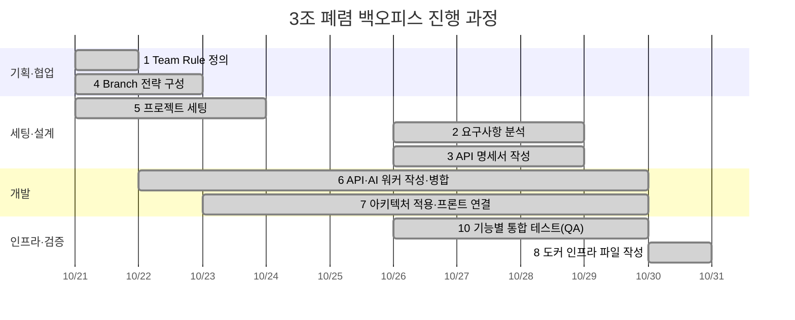

# AI Health Web Assignment

흉부 X-Ray 이미지 기반 폐렴 판독 모델을 활용한 **폐렴 환자 관리 백오피스** 프로젝트입니다.


## 🌟 프로젝트 과정 총 정리

| 번호 | 단계 | 진행 | 산출물 |
|---|---|---|---|
| 1 | Team Rule 정의 | ✅ Day01 | [팀 규칙](docs/day01_team_rules.md) |
| 2 | 사용자 요구사항 정의 | ✅ Day04~06 (제공된 요구사항 분석) | API 설계 문서의 요구사항 ID 표 |
| 3 | API 명세서 작성 | ✅ Day04~06 | [User API](docs/day04_USER_API_설계.md), [환자 관리 API](docs/day05_환자관리_API_설계.md), [AI 예측 API](docs/day06_AI예측_API_설계.md) |
| 4 | Git & GitHub Branch 전략 | ✅ Day01~02 | [Git Branch 전략](docs/day02_git_branch_전략.md) |
| 5 | 프로젝트 세팅 | ✅ Day01~03 | [프로젝트 뜯어보기](docs/day03_프로젝트_뜯어보기.md), [DB 마이그레이션](docs/day03_db_migration.md) |
| 6 | API·AI 워커 코드 작성과 병합 | ✅ Day02~06 (PR #4~#57) | API 20개, `worker/model.py` |
| 7 | 아키텍처 설계 및 적용 | ✅ Day03~07 | 레이어드 아키텍처, [앱 실행 화면](docs/day07_앱_실행화면.md) |
| 8 | 도커 인프라 파일 작성 | ✅ Day08 (PR #61~#67) | `app/Dockerfile`, `.dockerignore`, `docker-compose.yml`, [도커 실행 화면](docs/day08_도커_실행화면.md) |
| 9 | AWS 배포 | ⏳ 진행 예정 | - |
| 10 | QA 진행 | ✅ 기능별 통합 테스트 (Day04~06) / ⏳ 배포 후 QA 예정 | [통합 테스트 시나리오](docs/day05_통합테스트_시나리오.md), [통합 테스트 결과](docs/day06_통합테스트_결과.md) |

### 📅 진행 타임라인



> 9 AWS 배포와 배포 후 QA는 진행 예정이라 타임라인에 넣지 않음

### 👥 팀원별 기여

| 팀원 | 주요 작업 | PR 수 |
|---|---|---|
| 공통 | 팀 규칙·브랜치 전략, 일별 작업내역 정리 | 10 |
| 김지연 | DB 모델·마이그레이션, 단계별 설계 문서·뼈대, 회원가입·토큰 재발급·회원 목록 검색, 환자 영구 삭제·진료기록 등록, AI 모델 선택·예측·Grad-CAM 히트맵, 차트 번호 자동 발급, Dockerfile·torch CPU 전용·alembic 자동 적용 | 29 |
| 김도엽 | 회원 상세·삭제, 로그인·로그아웃(+ pytest), 환자 등록·목록(검색·필터), AI 폐렴 예측 `POST /predict`, compose mysql 서비스 | 6 |
| 박유정 | 회원 생성, 내 정보 조회·수정·회원 탈퇴, 진료기록 목록·상세, AI 예측 결과 목록 `GET /analyses`, `.dockerignore` | 6 |
| 이명석 | 회원 정보 수정, 비밀번호 변경·회원 목록·권한 변경, 환자 상세·수정, 프론트 예측 결과 표·자동 테스트, compose fastapi 서비스 | 6 |

- PR 수는 `develop`으로 머지된 작업 PR 기준 (develop → main 반영 PR 9개 제외, 총 57개)
- 공통: 팀 규칙(#1), 브랜치 전략(#3), README 문서 표(#6), 일별 작업내역(#31, #32, #35, #43, #48, #54, #60)
- Day03 템플릿 학습 정리와 단계별 통합 테스트는 4명 모두 참여

### 📈 GitHub Insights

- [Contributors](https://github.com/elin-115/Oz_codingSchool/graphs/contributors): 팀원별 커밋 그래프
- [Network](https://github.com/elin-115/Oz_codingSchool/network): 브랜치가 갈라지고 합쳐진 흐름
- [Pulse](https://github.com/elin-115/Oz_codingSchool/pulse): 기간별 PR·커밋 요약

### 1. Team Rule 정의

- **어떻게**: 첫날 4명이 모여 협업 규칙부터 정함
  - 코어 타임(15:10~16:10) Zep 스터디룸 집합, 1일 1커밋, 존댓말·`OO님` 호칭, 일정 이슈 공유
  - Git 규칙: `develop` 직접 push 금지, PR + 팀원 1명 이상 승인 후 merge, 충돌은 작성자와 함께 해결
  - 커밋 컨벤션(`feat`/`fix`/`docs`/`refactor`/`style`/`chore`)과 커밋하지 않는 파일(`.env`, `*.pt`, `.venv`, `media/`)
- **돌아보며**: 규칙을 문서로 남겨두니 헷갈릴 때 바로 확인할 수 있었음. 진행 중 생긴 문제(develop 브랜치 삭제 사고)는 날짜와 함께 규칙에 추가해서 다시 생기지 않게 함

### 2. 사용자 요구사항 정의

- **어떻게**: 이번 과제에서는 제공된 요구사항 문서를 읽고, 기능마다 요구사항 ID(`REQ-USER-*`, `REQ-PTNT-*`, `REQ-MDR-*`, `REQ-PRED-*`)를 API 설계 문서에 연결함
  - 기능 요구사항뿐 아니라 비기능 요구사항(예: AI 예측 3초 이내 응답 `NFR-PRED-002`)도 설계 근거로 사용
  - 요구사항이 애매한 부분(차트 번호 발급 방식, 대기자 마이페이지 접근 등)은 조교님께 질문하고 답변을 문서에 기록
- **돌아보며**: 요구사항을 먼저 읽고 ID로 묶어두니 "이 API가 왜 필요한지"를 설명하기 쉬웠음. 다음 프로젝트에서는 사용자·화면·기능 순으로 요구사항을 직접 작성해야 함

### 3. API 명세서 작성

- **어떻게**: 단계마다 설계 문서와 뼈대 코드(라우터·스키마 시그니처)를 먼저 올리고, API를 나눠 구현
  - 명세 항목: 메서드·경로, 권한, 요청·응답 스키마, 상태 코드, 오류 응답, 요구사항 ID
  - 템플릿 프론트(`static/apis.js`)의 호출 형식에 맞춰 설계해서, Stage 7에서 프론트 연결 수정이 0건이었음
- **돌아보며**: 명세가 먼저 있어서 4명이 동시에 작업해도 응답 형식이 어긋나지 않았음

### 4. Git & GitHub Branch 전략 구성

- **어떻게**: Git Flow와 GitHub Flow를 비교한 뒤 **간소화한 Git Flow**를 선택
  - `main`(제출용) / `develop`(개발 기준) / `feature/기능명_YYMMDD` / `docs/내용_YYMMDD`
  - 4명이 동시에 개발하므로 `develop`에서 먼저 모아 확인한 뒤 단계가 끝날 때 `develop → main` PR로 반영
  - 기간이 짧고 실제 출시가 없어 `release`·`hotfix`는 생략
  - GitHub Ruleset으로 `main`·`develop`에 PR 필수, 승인 1명 적용
- **돌아보며**: 
    - PR마다 리뷰를 거치니 다른 사람 코드를 읽게 되고 실수도 미리 잡았음. 
    - 이미 머지된 브랜치에 푸시한 커밋은 반영되지 않아서 새 PR을 올려야 한다는 것도 배움

### 5. 프로젝트 세팅

- **어떻게**
  - 팀 레포를 만들고 OZ 템플릿을 업로드, `develop` 브랜치와 팀원 권한 설정
  - `uv`로 가상환경·의존성 관리(`pyproject.toml`, `uv.lock`), `.env`는 `.env.example`만 공유
  - ERD 기반으로 SQLAlchemy 모델 5개 작성, alembic 마이그레이션으로 팀원 모두 같은 DB 구조 적용
  - 삭제 정책은 팀 논의 후 Soft Delete로 결정
- **돌아보며**: 템플릿 구조를 팀원별로 나눠 공부하고 정리한 덕분에 이후 API 작업이 빨라짐

### 6. API 및 AI 워커 코드 작성 후 Branch 전략을 통한 코드 병합

- **어떻게**: 단계마다 같은 흐름으로 진행
  1. 설계 문서 + 뼈대 PR (다른 작업이 기다리는 선행 작업)
  2. 각자 담당 API를 `feature` 브랜치에서 구현 → `develop`으로 PR
  3. 리뷰 후 merge → 프론트 화면에서 통합 테스트 → 개선 PR
- **결과**
  - User API 10개, 환자 관리·진료기록 API 8개, AI 예측 API 2개 (총 20개)
  - AI 워커(`worker/model.py`): 팀원 모델을 리더보드·Recall·응답 시간으로 비교해 3모델 앙상블(EfficientNet-B0 + ResNet50 + DenseNet121) 선택, Grad-CAM 히트맵 생성
  - 같은 진료기록·같은 모델이면 추론하지 않고 저장된 결과 재사용
- **돌아보며**: 
    - 모델 5 fold 전부(15개)를 쓰면 4.8초가 걸려 요구사항(3초)을 못 지켜서 fold1만 사용함. 
    - 정확도와 응답 속도를 같이 봐야 한다는 걸 배움

### 7. 아키텍처 설계 및 적용

- **어떻게**: 템플릿의 **레이어드 아키텍처**를 그대로 따름
  ```
  Client → apis(라우터) → services(비즈니스 로직) → repositories(DB 조회·저장) → models(DB)
                ↑ schemas(요청·응답 검증)          worker(AI 모델 추론)
  ```
  - 공통 코드는 `app/core/`(설정, DB 연결, 인증·권한 의존성, 파일 저장)로 모음
  - AI 모델은 요청마다 읽지 않고 서버가 켜질 때 `lifespan`에서 한 번만 불러옴
  - 모델 파일은 깃에 올리지 않고 드라이브로 공유
  - Stage 7에서 `fastapi run`으로 실행해 프론트와 API 20개 연결을 화면으로 확인
- **돌아보며**: 
    - 계층이 나뉘어 있어 한 사람이 service를, 다른 사람이 repository를 고쳐도 충돌이 적었음

### 8. 도커 인프라 관련 파일 작성

- **어떻게**
  - `app/Dockerfile`: `python:3.13-slim` + `uv sync --frozen --no-dev`, 의존성 파일을 먼저 복사해 빌드 캐시 활용
  - `.dockerignore`: `.env`·캐시·도커 설정·문서·IDE·모델 파일 제외
  - `docker-compose.yml`: fastapi + mysql, 코드 볼륨 마운트 + `--reload`, healthcheck로 mysql 준비 후 fastapi 시작, 켤 때 alembic 자동 적용
  - 비밀번호는 `.env`에서만 받고 compose·이미지에 값을 쓰지 않음
- **결과**: 이미지 12GB → 1.91GB (리눅스에서 torch CPU 전용 설치 + `.dockerignore`)
- **돌아보며**: 
    - 이미지 안에 `.env`가 들어가 있던 것을 `.dockerignore`를 작성하며 발견함. 
    - 빌드 결과물에 무엇이 들어가는지 직접 확인하는 습관이 필요함

### 9. AWS 배포

- **진행 예정**
  - 도커 이미지를 기준으로 서버에 배포할 계획 (compose 그대로 실행)
  - `.env`는 서버에서 직접 만들고, 모델 파일은 별도로 업로드
  - 보안 그룹에서 필요한 포트만 열기, DB 포트는 외부에 열지 않기

### 10. QA 진행

- **어떻게**: 단계마다 API를 merge한 뒤 프론트 화면 기준 시나리오를 만들고 4명이 각자 실행
  - 환자·진료기록 6단계 시나리오, AI 예측·재예측·오류 응답 시나리오
  - pytest 자동 테스트(로그인, AI 예측 등 12개)
  - 팀원별 결과를 모아 공통 발견을 정리하고 개선 PR로 반영
- **발견해서 고친 것 (예)**: 화면 시각이 9시간 이르게 보임(UTC), 히트맵 칸이 안 보임(브라우저 캐시), 휴대폰 번호 형식, 영어 오류 메시지, 버튼 이름
- **남은 것**: AWS 배포 후 배포 환경에서 전체 시나리오 다시 실행
- **돌아보며**: 같은 시나리오라도 사람마다 다른 문제를 발견해서, 4명이 모두 직접 테스트한 것이 효과적이었음


=============================================================================

## Alembic Migration Guide

이 프로젝트는 데이터베이스 마이그레이션을 위해 Alembic을 사용합니다.

### 1. 마이그레이션 파일 생성 (자동 생성)
모델(`app/models/`)이 변경된 경우 다음 명령어를 실행하여 마이그레이션 파일을 생성합니다.
```bash
uv run alembic revision --autogenerate -m "변경 내용 설명"
```

### 2. 데이터베이스에 반영
생성된 마이그레이션을 데이터베이스에 적용하려면 다음 명령어를 실행합니다.
```bash
uv run alembic upgrade head
```

### 3. 이전 상태로 되돌리기 (Rollback)
마지막 마이그레이션을 취소하려면 다음 명령어를 실행합니다.
```bash
uv run alembic downgrade -1
```

=============================================================================

## 🐳 도커로 실행하기

프로젝트 루트에 `.env`를 만든 뒤(`.env.example` 참고) 실행함.

```bash
docker compose up --build
```

- fastapi + mysql 컨테이너가 함께 뜸. mysql이 준비된 뒤 fastapi가 켜짐
- fastapi가 켜질 때 `alembic upgrade head`가 자동으로 실행돼 테이블이 최신 상태로 맞춰짐 (따로 실행할 필요 없음)
- 로컬 코드(`app/`, `alembic/`, `worker/`, `static/`)가 컨테이너에 연결돼 있어 수정하면 `--reload`로 바로 반영됨
- AI 모델 파일(`worker/models/*.pt`)은 Drive에서 받아 로컬 `worker/models/`에 두면 됨
- 접속: http://localhost:8000/docs

도커 이미지만 따로 빌드·실행할 때는 [Day08 도커 실행 화면](docs/day08_도커_실행화면.md) 참고.

=============================================================================

## 📋 팀 작업판

Stage 1~6 단계별로 누가 무엇을 했는지, 세부 내역과 PR 번호를 한 페이지로 정리함.

👉 [3조 폐렴 백오피스 작업판](https://claude.ai/artifact/XAdRyoYF6AgLyK2kV5DR8Z)

## 📚 과제 문서

| Day | 날짜 | 문서 | 내용 |
|---|---|---|---|
| Day01 | 10/21 | [팀 규칙](docs/day01_team_rules.md) | 팀원, 팀 규칙, Git 협업 규칙, 커밋 컨벤션 |
| Day02 | 10/22 | [Git Branch 전략](docs/day02_git_branch_전략.md) | Git Flow와 GitHub Flow 비교, 우리 팀 브랜치 전략 |
| Day03 | 10/23 | [프로젝트 뜯어보기](docs/day03_프로젝트_뜯어보기.md) | 디렉터리·파일 역할, DB 연결, alembic, API 구현 흐름 |
| Day03 | 10/23 | [DB 마이그레이션](docs/day03_db_migration.md) | ERD 기반 모델 작성, 마이그레이션 결과, 트러블슈팅 |
| Day04 | 10/26 | [User API 설계](docs/day04_USER_API_설계.md) | 요구사항 기반 User API 10종 명세, 인증·권한 설계 |
| Day05 | 10/27 | [환자 관리 API 설계](docs/day05_환자관리_API_설계.md) | 환자 관리·진료기록 API 8종 명세, 의료진 권한, X-Ray 저장, 영구 삭제 |
| Day05 | 10/27 | [통합 테스트 시나리오](docs/day05_통합테스트_시나리오.md) | 프론트 화면 기준 환자·진료기록 테스트 6단계와 실행 결과 |
| Day06 | 10/28 | [AI 예측 API 설계](docs/day06_AI예측_API_설계.md) | AI 폐렴 예측·결과 목록 API 명세, 모델 선택, 히트맵 저장 |
| Day06 | 10/28 | [AI 예측 통합 테스트 시나리오](docs/day06_AI예측_통합테스트_시나리오.md) | 예측·재예측·오류 응답 자동 테스트와 화면 확인 결과 |
| Day06 | 10/29 | [통합 테스트 결과](docs/day06_통합테스트_결과.md) | 팀원별 화면·자동 테스트 결과, 공통 발견(시간 9시간·캐시), 개선 제안 6개 |
| Day07 | 10/29 | [앱 실행 화면](docs/day07_앱_실행화면.md) | `fastapi run`으로 실행한 API 20개의 프론트 화면 캡처와 동작 설명 |
| Day08 | 10/30 | [도커 실행 화면](docs/day08_도커_실행화면.md) | Dockerfile·.dockerignore 빌드·실행, docker compose(fastapi + mysql) 실행·--reload 확인 |

## 📝 작업 내역

매일 무엇을, 왜, 어떻게 만들고 바꿨는지 기록한다.

| Day | 날짜 | 문서 | 주요 작업 |
|---|---|---|---|
| Day01 | 10/21 | [작업 내역](docs/day01_작업내역.md) | 레포 설정, 브랜치 보호 규칙, 팀 규칙 문서화 |
| Day02 | 10/22 | [작업 내역](docs/day02_작업내역.md) | 회원 API 5종 협업, PR 흐름, 코드 리뷰 |
| Day03 | 10/23 | [작업 내역](docs/day03_작업내역.md) | DB 모델·마이그레이션, Soft Delete 전환, 팀원 DB 적용 |
| Day04 | 10/26~27 | [작업 내역](docs/day04_작업내역.md) | User API 10개, 코드 리뷰, 회원 목록 검색, 프론트 통합 테스트와 버그 수정, 조교님 확인 후 프론트 수정 |
| Day05 | 10/27 | [작업 내역](docs/day05_작업내역.md) | 환자·진료기록 API 8개, X-Ray 업로드·영구 삭제, 코드 리뷰, 프론트 통합 테스트와 개선 |
| Day06 | 10/28~29 | [작업 내역](docs/day06_작업내역.md) | AI 모델 결정(3종 앙상블), 폐렴 예측·결과 목록 API, Grad-CAM 히트맵, 코드 정리, 화면 통합 테스트 |
| Day07 | 10/29 | [작업 내역](docs/day07_작업내역.md) | 프론트 API 20개 연결 확인(`fastapi run`), API별 실행 화면 캡처, develop → main |
| Day08 | 10/30 | [작업 내역](docs/day08_작업내역.md) | Dockerfile, torch CPU 전용(12GB → 1.91GB), .dockerignore, docker compose(fastapi + mysql), alembic 자동 적용 |
