# 🖥️ 7일차 앱 실행 화면

- 날짜: 2026-10-29
- 실행: `fastapi run app/main.py` → 브라우저에서 접속
- 기준 브랜치: `develop` (#56 Stage 6 개선 반영까지)
- 범위: `static/apis.js`가 호출하는 API 20개 전부
- 진행: 각 API 담당자가 Stage 4~6에서 구현하고 통합 테스트로 확인 → 김지연이 앱을 실행해 API별 화면을 캡처하고 문서로 정리함
- 테스트 데이터: 캡처 전용 계정 2개(`stage7-admin`, `stage7-member`)와 테스트 환자 `캡처테스트`를 만들어 사용하고, 캡처 후 모두 삭제함

## 🔌 과제 1. 프론트 템플릿 코드에 API 연결

### AI Agent(Claude Code) 활용 과정

1. **대조**: `static/apis.js`가 부르는 주소·메서드 20개와 `app/apis/*.py` 라우트를 하나씩 맞춰봄 → 20개 모두 일치
2. **실행 확인**: `fastapi run app/main.py`로 띄우고 화면에서 20개를 직접 호출 → 모두 정상 (아래 [전체 결과](#-전체-결과))
3. **수정**: 확인 중 발견한 문제를 고쳐 develop에 머지 (아래 표)

### 프론트 수정 없이 연결된 이유

- Stage 4부터 API를 설계할 때 `apis.js`가 보내는 주소·요청 필드·응답 필드를 기준으로 맞춤
  - 예: 환자 응답은 DB 컬럼 `phone`을 프론트가 읽는 `phone_number`로 이름만 바꿔 내보냄
  - 예: 진료기록 등록은 프론트가 `FormData`로 파일과 함께 보내서 서버도 `Form()`, `UploadFile`로 받음
- 그래서 Stage 7에서는 프론트 템플릿 코드를 고치지 않고 실행 확인만으로 연결됨

### 연결하면서 맞춘 것 (Stage 4~7)

| PR | 내용 | 맞춘 쪽 |
|---|---|---|
| #29 | 비밀번호 변경 요청 필드 이름을 프론트에 맞춤 | 서버 |
| #30 | 로그아웃에서 로그인 확인 제거 (토큰 만료 후에도 로그아웃 가능) | 서버 |
| #33 | 승인 대기 회원도 마이페이지 접근, 비밀번호 보기 아이콘 | 프론트 |
| #42 | 환자·진료기록 화면 통합 테스트 후 한글 오류 문구, 검색 방식 정리 | 서버·프론트 |
| #52 | AI 예측 결과 표에 ID·히트맵 열 추가 | 프론트 |
| #55 | 차트 번호 자동 발급 (입력칸 선택 입력으로) | 서버·프론트 |
| #56 | 시각 한국 시간 표시(UTC 표시), 휴대폰 번호 `010` 규칙, 버튼명, JS·CSS 캐시 버전 | 서버·프론트 |

## 📌 API 연결 구조 (팀원 공유용)

프론트 화면은 모두 같은 흐름으로 서버를 부름

```
templates/*.html (버튼·폼)
  → static/pages.js (입력값 읽기, 결과를 화면에 그리기)
    → static/apis.js (fetch로 /api/v1/... 요청, Authorization 헤더에 Access Token)
      → app/apis/*.py (라우터) → services → repositories → DB
```

- `apis.request()`가 모든 요청의 공통 통로. 401이 오면 `/users/refresh`로 토큰을 재발급받고 원래 요청을 다시 보냄
- 프론트(`apis.js`)의 주소·필드·응답 형식에 맞춰 Stage 4~6에서 API를 설계해서, 프론트 코드는 거의 그대로 연결됨

## 🖼️ 과제 2. API별 실행 화면

### 📋 전체 결과

| # | 기능 | API | 담당 | 결과 |
|---|---|---|---|---|
| 1 | 회원가입 | `POST /api/v1/users/signup` | 김지연 | ✅ 201 |
| 2 | 로그인 | `POST /api/v1/users/login` | 김도엽 | ✅ 200 |
| 3 | 토큰 재발급 | `POST /api/v1/users/refresh` | 김지연 | ✅ 401 → 200 → 재요청 200 |
| 4 | 로그아웃 | `POST /api/v1/users/logout` | 김도엽 | ✅ 200 |
| 5 | 내 정보 조회 | `GET /api/v1/users/me` | 박유정 | ✅ 200 |
| 6 | 내 정보 수정 | `PATCH /api/v1/users/me` | 박유정 | ✅ 200 |
| 7 | 비밀번호 변경 | `PATCH /api/v1/users/me/password` | 이명석 | ✅ 200 |
| 8 | 회원 탈퇴 | `DELETE /api/v1/users/me` | 박유정 | ✅ 204 |
| 9 | 회원 목록 (관리자) | `GET /api/v1/admin/users` | 이명석 | ✅ 200 |
| 10 | 권한 변경 (관리자) | `PATCH /api/v1/admin/users/role` | 이명석 | ✅ 200 |
| 11 | 환자 등록 | `POST /api/v1/patients` | 김도엽 | ✅ 201 |
| 12 | 환자 목록 | `GET /api/v1/patients` | 김도엽 | ✅ 200 |
| 13 | 환자 상세 | `GET /api/v1/patients/{id}` | 이명석 | ✅ 200 |
| 14 | 환자 수정 | `PATCH /api/v1/patients/{id}` | 이명석 | ✅ 200 |
| 15 | 환자 삭제 | `DELETE /api/v1/patients/{id}` | 김지연 | ✅ 200 |
| 16 | 환자별 진료기록 목록 | `GET /api/v1/patients/{id}/medical-records` | 박유정 | ✅ 200 |
| 17 | 진료기록 등록 | `POST /api/v1/medical-records` | 김지연 | ✅ 201 |
| 18 | 진료기록 상세 | `GET /api/v1/medical-records/{id}` | 박유정 | ✅ 200 |
| 19 | AI 폐렴 예측 | `POST /api/v1/medical-records/{id}/predict` | 김도엽 | ✅ 201 (재요청 200) |
| 20 | AI 예측 결과 목록 | `GET /api/v1/medical-records/{id}/analyses` | 박유정 | ✅ 200 |

---

## 👤 회원

### 1. 회원가입 `POST /api/v1/users/signup` (담당: 김지연)

- **화면**: 상단 메뉴 → 회원가입. 이메일·이름·부서·성별·휴대폰 번호·비밀번호 입력 후 "가입하기"
- **결과**: `201` → "회원가입이 완료되었습니다. 로그인해주세요." 알림 후 로그인 화면으로 이동. 가입 직후 권한은 `pending`(승인대기)
- **연결**: `signup.html` → `pages.handleSignup` → `apis.signup()` → `users.py` `signup`
- 휴대폰 번호는 입력하면서 자동으로 `010-0000-0702`처럼 하이픈이 붙고, 보낼 때는 숫자만 보냄 (`010`으로 시작하는 11자리 검사)

| 입력 | 결과 |
|---|---|
| 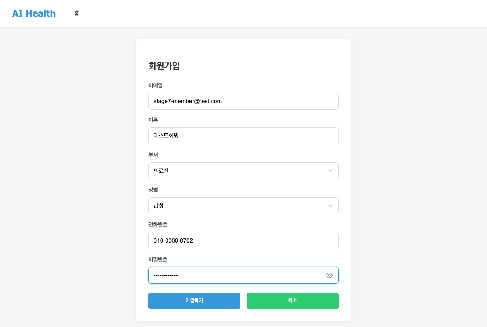 | 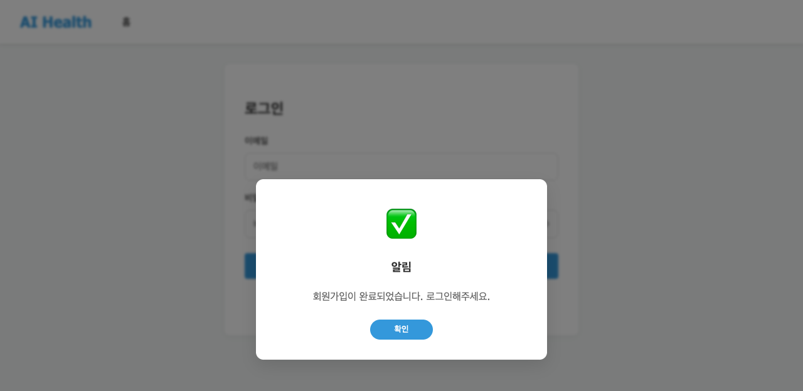 |

### 2. 로그인 `POST /api/v1/users/login` (담당: 김도엽)

- **화면**: 이메일·비밀번호 입력 후 "로그인"
- **결과**: `200` → Access Token은 `localStorage`, Refresh Token은 쿠키에 저장. 환자 관리 화면으로 이동하고 상단에 `이름(부서)`·로그아웃 버튼 표시. 관리자는 "회원 관리" 메뉴도 보임
- **연결**: `login.html` → `pages.handleLogin` → `apis.login()` → `users.py` `login`

| 입력 | 결과 |
|---|---|
| 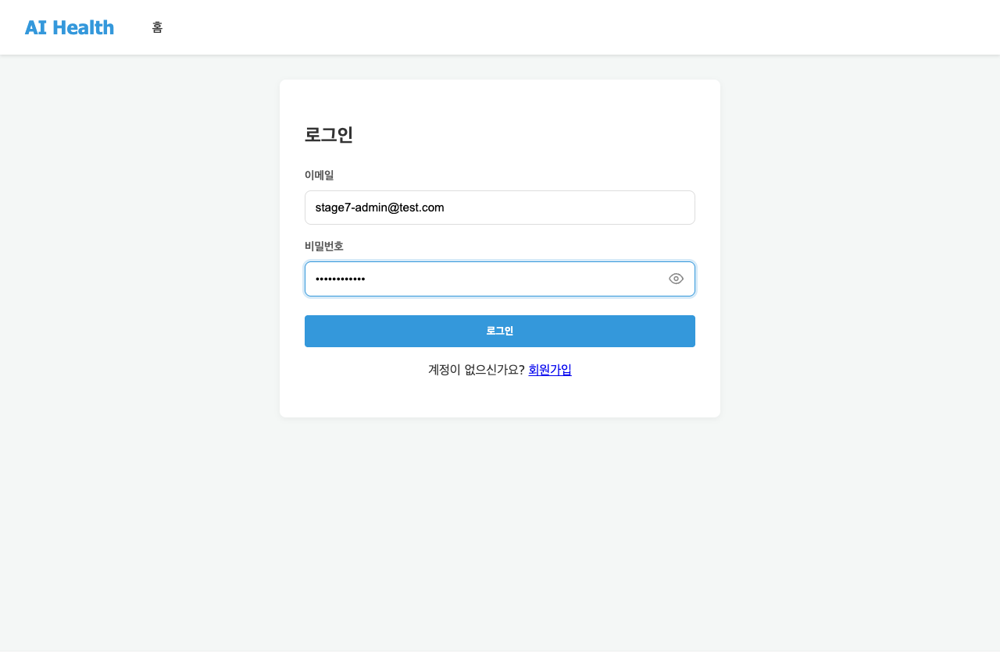 | 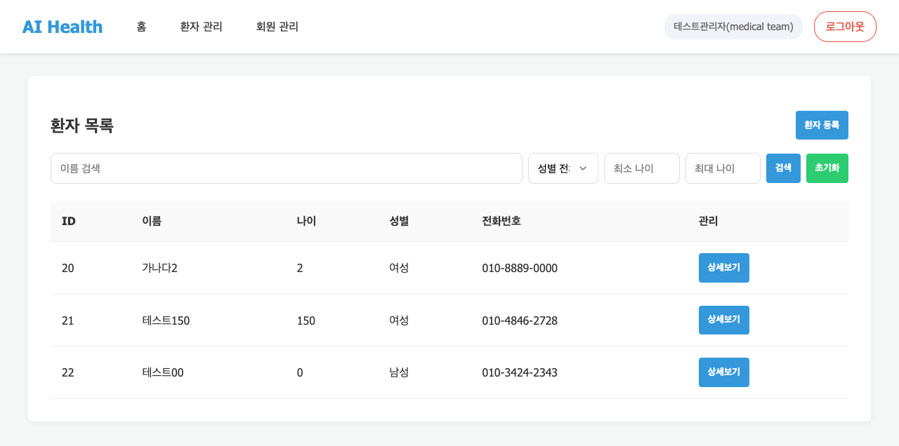 |

### 3. 토큰 재발급 `POST /api/v1/users/refresh` (담당: 김지연)

- **화면**: 버튼이 따로 없음. Access Token이 만료된 상태로 아무 화면이나 열면 자동으로 동작
- **확인 방법**: `localStorage`의 토큰을 일부러 틀린 값으로 바꾼 뒤 환자 목록으로 이동
- **결과**: 환자 목록 요청이 `401` → `apis.request()`가 Refresh 쿠키로 `/users/refresh` 호출 `200` → 새 토큰으로 환자 목록 재요청 `200`. 사용자는 로그아웃되지 않고 화면이 정상 표시됨
- **연결**: `apis.request()` (401 처리) → `users.py` `refresh`
- 오른쪽 아래 상자는 개발자 도구 Network 탭 대신 요청 순서를 보여주려고 캡처 때 덧붙인 것

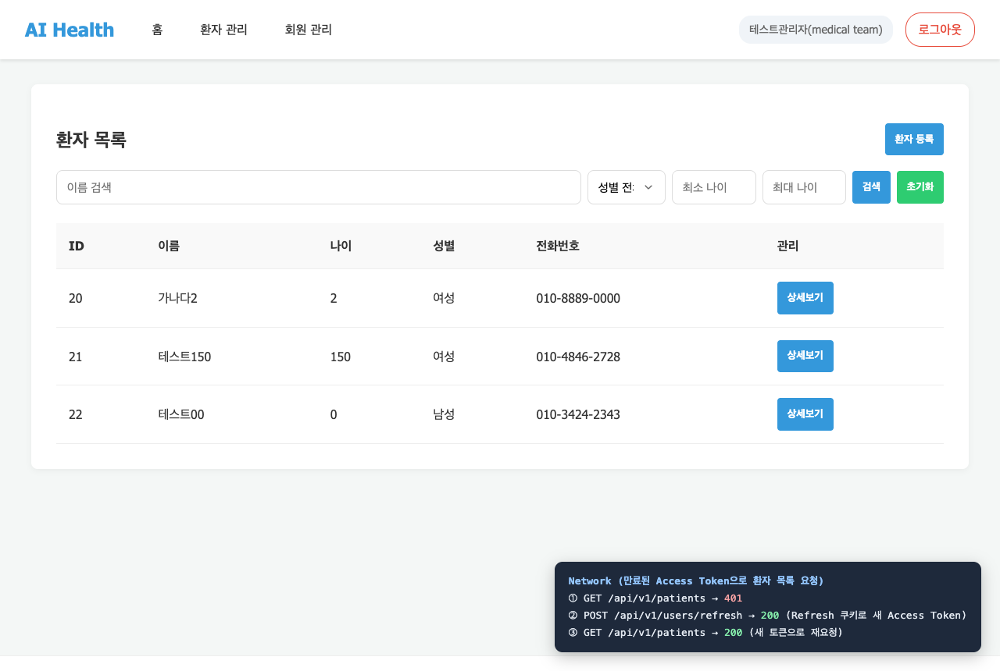

### 4. 로그아웃 `POST /api/v1/users/logout` (담당: 김도엽)

- **화면**: 상단 오른쪽 "로그아웃"
- **결과**: `200` → Refresh 쿠키 삭제, `localStorage` 토큰 삭제 후 로그인 화면으로 이동. 상단 메뉴가 "로그인"으로 바뀜
- **연결**: `app.js` `logout()` → `apis.logout()` → `users.py` `logout`

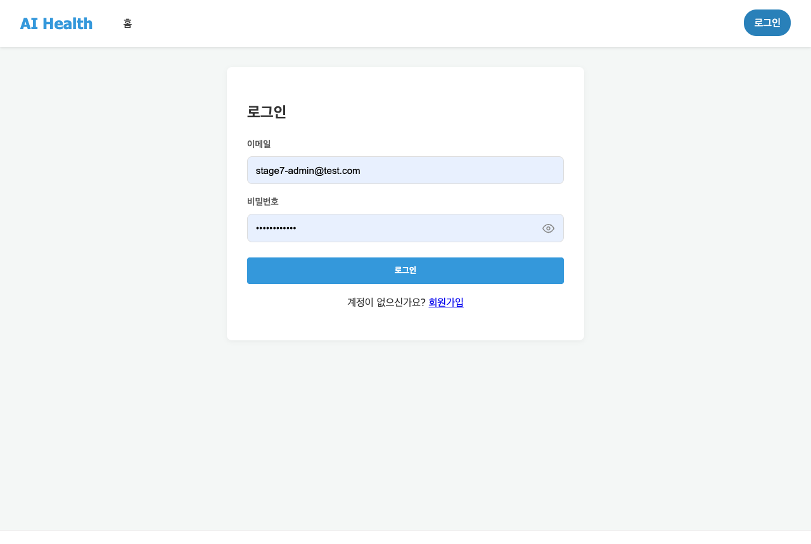

### 5. 내 정보 조회 `GET /api/v1/users/me` (담당: 박유정)

- **화면**: 상단의 `이름(부서)`를 누르면 마이페이지
- **결과**: `200` → 이메일·이름·부서·성별·휴대폰 번호·권한 표시. 새로고침할 때마다 로그인 상태 확인에도 쓰임
- **연결**: `my-page.html` → `pages.renderMyPage` → `apis.getMe()` → `users.py` `get_me`

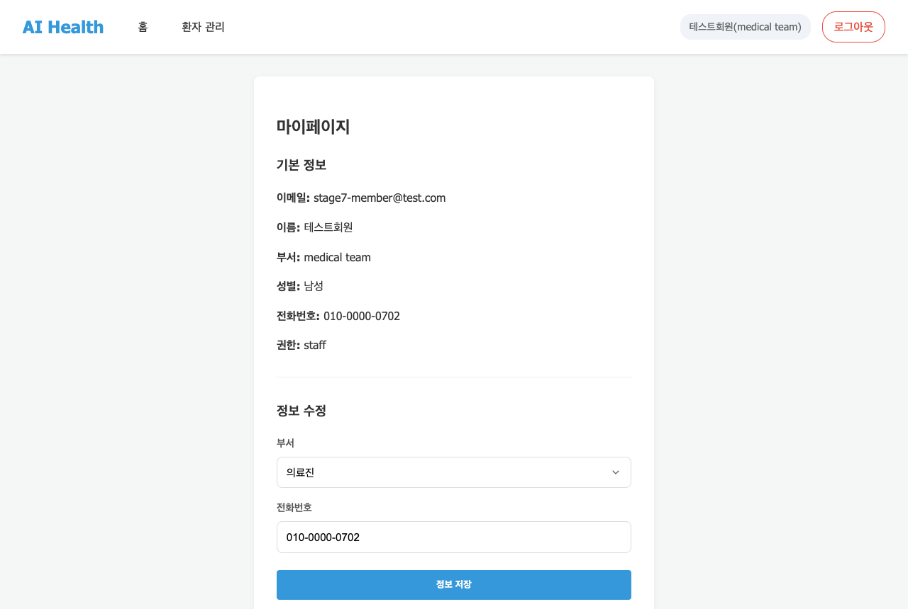

### 6. 내 정보 수정 `PATCH /api/v1/users/me` (담당: 박유정)

- **화면**: 마이페이지 아래 "정보 수정"에서 휴대폰 번호·부서를 바꾸고 "정보 저장"
- **결과**: `200` → "회원 정보가 수정되었습니다." 알림, 위쪽 내 정보와 상단 `이름(부서)`가 바뀐 값으로 갱신 (부서 `medical team` → `researcher`)
- **연결**: `my-page.html` → `pages.handleUpdateMe` → `apis.updateMe()` → `users.py` `update_me`

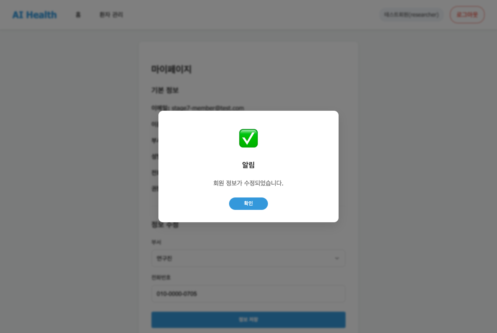

### 7. 비밀번호 변경 `PATCH /api/v1/users/me/password` (담당: 이명석)

- **화면**: 마이페이지 "비밀번호 변경"에서 현재 비밀번호·새 비밀번호 입력 후 "비밀번호 변경"
- **결과**: `200` → "비밀번호가 변경되었습니다." 알림. 현재 비밀번호가 틀리거나 새 비밀번호가 규칙(8~20자, 대문자·특수문자)에 안 맞으면 오류 문구
- **연결**: `my-page.html` → `pages.handleUpdatePassword` → `apis.updatePassword()` → `users.py` `change_password`

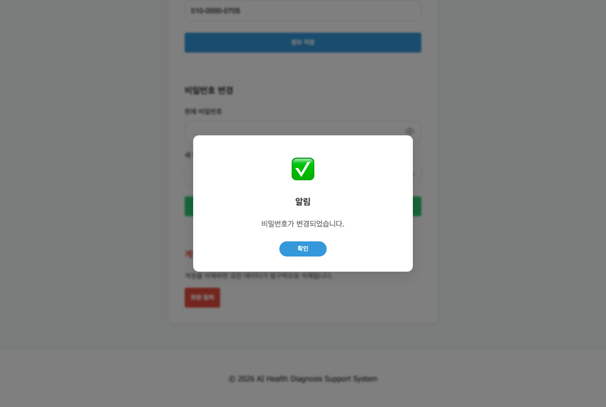

### 8. 회원 탈퇴 `DELETE /api/v1/users/me` (담당: 박유정)

- **화면**: 마이페이지 "회원 탈퇴" → "정말로 탈퇴하시겠습니까?" 확인
- **결과**: `204` → "탈퇴 처리가 완료되었습니다." 알림 후 로그아웃되고 로그인 화면으로 이동
- **연결**: `my-page.html` → `pages.handleDeleteMe` → `apis.deleteMe()` → `users.py` `withdraw`

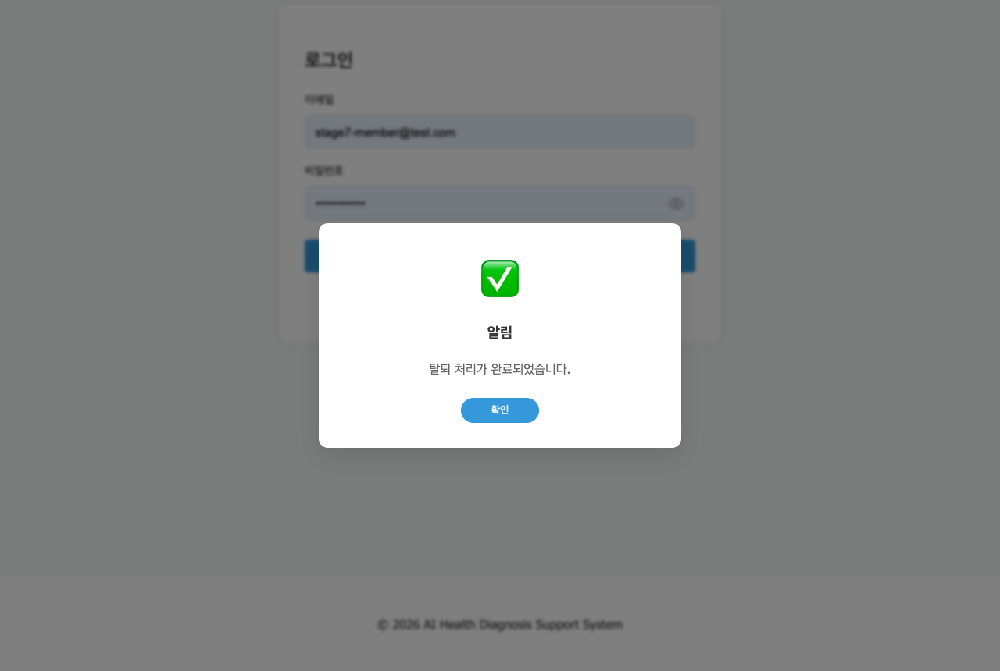

---

## 🛡️ 관리자

### 9. 회원 목록 `GET /api/v1/admin/users` (담당: 이명석)

- **화면**: 관리자로 로그인 → 상단 "회원 관리". 이름·이메일 검색, 부서 필터
- **결과**: `200` → ID·이름·이메일·부서·휴대폰 번호·권한·상태 표. "테스트"로 검색하면 `?query=테스트`로 요청해 2명만 표시. 내 계정의 권한 칸은 잠겨 있음
- **연결**: `admin-users.html` → `pages.renderAdminUsers` → `apis.adminGetUsers()` → `admin.py` `get_user_list`

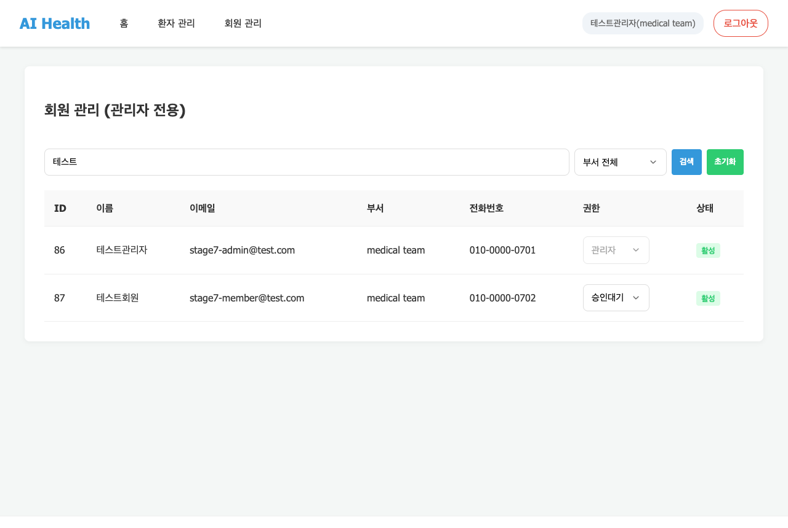

### 10. 권한 변경 `PATCH /api/v1/admin/users/role` (담당: 이명석)

- **화면**: 회원 목록의 권한 드롭다운에서 `승인대기` → `일반회원` 선택
- **결과**: `200` → "권한이 변경되었습니다." 알림 후 목록 새로 고침. 승인된 회원은 환자 관리 화면을 쓸 수 있음
- **연결**: `admin-users.html` → `pages.handleRoleUpdate` → `apis.adminUpdateUserRole()` → `admin.py` `change_user_role`

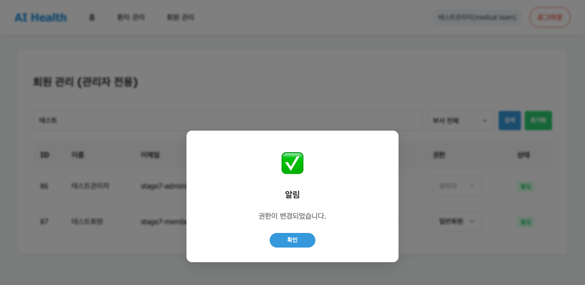

---

## 🏥 환자

### 11. 환자 등록 `POST /api/v1/patients` (담당: 김도엽)

- **화면**: 환자 관리 → "환자 등록". 이름·나이·성별·휴대폰 번호 입력 후 "등록" (의료진 부서만 가능)
- **결과**: `201` → "환자가 등록되었습니다." 알림 후 환자 목록으로 이동
- **연결**: `patient-create.html` → `pages.handlePatientCreate` → `apis.createPatient()` → `patients.py` `create_patient`

| 입력 | 결과 |
|---|---|
| 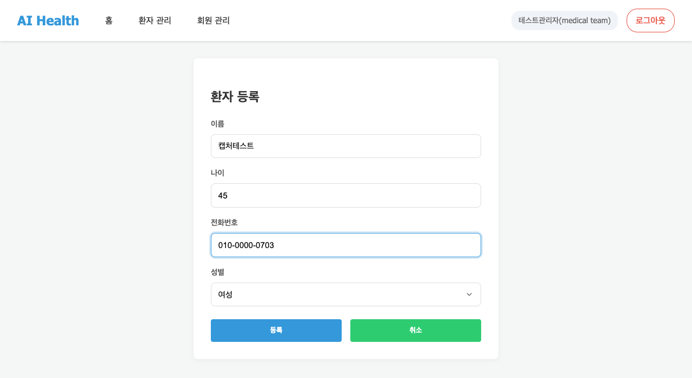 | 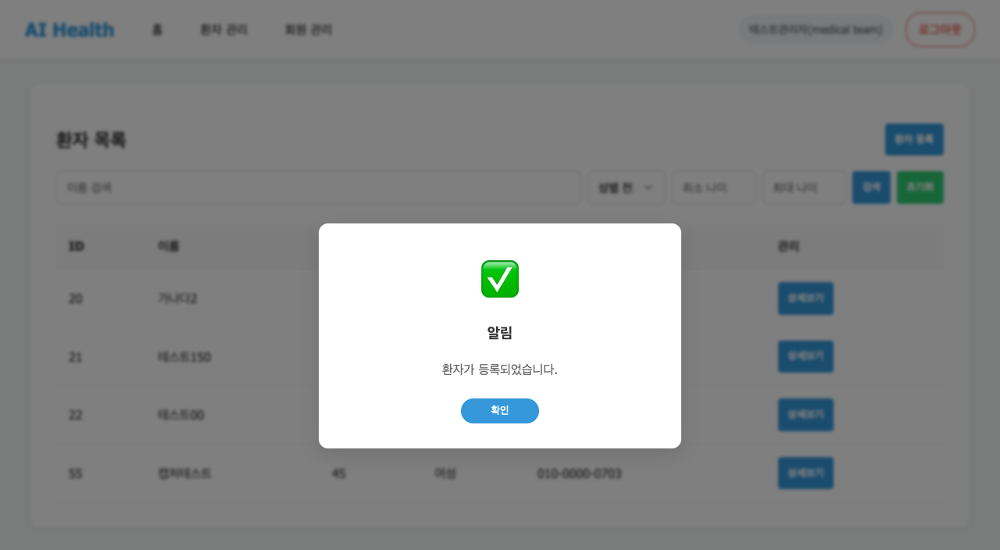 |

### 12. 환자 목록 `GET /api/v1/patients` (담당: 김도엽)

- **화면**: 환자 관리. 이름 검색, 성별·나이 범위 필터
- **결과**: `200` → "캡처"로 검색하면 `?name=캡처`로 요청해 방금 등록한 환자만 표시
- **연결**: `patients.html` → `pages.renderPatients` → `apis.getPatients()` → `patients.py` `get_patient_list`

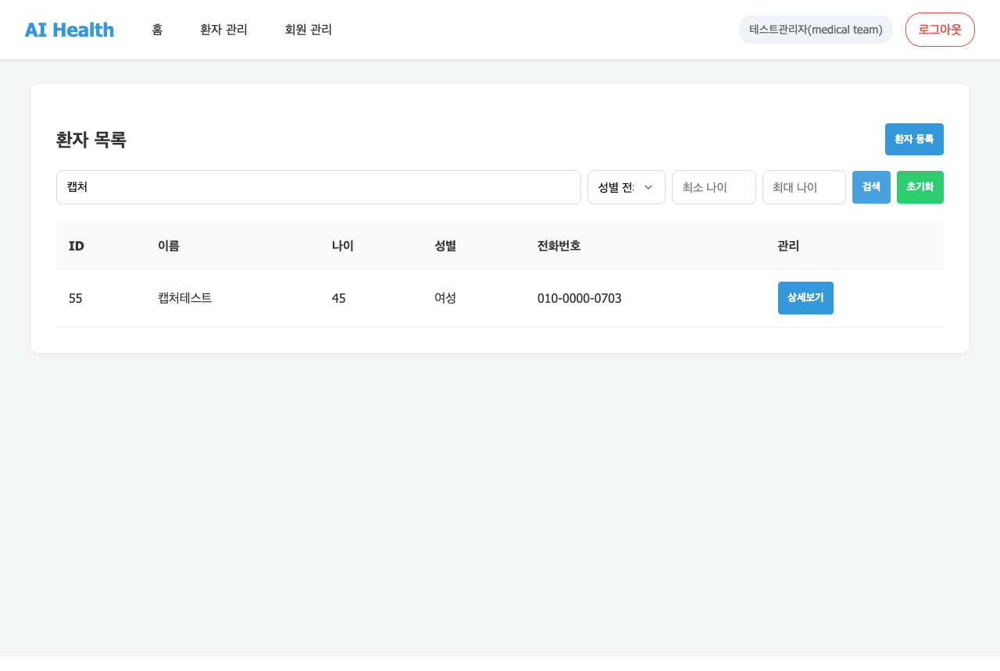

### 13. 환자 상세 `GET /api/v1/patients/{id}` (담당: 이명석)

- **화면**: 환자 목록에서 "상세보기"
- **결과**: `200` → 이름·성별·나이·연락처 표시. 아래에 진료 기록 목록(16번)이 함께 나옴 (처음엔 비어 있음)
- **연결**: `patient-detail.html` → `pages.renderPatientDetail` → `apis.getPatient()` → `patients.py` `get_patient`

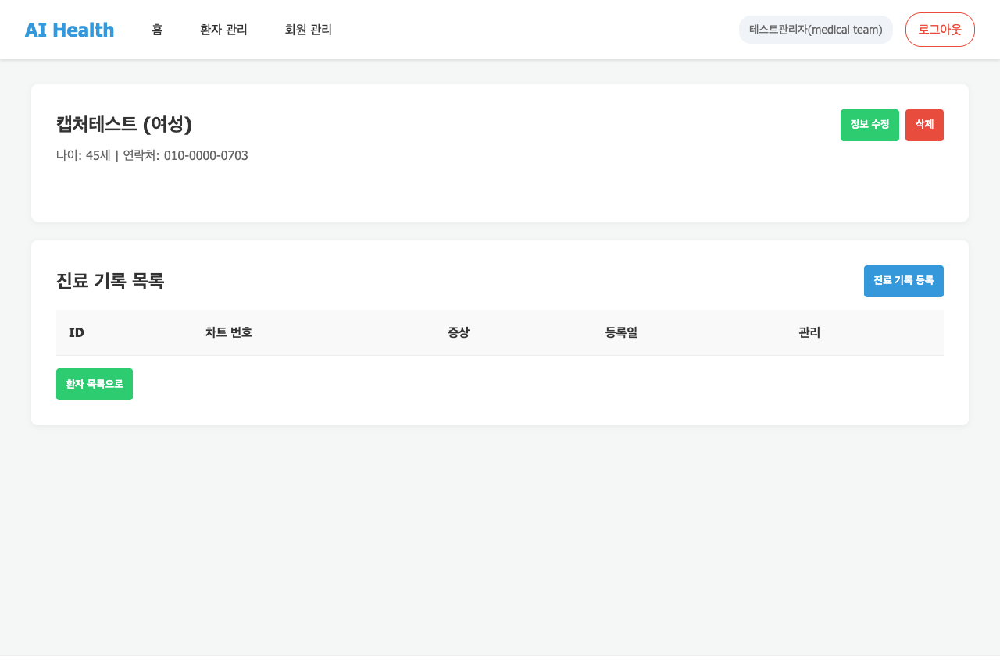

### 14. 환자 수정 `PATCH /api/v1/patients/{id}` (담당: 이명석)

- **화면**: 환자 상세 → "정보 수정" 창에서 연락처를 바꾸고 "수정 완료" (나이·성별은 수정 불가)
- **결과**: `200` → "환자 정보가 수정되었습니다." 알림, 연락처가 `010-0000-0703` → `010-0000-0704`로 갱신
- **연결**: `patient-detail.html` → `pages.handlePatientUpdate` → `apis.updatePatient()` → `patients.py` `update_patient`

| 입력 | 결과 |
|---|---|
| 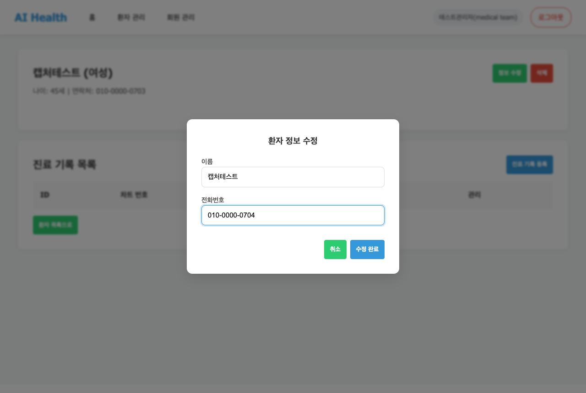 | 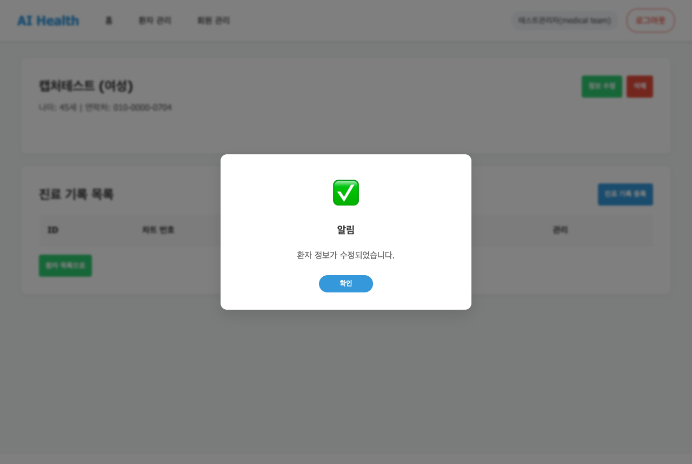 |

### 15. 환자 삭제 `DELETE /api/v1/patients/{id}` (담당: 김지연)

- **화면**: 환자 상세 → "삭제" → "모든 진료 기록 및 AI 분석 데이터가 영구적으로 삭제됩니다." 확인 창 → "확인했습니다."
- **결과**: `200` → "환자 정보와 관련 데이터가 모두 삭제되었습니다." 알림 후 환자 목록으로 이동. 진료기록·AI 결과와 서버의 X-Ray·히트맵 파일까지 함께 삭제
- **연결**: `patient-detail.html` → `pages.handlePatientDelete` → `apis.deletePatient()` → `patients.py` `delete_patient`

| 확인 창 | 결과 |
|---|---|
| 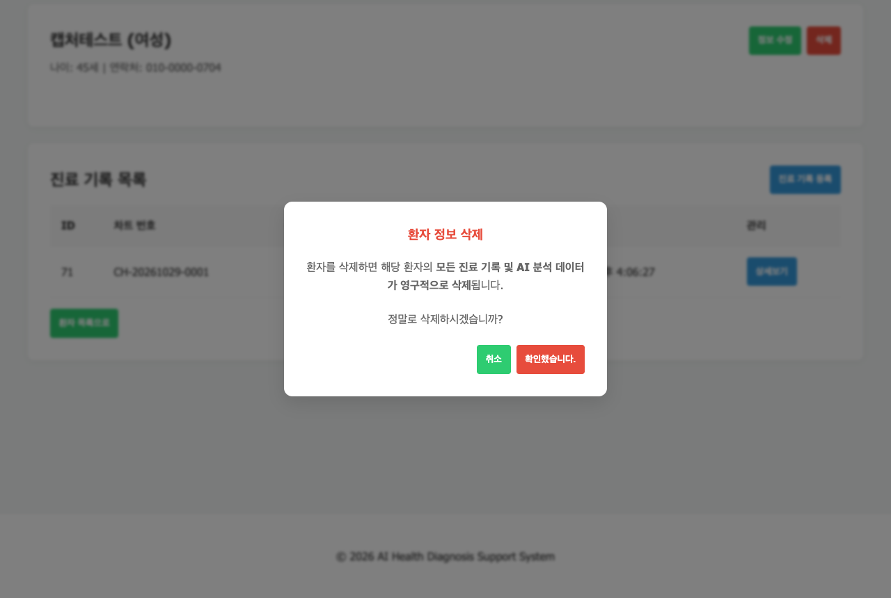 | 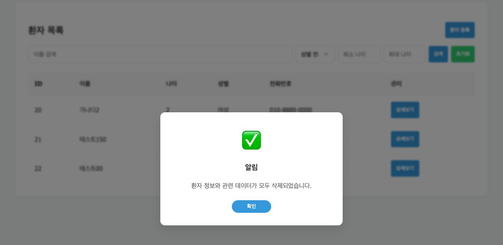 |

---

## 📄 진료기록

### 16. 환자별 진료기록 목록 `GET /api/v1/patients/{id}/medical-records` (담당: 박유정)

- **화면**: 환자 상세 화면 아래 "진료 기록 목록"
- **결과**: `200` → ID·차트 번호·증상·등록일 표. 등록일이 실제 한국 시각(오후 4:06)으로 표시됨 (#56 시간 수정 반영)
- **연결**: `patient-detail.html` → `pages.renderPatientDetail` → `apis.getPatientMedicalRecords()` → `patients.py` `get_patient_medical_records`

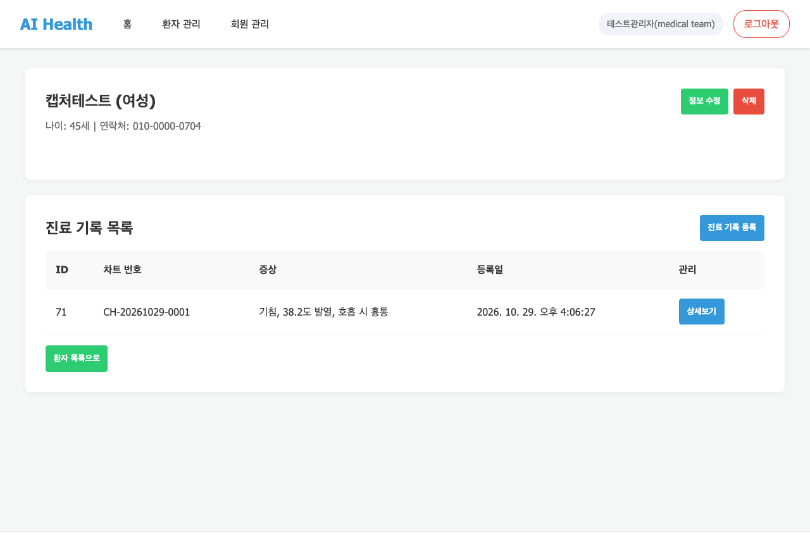

### 17. 진료기록 등록 `POST /api/v1/medical-records` (담당: 김지연)

- **화면**: 환자 상세 → "진료 기록 등록". 증상 입력, 흉부 X-Ray 이미지 선택(미리보기 표시) 후 "등록". 차트 번호는 비워 둠
- **결과**: `201` → "진료 기록이 등록되었습니다." 알림 후 환자 상세로 이동. 차트 번호 `CH-20261029-0001` 자동 발급 (#55)
- **연결**: `record-create.html` → `pages.handleRecordCreate` → `apis.createMedicalRecord()` (`FormData`로 파일 전송) → `medical_records.py` `create_medical_record`

| 입력 | 결과 |
|---|---|
| 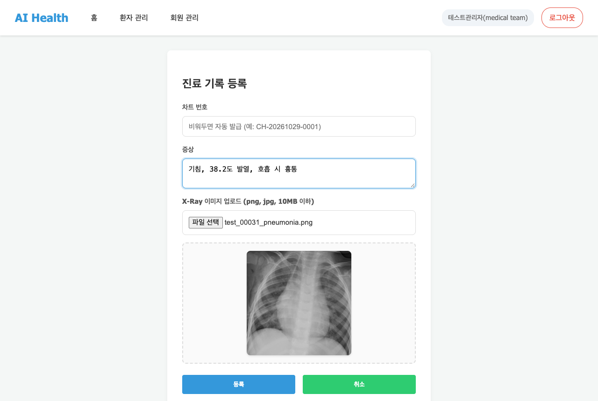 | 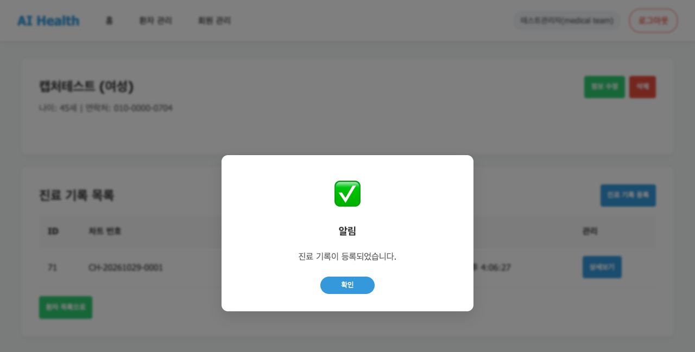 |

### 18. 진료기록 상세 `GET /api/v1/medical-records/{id}` (담당: 박유정)

- **화면**: 진료 기록 목록에서 "상세보기"
- **결과**: `200` → ID·차트 번호·증상·등록일과 X-Ray 이미지 표시. 아래 AI 예측 결과 표는 아직 비어 있음
- **연결**: `record-detail.html` → `pages.renderRecordDetail` → `apis.getMedicalRecord()` → `medical_records.py` `get_medical_record`

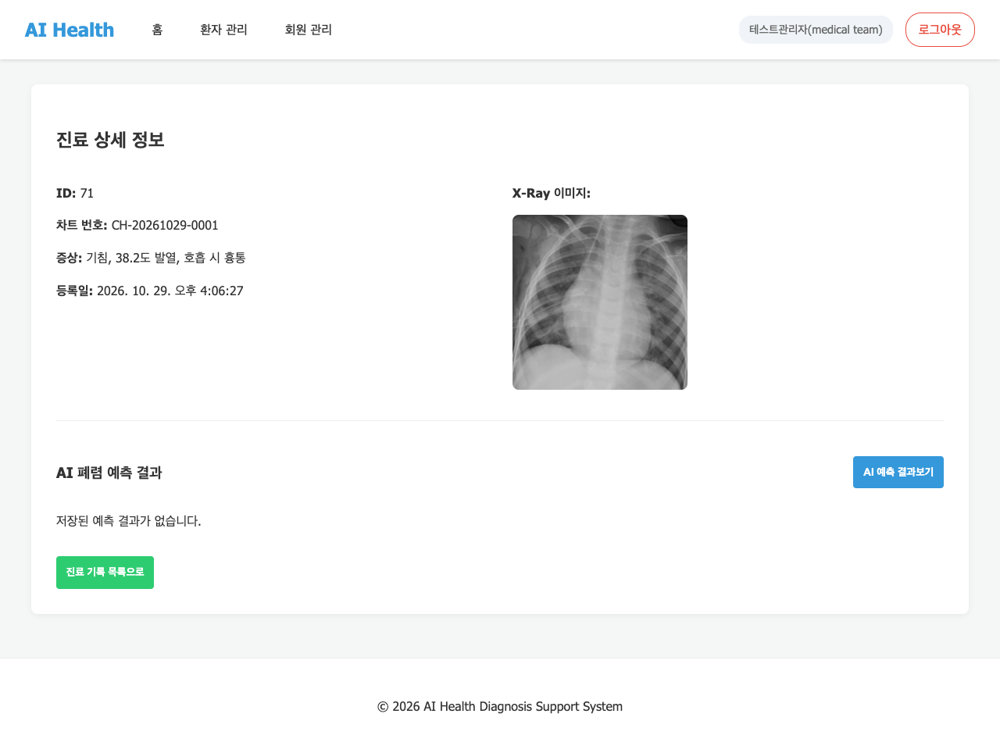

---

## 🤖 AI 예측

### 19. AI 폐렴 예측 `POST /api/v1/medical-records/{id}/predict` (담당: 김도엽)

- **화면**: 진료기록 상세 → "AI 예측 결과보기"
- **결과**: `201` → "AI 예측이 완료되었습니다." 알림. Positive 97.01%, 히트맵 생성, 클릭부터 응답까지 약 1.8초 (3초 기준 통과)
- 같은 진료기록에서 다시 누르면 `200`으로 저장된 결과를 재사용 (표 1줄 그대로, 모델을 다시 돌리지 않음)
- **연결**: `record-detail.html` → `pages.handlePredict` → `apis.predictPneumonia()` → `ai_analyses.py` `predict_medical_record` → `worker/model.py`

| 첫 예측 (201) | 재요청 (200, 결과 재사용) |
|---|---|
| 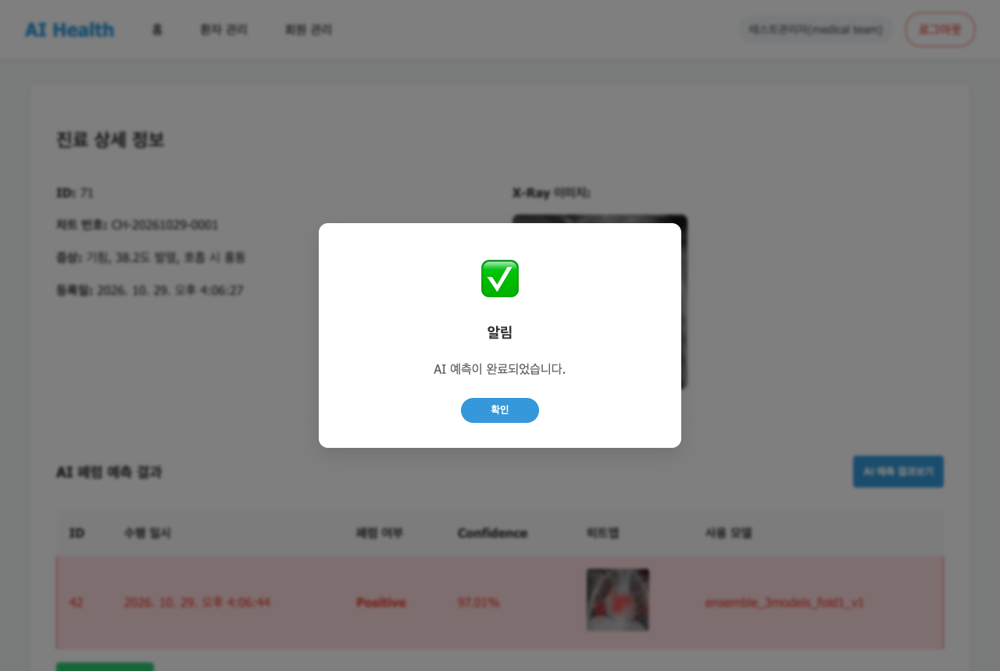 |  |

### 20. AI 예측 결과 목록 `GET /api/v1/medical-records/{id}/analyses` (담당: 박유정)

- **화면**: 진료기록 상세 화면을 열 때마다 자동으로 불러옴
- **결과**: `200` → ID·수행 일시·폐렴 여부·Confidence·히트맵 썸네일·사용 모델 표. Positive는 빨간 줄로 강조, 히트맵을 누르면 새 탭에서 크게 보임
- **연결**: `record-detail.html` → `pages.renderRecordDetail` → `apis.getMedicalRecordAnalyses()` → `ai_analyses.py` `get_record_analyses`

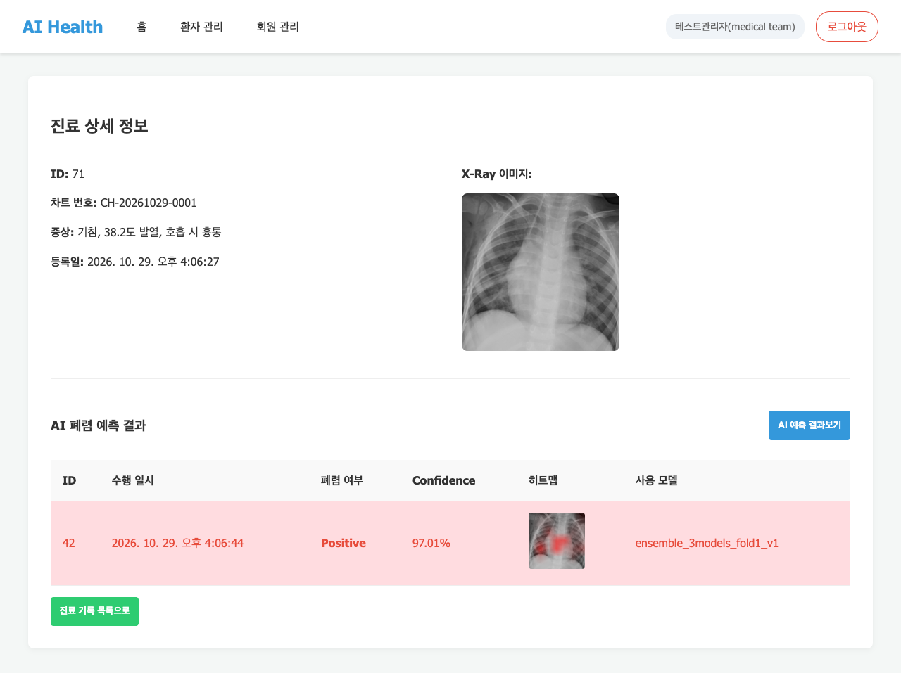

---

## 🔍 확인하면서 본 것

- API 20개 모두 프론트 화면에서 정상 호출됨. 프론트 템플릿 코드는 수정 없이 연결됨 (Stage 4~6에서 `apis.js` 기준으로 설계)
- #56에서 고친 내용이 실행 화면에 반영됨: 등록일·수행 일시가 한국 시각으로 표시, 버튼 이름 `환자 목록으로`·`진료 기록 목록으로`, 휴대폰 번호 `010` 규칙
- 비밀번호 칸은 가려진 상태로만 캡처, 개인정보는 테스트 값만 사용
