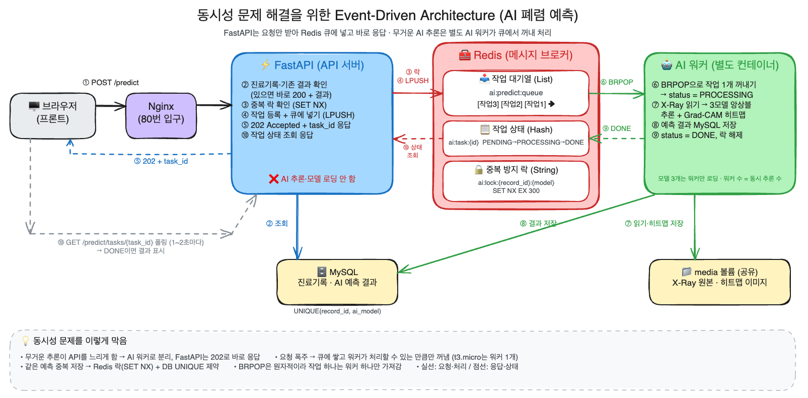

# ⚡ 9일차 동시성 문제 해결을 위한 아키텍처 설계

> FastAPI와 Redis를 이용한 Event-Driven Architecture(EDA)를 공부하고, 우리 프로젝트의 AI 폐렴 예측에 적용할 구조를 설계함

## 0. 왜 다시 설계하나: 지금 구조의 문제

지금 AI 예측(`POST /api/v1/medical-records/{record_id}/predict`)은 **요청 하나 안에서 모든 일을 끝내는 동기 구조**임.

```
브라우저 ──요청──▶ FastAPI ── 진료기록 조회 → 기존 결과 확인 → AI 추론(수 초) → 히트맵 → DB 저장 ──응답──▶ 브라우저
                  (이 시간 동안 브라우저는 계속 기다림)
```

`app/services/ai_analyses.py`의 `predict_record()`를 보면서 찾은 문제

| 문제 | 지금 코드에서 | 왜 문제인가 |
|---|---|---|
| ① 무거운 작업이 API 서버 안에서 실행됨 | `run_in_threadpool(ai_model.predict, ...)` | torch 추론은 CPU를 많이 씀. 예측 요청이 몰리면 같은 서버의 로그인·환자 목록 같은 가벼운 API까지 느려짐 |
| ② 동시에 같은 예측을 누르면 중복 저장 | 2번 "기존 결과 확인" → 7번 "저장" 사이에 수 초 공백 | A, B 요청이 동시에 들어오면 둘 다 "결과 없음"을 보고 **둘 다 추론하고 둘 다 저장**함. `ai_analysis_results`에 `(record_id, ai_model)` 유니크 제약도 없음 |
| ③ 동시 추론 개수를 조절할 수 없음 | 요청이 들어오는 만큼 스레드에서 추론 | t3.micro(RAM 1GiB)에서 AI 예측 4개가 동시에 돌면 메모리 부족으로 컨테이너가 강제 종료될 수 있음 (AWS 배포 때 스왑을 이미 588Mi 사용) |
| ④ 응답을 오래 기다려야 함 | 추론이 끝날 때까지 HTTP 연결 유지 | nginx `proxy_read_timeout`을 120초로 늘려야 했음. 더 느려지면 504 에러 |
| ⑤ API 서버와 AI 모델이 한 몸 | FastAPI가 켜질 때 `lifespan`에서 모델 3개를 불러옴 | API만 늘리고 싶어도 모델까지 같이 복제됨. 모델을 바꾸면 API 서버도 다시 배포해야 함 |

> 💡 **동시성(Concurrency) 문제**: 여러 요청이 **같은 시간에 같은 자원**(DB 행, CPU, 메모리)을 쓰려고 할 때 생기는 문제. 결과가 꼬이거나(②), 자원이 부족해짐(①③)

## 1. Event-Driven Architecture (EDA)

### 개념

**"일이 생겼다(이벤트)"는 사실만 알리고, 실제 처리는 그 일을 맡은 쪽이 따로 하는 구조**임.

```
[동기]  주문 받은 직원이 요리까지 하고 손님은 계산대 앞에서 기다림
[EDA]   직원은 주문서를 주방 레일에 꽂고 번호표를 줌 → 요리사가 순서대로 만들고 → 손님은 번호가 뜨면 받아감
```

| 용어 | 뜻 | 우리 설계에서 |
|---|---|---|
| 이벤트(Event) | 일어난 일에 대한 기록 ("예측 요청됨", "예측 완료됨") | `predict.requested`, `predict.done` |
| 프로듀서(Producer) | 이벤트를 만들어 보내는 쪽 | FastAPI (예측 요청을 큐에 넣음) |
| 컨슈머(Consumer) | 이벤트를 받아 처리하는 쪽 | AI 워커 (큐에서 꺼내 추론) |
| 브로커(Broker) | 이벤트를 잠시 보관하고 전달하는 중간 저장소 | Redis |
| 작업 대기열(Task Queue) | 처리할 작업을 순서대로 쌓아 두는 줄 | Redis List `ai:predict:queue` |

### 동기 vs 비동기(이벤트) 비교

| 구분 | 동기 (지금) | 이벤트 기반 (설계) |
|---|---|---|
| 응답 | 추론이 끝나야 응답 (수 초~수십 초) | 큐에 넣자마자 응답 `202 Accepted` + 작업 ID (수십 ms) |
| 결과 받기 | 같은 요청의 응답으로 | 작업 ID로 상태를 다시 물어봄 (폴링) |
| 무거운 작업 | API 서버 안에서 | **별도 AI 워커 컨테이너**에서 |
| 요청이 몰리면 | 동시에 전부 추론 → 서버 과부하 | 큐에 쌓이고 워커가 **처리할 수 있는 만큼만** 꺼내감 |
| 확장 | API 서버 통째로 늘림 | API 서버와 워커를 **따로** 늘림 |
| 단점 | 단순함 | 구성 요소가 늘고, 결과를 받는 흐름이 한 단계 더 생김 |

### EDA의 장점

- **느슨한 결합**: FastAPI는 "누가 어떻게 추론하는지" 몰라도 됨. 큐에 넣기만 하면 됨
- **부하 조절(Backpressure)**: 큐가 완충 역할. 요청이 순간적으로 몰려도 워커는 자기 속도대로 처리
- **장애 격리**: AI 워커가 죽어도 API 서버(로그인, 환자 관리)는 정상 동작. 작업은 큐에 남아 있다가 워커가 살아나면 처리됨
- **독립 확장**: 예측이 밀리면 워커만 2개, 3개로 늘림

## 2. Redis

### Redis란

- **메모리에 데이터를 저장하는 Key-Value 저장소** (Remote Dictionary Server)
- 디스크 DB(MySQL)보다 훨씬 빨라서 캐시, 세션, 작업 대기열, 실시간 메시지에 많이 씀
- 명령 하나하나가 **원자적(atomic)** 으로 실행됨 → 여러 요청이 동시에 와도 중간에 끼어들 수 없음. 동시성 제어에 유리함

### 자료구조와 쓰임

| 자료구조 | 명령 예 | 이번 설계에서 쓰는 곳 |
|---|---|---|
| **List** | `LPUSH`(왼쪽에 넣기), `BRPOP`(오른쪽에서 꺼낼 때까지 대기) | **작업 대기열** (먼저 들어온 작업부터 처리, FIFO) |
| **Hash** | `HSET`, `HGETALL` | **작업 상태** 저장 (status, result_id, error) |
| **String** | `SET key value NX EX 300` | **중복 방지 락** (없을 때만 저장 + 자동 만료) |
| Pub/Sub | `PUBLISH`, `SUBSCRIBE` | (확장) 예측 완료 알림 → 화면 실시간 갱신 |
| Stream | `XADD`, `XREADGROUP`, `XACK` | (확장) 처리 확인(ACK)이 필요한 신뢰성 높은 큐 |

### 큐로 쓰는 기본 원리

```
FastAPI  ── LPUSH ai:predict:queue {작업} ──▶  [작업3][작업2][작업1]  ── BRPOP ──▶ AI 워커
                                                  Redis List
```

- `BRPOP`은 큐가 비어 있으면 **작업이 들어올 때까지 기다림**(Blocking). 워커가 계속 물어보지 않아도 됨
- 워커가 여러 개여도 `BRPOP`은 원자적이라 **작업 하나는 워커 하나만** 가져감 → 같은 작업을 두 번 처리하지 않음

### 다른 메시지 브로커와 비교

| 도구 | 특징 | 우리 프로젝트에 |
|---|---|---|
| **Redis** | 설치·사용이 간단, 빠름, 캐시·락까지 같이 사용 | ✅ 규모가 작고 큐·락·상태 저장을 한 도구로 해결 |
| RabbitMQ | 메시지 전달 보장, 라우팅 기능이 많음 | 이 규모엔 과함 |
| Kafka | 초당 수십만 건, 이벤트를 오래 보관하고 다시 읽음 | 대규모 서비스용, 과함 |
| Celery / RQ / arq | 파이썬 작업 큐 라이브러리 (Redis를 브로커로 사용) | 실제 구현 시 후보. 이번 문서는 원리를 이해하려고 Redis 명령으로 설명 |

## 3. FastAPI + Redis 비동기 작업 패턴

### 요청 흐름: 202 Accepted + 상태 조회(폴링)

```
1. POST /predict              → 202 { "task_id": "abc", "status": "PENDING" }   (바로 응답)
2. GET  /predict/tasks/abc    → 200 { "status": "PROCESSING" }
3. GET  /predict/tasks/abc    → 200 { "status": "DONE", "result_id": 42 }
4. GET  /analyses             → 결과 목록에서 42번 표시 (기존 API 그대로)
```

- `202 Accepted`: "요청은 받았고 처리는 나중에 함"이라는 HTTP 상태 코드
- 프론트는 1~2초 간격으로 상태를 물어보다가 `DONE`이 되면 결과를 보여줌

### FastAPI `BackgroundTasks`와 차이

| 구분 | `BackgroundTasks` | Redis 큐 + 워커 |
|---|---|---|
| 실행 위치 | **같은 FastAPI 프로세스** 안 | **별도 워커 프로세스·컨테이너** |
| 서버가 재시작되면 | 진행 중이던 작업이 사라짐 | 큐에 남아 있어서 다시 처리 |
| 동시 처리 수 조절 | 어려움 | 워커 수로 조절 |
| 적합한 일 | 메일 보내기 같은 가벼운 후처리 | AI 추론처럼 무겁고 오래 걸리는 일 |

→ AI 추론은 무겁고 서버 자원을 많이 써서 **API 서버와 분리된 워커**가 맞음

### 코드로 보면 (원리 이해용 예시)

FastAPI (프로듀서)

```python
import json, uuid
import redis.asyncio as redis

r = redis.Redis(host="redis", port=6379)

@router.post("/{record_id}/predict", status_code=202)
async def request_predict(record_id: int, db: DBSession, user: StaffUser):
    await medical_record_service.get_record_or_404(db, record_id)     # 진료기록 확인만 하고

    # 이미 결과가 있으면 큐에 넣지 않고 바로 돌려줌 (기존 재사용 규칙 유지)
    existing = await ai_analysis_repository.get_existing_result(db, record_id, MODEL_NAME)
    if existing:
        return {"status": "DONE", "result_id": existing.id}

    # 같은 진료기록·모델 작업이 이미 진행 중이면 그 작업 ID를 돌려줌 (중복 방지 락)
    lock_key = f"ai:lock:{record_id}:{MODEL_NAME}"
    task_id = str(uuid.uuid4())
    if not await r.set(lock_key, task_id, nx=True, ex=300):            # NX: 없을 때만 저장
        return {"status": "PENDING", "task_id": (await r.get(lock_key)).decode()}

    await r.hset(f"ai:task:{task_id}", mapping={"status": "PENDING", "record_id": record_id})
    await r.lpush("ai:predict:queue", json.dumps({"task_id": task_id, "record_id": record_id}))
    return {"status": "PENDING", "task_id": task_id}                  # 추론을 기다리지 않고 바로 응답
```

AI 워커 (컨슈머)

```python
while True:
    _, raw = r.brpop("ai:predict:queue")             # 작업이 올 때까지 대기
    job = json.loads(raw)
    key = f"ai:task:{job['task_id']}"
    r.hset(key, "status", "PROCESSING")
    try:
        result_id = run_predict_and_save(job["record_id"])    # 추론 → 히트맵 → MySQL 저장
        r.hset(key, mapping={"status": "DONE", "result_id": result_id})
    except Exception as e:
        r.hset(key, mapping={"status": "FAILED", "error": str(e)})
    finally:
        r.delete(f"ai:lock:{job['record_id']}:{MODEL_NAME}")  # 락 해제
        r.expire(key, 3600)                                    # 상태는 1시간 뒤 자동 삭제
```

## 4. 동시성 문제를 어떻게 막나

| 문제 (0장) | 해결 방법 | 어디서 |
|---|---|---|
| ① 무거운 추론이 API를 느리게 함 | 추론을 **AI 워커 컨테이너로 분리**. FastAPI는 큐에 넣고 바로 응답 | 아키텍처 |
| ② 같은 예측 중복 저장 | ⓐ Redis 락 `SET NX EX`: 진행 중인 같은 작업이 있으면 새로 넣지 않음<br>ⓑ DB `UNIQUE(record_id, ai_model)` 제약: 마지막 안전장치<br>ⓒ 워커가 저장 직전에 기존 결과를 한 번 더 확인 | Redis + MySQL |
| ③ 동시 추론 개수 폭주 | 워커 수 = 동시에 추론하는 최대 개수. t3.micro는 **워커 1개**로 메모리 보호 | Redis 큐 |
| ④ 긴 HTTP 연결 | `202` 즉시 응답 + 상태 조회 | API |
| ⑤ API와 모델이 한 몸 | 모델은 워커만 불러옴. API 서버는 모델 없이 가볍게 실행 | 아키텍처 |

### 꼭 알아야 할 개념

| 개념 | 설명 |
|---|---|
| 경쟁 상태(Race Condition) | "확인 → 저장" 사이에 다른 요청이 끼어들어 결과가 꼬이는 것 (②의 원인) |
| 원자성(Atomicity) | 명령이 중간에 끊기지 않고 한 번에 실행되는 성질. Redis 명령, DB 제약이 보장 |
| 분산 락(Distributed Lock) | 서버가 여러 대여도 공용 저장소(Redis)에 "지금 내가 쓰는 중" 표시를 남겨 한 곳만 작업하게 함. `EX`로 만료 시간을 걸어 워커가 죽어도 락이 영원히 남지 않게 함 |
| 멱등성(Idempotency) | 같은 요청을 여러 번 보내도 결과가 한 번 보낸 것과 같은 성질. 같은 예측을 두 번 눌러도 결과는 하나 |
| 백프레셔(Backpressure) | 처리 속도보다 요청이 빠를 때 큐에 쌓아 두고 처리할 수 있는 만큼만 꺼내는 것 |

## 5. 우리 프로젝트 아키텍처 설계



> Excalidraw 원본: [`images/day09/eda_architecture.excalidraw`](images/day09/eda_architecture.excalidraw) ([excalidraw.com](https://excalidraw.com)에서 열기 → 파일 열기)

### 구성 요소와 역할

| 구성 요소 | 역할 | 하지 않는 일 |
|---|---|---|
| 브라우저 (프론트) | 예측 요청, 작업 상태 폴링, 결과 표시 | |
| Nginx | 80번 입구, FastAPI로 전달 | |
| **FastAPI (API 서버)** | 인증·권한, 진료기록 확인, 기존 결과 재사용, **락 확인 후 작업을 큐에 넣기**, 상태 조회 응답 | ❌ AI 추론, 모델 로딩 |
| **Redis (브로커)** | 작업 대기열, 작업 상태, 중복 방지 락 | ❌ 영구 저장 (결과는 MySQL) |
| **AI 워커** | 큐에서 작업 꺼내기, X-Ray 읽기, 추론·히트맵, 결과 저장, 상태 갱신 | ❌ HTTP 요청 받기 |
| MySQL | 진료기록, AI 예측 결과 영구 저장 | |
| media 볼륨 (공유) | X-Ray 원본(FastAPI가 저장), 히트맵(워커가 저장) | |

### 처리 순서

| 번호 | 누가 | 무엇을 |
|---|---|---|
| ① | 브라우저 → Nginx → FastAPI | `POST /medical-records/{id}/predict` |
| ② | FastAPI → MySQL | 진료기록 확인, 같은 모델의 기존 결과가 있으면 바로 `200` + 결과 |
| ③ | FastAPI → Redis | `SET ai:lock:{record_id}:{model} NX EX 300` → 이미 진행 중이면 기존 `task_id` 반환 |
| ④ | FastAPI → Redis | `HSET ai:task:{task_id} status=PENDING`, `LPUSH ai:predict:queue` |
| ⑤ | FastAPI → 브라우저 | `202 Accepted` + `task_id` (추론을 기다리지 않음) |
| ⑥ | AI 워커 → Redis | `BRPOP ai:predict:queue` → 작업 하나 꺼냄, `status=PROCESSING` |
| ⑦ | AI 워커 → media | X-Ray 원본 읽기 → 추론(3모델 앙상블) → 히트맵 저장 |
| ⑧ | AI 워커 → MySQL | 예측 결과 저장 (`UNIQUE(record_id, ai_model)`로 중복 차단) |
| ⑨ | AI 워커 → Redis | `status=DONE, result_id` (실패면 `FAILED, error`), 락 삭제 |
| ⑩ | 브라우저 → FastAPI → Redis | `GET /predict/tasks/{task_id}` 폴링 → `DONE`이면 결과 표시 |

### Redis 키 설계

| 키 | 자료구조 | 값 | 만료 |
|---|---|---|---|
| `ai:predict:queue` | List | `{"task_id", "record_id", "model"}` JSON | 없음 (처리되면 빠짐) |
| `ai:task:{task_id}` | Hash | `status`, `record_id`, `result_id`, `error` | 완료 후 1시간 |
| `ai:lock:{record_id}:{model}` | String | 진행 중인 `task_id` | 300초 (워커가 죽어도 자동 해제) |

### 작업 상태 변화

```
PENDING ──(워커가 꺼냄)──▶ PROCESSING ──(성공)──▶ DONE
                                       └──(실패)──▶ FAILED ──(재시도 시 새 작업)
```

### API 변경

| API | 지금 | 설계 후 |
|---|---|---|
| `POST /medical-records/{id}/predict` | 추론 후 `201`(새 결과) / `200`(기존 결과) | 기존 결과 있으면 `200`, 없으면 큐에 넣고 **`202` + task_id** |
| `GET /medical-records/predict/tasks/{task_id}` | 없음 | **새로 추가**: 작업 상태 조회 |
| `GET /medical-records/{id}/analyses` | 결과 목록 | 그대로 |

### docker compose 변화

| 서비스 | 지금 | 설계 후 |
|---|---|---|
| nginx | ✅ | 그대로 |
| fastapi | API + AI 모델 | API만 (모델 로딩 제거 → 메모리 절약) |
| **redis** | 없음 | **추가** (`redis:7-alpine`) |
| **ai-worker** | 없음 | **추가** (같은 이미지, `command`만 워커 실행, `./models`·`./media` 연결) |
| mysql | ✅ | 그대로 |

## 6. 고려할 점

| 항목 | 내용 |
|---|---|
| 워커가 작업 도중 죽으면 | `BRPOP`으로 꺼낸 작업은 큐에서 사라짐 → 상태가 `PROCESSING`에 멈춤. 락 만료(300초) 후 다시 요청 가능. 더 안전하게 하려면 Redis Stream의 `XACK`(처리 완료 확인)나 처리 중 목록(`BLMOVE`)을 사용 |
| 재시도 | 실패한 작업은 `FAILED`로 남기고 사용자가 다시 누르면 새 작업. 자동 재시도는 횟수 제한을 두어야 무한 반복을 막음 |
| Redis가 죽으면 | 큐에 있던 작업이 사라질 수 있음 → Redis 저장 옵션(AOF) 사용, 결과는 MySQL에 있으므로 영구 데이터는 안전 |
| 결과 알림 방식 | 폴링이 가장 간단. 실시간이 필요하면 Redis Pub/Sub + WebSocket/SSE |
| 메모리 | 모델을 워커만 불러와서 API 서버는 가벼워지지만, t3.micro에 Redis·워커가 추가되므로 워커는 1개로 시작 |

## 💡 정리

- **동시성 문제**는 같은 자원을 여러 요청이 동시에 쓸 때 생김. 우리 프로젝트에선 "AI 추론이 API를 붙잡는 문제"와 "같은 예측 중복 저장"이 핵심
- **EDA**는 요청을 받는 쪽(FastAPI)과 처리하는 쪽(AI 워커)을 **이벤트(작업)로 분리**해서 해결함
- **Redis**는 작업 대기열(List), 작업 상태(Hash), 중복 방지 락(String NX)을 한 번에 맡는 브로커
- FastAPI는 **`202` + 작업 ID**로 바로 응답하고, 결과는 상태 조회로 받음

## 📚 참고 자료

- [FastAPI - Background Tasks](https://fastapi.tiangolo.com/tutorial/background-tasks/)
- [Redis - Lists (큐로 사용)](https://redis.io/docs/latest/develop/data-types/lists/)
- [Redis - SET (NX, EX 옵션)](https://redis.io/docs/latest/commands/set/)
- [Redis - Distributed Locks](https://redis.io/docs/latest/develop/use/patterns/distributed-locks/)
- [Redis - Streams](https://redis.io/docs/latest/develop/data-types/streams/)
- [MDN - 202 Accepted](https://developer.mozilla.org/ko/docs/Web/HTTP/Status/202)
- [AWS - 이벤트 기반 아키텍처란?](https://aws.amazon.com/ko/event-driven-architecture/)
