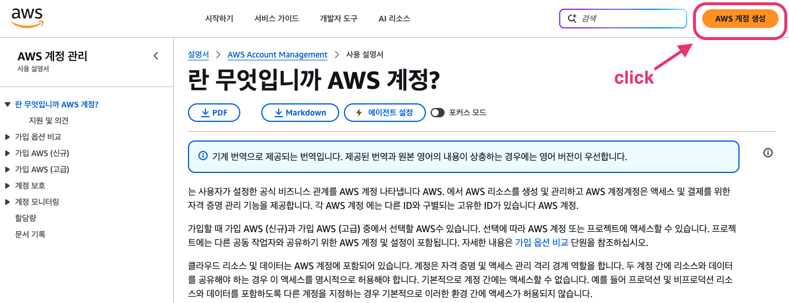
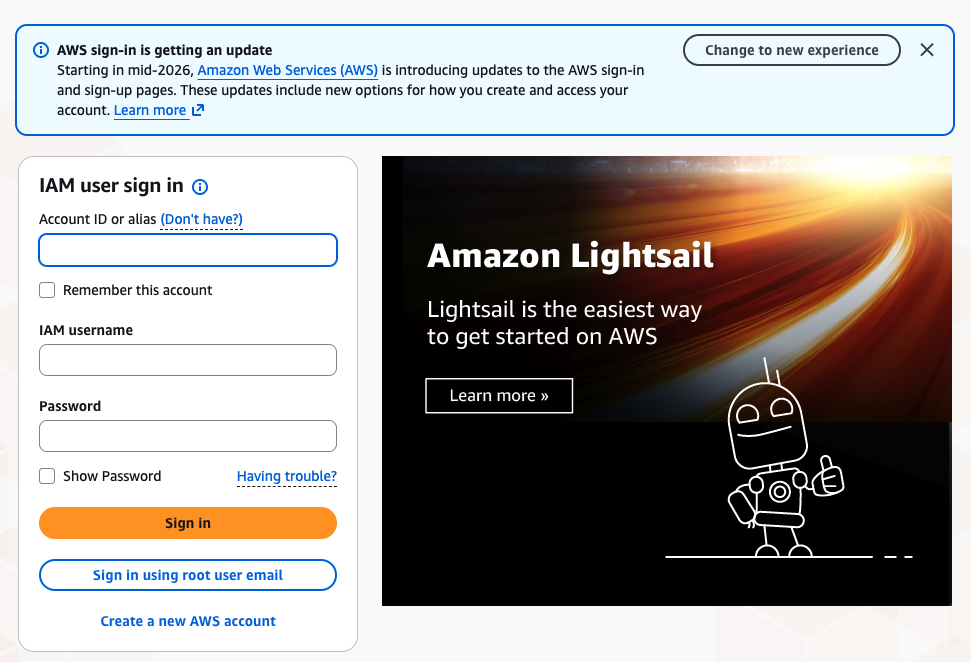
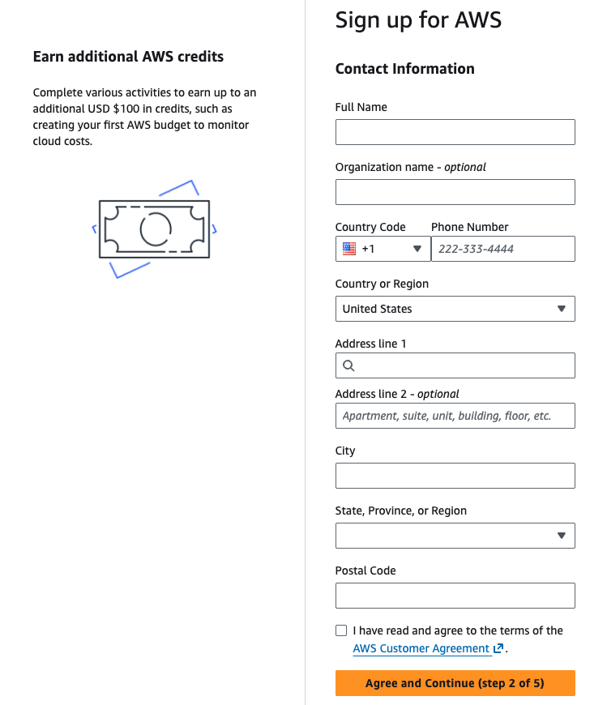
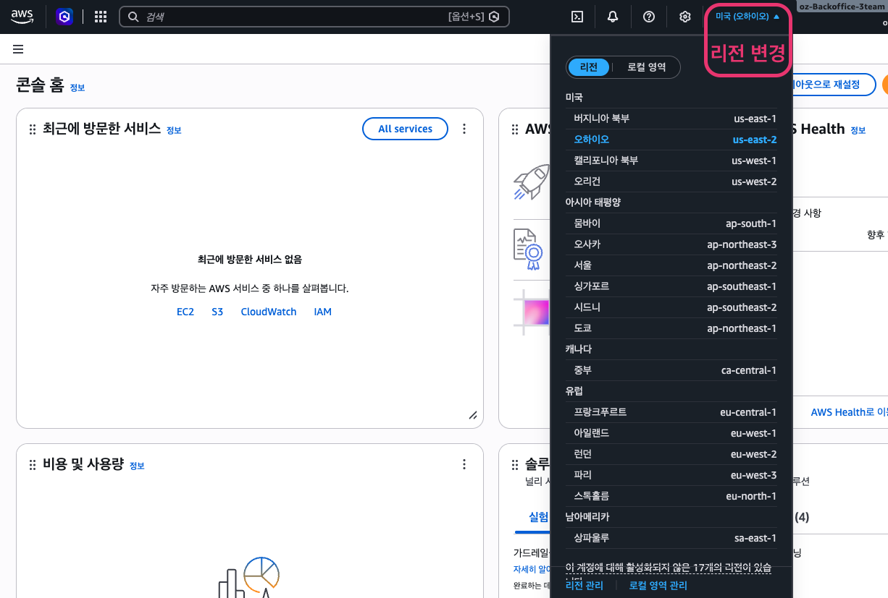
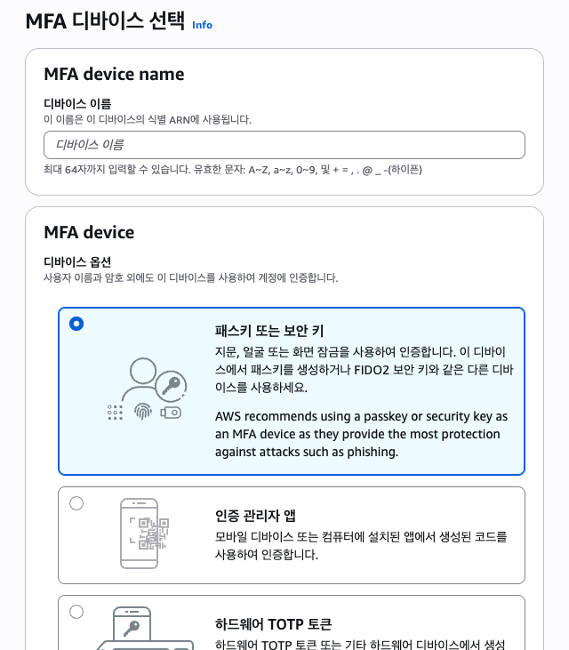
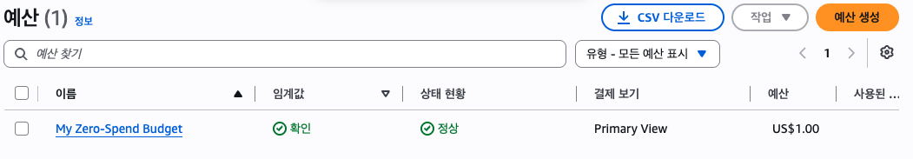

# 1️⃣ AWS 계정 만들기

> 참고: [AWS 계정 생성 - AWS 계정 관리](https://docs.aws.amazon.com/ko_kr/accounts/latest/reference/manage-acct-creating.html)

- 담당: 김지연
- 날짜: 2026-11-02

## ✅ 진행 순서

- [x] AWS 가입 (이메일, 계정 이름 `oz-Backoffice-3team`)
- [x] 플랜 선택: **Free**
- [x] 연락처 정보 입력 (영문), 결제 수단 등록·카드 인증, 휴대폰 본인 인증
- [x] 콘솔 리전을 **서울(ap-northeast-2)** 로 변경
- [x] 루트 계정 MFA(패스키) 설정
- [x] 비용 알림: 제로 지출 예산 생성

## 1. 가입 화면 들어가기

설명서 오른쪽 위 **AWS 계정 생성**을 누르면 **로그인 화면**이 먼저 나옴.

로그인 화면의 입력칸은 무시하고 맨 아래 **`Create a new AWS account`** 를 눌러야 가입 화면으로 넘어감.

| 버튼 | 뜻 |
|---|---|
| IAM user sign in | 이미 있는 계정 안의 하위 사용자(IAM)가 로그인하는 곳 |
| Sign in using root user email | 가입 후 내 이메일(루트 계정)로 로그인할 때 사용 |
| Create a new AWS account | 새 계정 만들기 ✅ |

## 2. 플랜 선택: Free

| 플랜 | 특징 | 선택 |
|---|---|---|
| **Free** | 가입 크레딧 안에서만 사용, 크레딧·기간(6개월)이 끝나면 리소스가 멈추고 **카드로 청구되지 않음**. EC2 t3.micro, EBS, 기본 VPC 사용 가능 | ✅ |
| Paid | 모든 서비스 사용 가능, 프리 티어·크레딧을 넘으면 바로 청구됨 | |

- 과제가 프리 티어 한도 안에서 진행되므로 실수로 요금이 나갈 위험이 없는 Free 플랜을 고름
- 필요하면 나중에 Paid로 업그레이드할 수 있음

## 3. 연락처 정보 (영문)

| 칸 | 입력 방법 |
|---|---|
| Full Name | 영문 이름 |
| Country Code / Phone Number | **+82**, 맨 앞 `0`을 빼고 입력 (`010-...` → `10-...`) |
| Country or Region | **South Korea** |
| Address line 1·2 | 영문 도로명 주소 ([도로명주소 안내시스템](https://www.juso.go.kr) "영문보기") |
| City | 시 (예: `Suwon-si`) |
| State, Province, or Region | 시·도 (예: `Gyeonggi-do`) |
| Postal Code | 우편번호 5자리 |

> ⚠️ **State에 경기도가 안 나옴** → 목록이 알래스카, 캔자스 같은 미국 주였음. `Country or Region`이 기본값 **United States**로 남아 있어서였음. **나라를 먼저 South Korea로 바꾸면** 한국 시·도 목록으로 바뀜

이후 결제 수단(카드) 등록 → 휴대폰 본인 인증 → 가입 완료.

## 4. 리전을 서울로 변경

가입 후 콘솔에 들어가면 리전이 **미국 (오하이오)** 로 잡혀 있음. 오른쪽 위 리전 메뉴의 **아시아 태평양 → 서울 ap-northeast-2** 로 바꿈.

- EC2처럼 리전별로 만들어지는 서비스는 리전을 확인하고 만들어야 함 (가까워서 빠르고, 나중에 정리할 때도 헷갈리지 않음)
- IAM, 결제, Budgets 화면에서는 리전 자리에 **"글로벌"** 이 나옴. 계정 전체에 적용되는 서비스라 정상임
- 콘솔 첫 화면의 "AWS용 에이전트 툴킷 설정" 팝업은 AI 코딩 도구에 AWS 권한을 연결하는 기능이라 사용하지 않고 닫음

## 5. 루트 계정 MFA (2단계 인증)

카드가 연결된 계정이라 비밀번호가 유출돼도 로그인하지 못하게 MFA를 걸어둠.  
오른쪽 위 계정 이름 → **보안 자격 증명** → **MFA 디바이스 할당**

| 방식 | 특징 | 선택 |
|---|---|---|
| **패스키 또는 보안 키** | 맥 Touch ID로 인증, 앱 설치 불필요, iCloud 키체인으로 다른 Apple 기기와 동기화, AWS 권장(피싱에 강함) | ✅ |
| 인증 관리자 앱 | 휴대폰 앱(Google Authenticator 등)의 6자리 코드 입력 | 백업용으로 추가 가능 |

- 디바이스 이름: 어떤 기기인지 구분하는 용도 (영문·숫자·`-`·`_`만 가능, 예: `이름-macbook-passkey`)
- 컴퓨터를 바꿔도 iCloud 키체인으로 패스키가 따라오고, MFA는 계정당 최대 8개까지 등록할 수 있어서 휴대폰 앱을 백업으로 추가해 둘 수 있음
- MFA는 루트 계정용이라 팀원과 공유하지 않음

## 6. 비용 알림 설정

종량제라서 요금이 나가기 시작하면 바로 알 수 있게 알림을 켜 둠.

| 설정 | 위치 | 내용 |
|---|---|---|
| PDF 인보이스 이메일 | 결제 → 청구서 기본 설정 | 매달 청구서 메일 (가입 시 기본 활성화) |
| AWS 프리 티어 알림 | 결제 → 청구서 기본 설정 | 프리 티어 한도에 가까워지면 메일 (기본 활성화) |
| CloudWatch 결제 알림 | 결제 → 청구서 기본 설정 | 요금 데이터를 CloudWatch로 보냄 (켜는 것 자체는 무료, 끌 수 없음) |
| **제로 지출 예산** | 결제 및 비용 관리 → 예산 → 예산 생성 → 템플릿 → 제로 지출 예산 | 1센트라도 청구되면 메일 |

> ⚠️ 청구서 기본 설정의 **조달 포털(SAP Business Network, Coupa)** 은 기업 구매 시스템 연결 기능이라 상관없음. 잘못 들어가면 취소  
> 💡 상단 검색창에 `Budgets`를 검색하면 서비스가 바로 안 나옴 → **결제 및 비용 관리** 안의 **예산** 메뉴로 들어감

## 💡 배운 점

- AWS는 계정을 만드는 순간 결제와 연결되므로, **Free 플랜 + 비용 알림**으로 안전장치부터 걸어 두는 게 먼저임
- 리전은 기본값이 서울이 아님. 리소스를 만들기 전에 항상 오른쪽 위 리전을 확인해야 함
- 캡처에 나오는 **계정 ID(12자리), 이메일, 공인 IP**는 문서에 올리기 전에 가림
