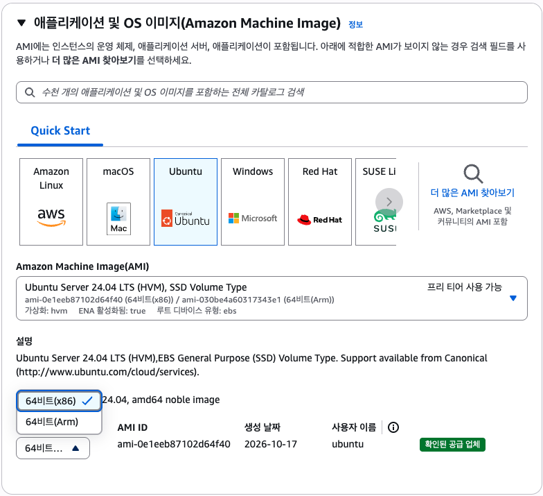
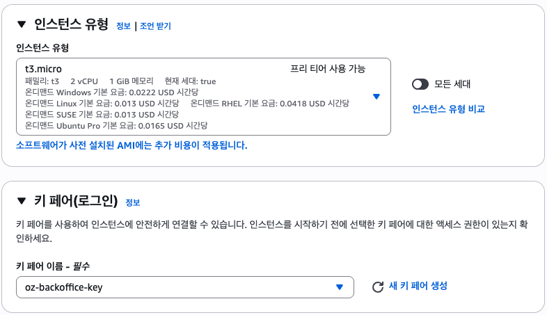
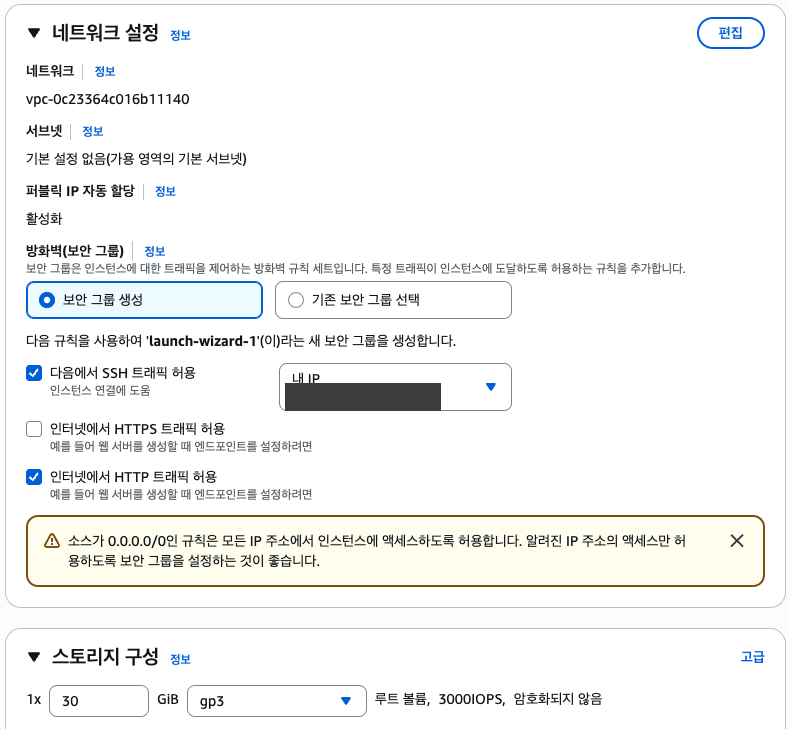
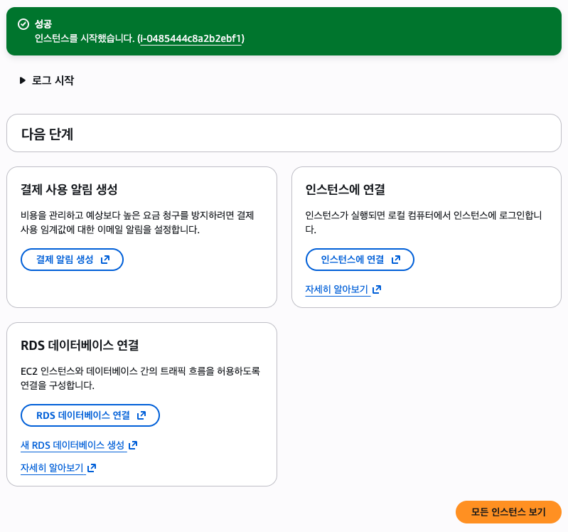
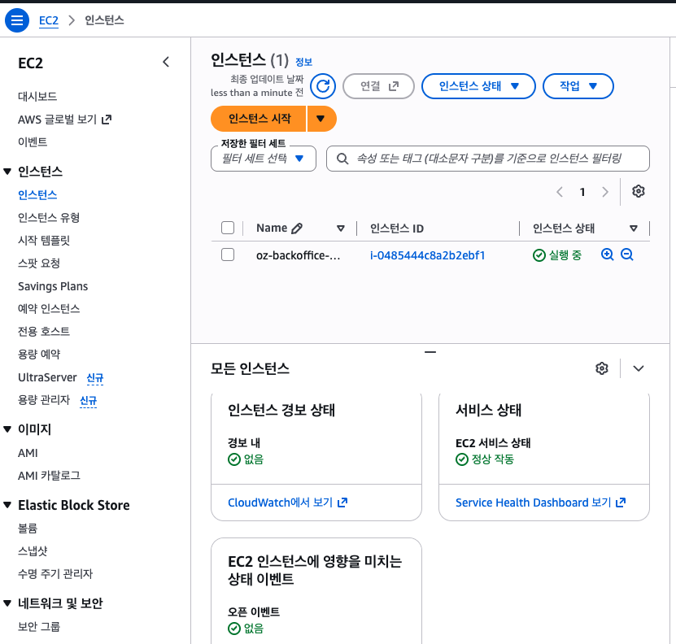

# 2️⃣ AWS EC2 인스턴스 생성하기

## ⚙️ 선택한 설정

EC2 콘솔(리전 **서울** 확인) → **인스턴스 시작**

| 항목 | 값 | 이유 |
|---|---|---|
| 이름 | `oz-backoffice-server` | |
| AMI | **Ubuntu Server 24.04 LTS** (HVM), SSD Volume Type | 과제 가이드(도커 설치, 스왑)가 24.04 기준 |
| 아키텍처 | **64비트(x86)** | t3.micro가 x86. 우리 이미지도 amd64로 빌드함 |
| 인스턴스 유형 | **t3.micro** (2 vCPU, 1GiB) | 프리 티어 |
| 키 페어 | 새로 생성 `oz-backoffice-key` (RSA, `.pem`) | SSH 접속용 |
| 보안 그룹 | SSH 22: **내 IP** / HTTP 80: 전체 / HTTPS 443: 안 엶 | 서버 접속은 나만, 웹 접속은 누구나 |
| 스토리지 | **30GiB gp3** | 기본 8GiB로는 이미지(약 2GB) + MySQL + 스왑 4GB가 부족함. 프리 티어는 30GB까지 |

## 1. AMI: 26.04 → 24.04로 변경

Ubuntu를 고르면 최신 버전인 **26.04**가 기본으로 선택됨. AMI 박스 오른쪽 **▼**를 눌러 **24.04 LTS**로 바꿈.



- 26.04도 동작할 가능성이 높지만, 가이드 명령어가 24.04 기준이고 막혔을 때 찾을 자료가 더 많음
- 서버에는 도커만 설치하고 앱은 컨테이너(`python:3.13-slim`) 안에서 돌아가서 우분투 버전 영향은 적음
- **아키텍처 드롭다운(64비트 x86 / Arm)** 과 **AMI 드롭다운**은 다른 칸이라 헷갈리지 않게 주의

## 2. 인스턴스 유형, 키 페어



- **키 페어 `.pem` 파일은 생성할 때 딱 한 번만 다운로드됨**
- 레포 안에 두면 실수로 커밋될 수 있어서 레포 밖 폴더로 옮기고 권한을 나만 읽기(400)로 바꿈. 권한이 넓으면 SSH가 `UNPROTECTED PRIVATE KEY FILE` 에러를 냄

```bash
mkdir -p ~/Desktop/aws-key && mv ~/Downloads/oz-backoffice-key.pem ~/Desktop/aws-key/ && chmod 400 ~/Desktop/aws-key/oz-backoffice-key.pem
```

## 3. 네트워크(보안 그룹), 스토리지



- SSH 소스 기본값이 **위치 무관(0.0.0.0/0)** → 전 세계 누구나 22번 포트로 접속을 시도할 수 있어서 **내 IP**로 바꿈
- 노란 경고(0.0.0.0/0)는 **HTTP를 전체 허용**해서 뜨는 것. 웹 서비스는 누구나 접속해야 하므로 의도한 설정
- "내 IP"는 지금 연결된 네트워크 기준. 다른 와이파이에서 SSH가 안 되면 보안 그룹 인바운드 규칙에서 다시 "내 IP"로 수정
- 스토리지 **8 → 30**GiB

## 4. 인스턴스 시작



- 다음 단계 카드의 **RDS 데이터베이스 연결**은 사용하지 않음 (MySQL은 도커 컨테이너로 띄움, RDS는 별도 요금)

**모든 인스턴스 보기**에서 확인



- [x] 인스턴스 상태: **실행 중**
- [x] 상태 검사: **3/3 통과** (시스템, 인스턴스, 연결된 EBS 볼륨)
- [x] 인스턴스 클릭 → 세부 정보에서 **퍼블릭 IPv4 주소** 확인

## 💡 배운 점

- AWS 콘솔의 기본값(최신 AMI, SSH 전체 허용, 8GiB)이 우리 과제에 맞지 않는 경우가 많음. **요약 칸에서 AMI·유형·스토리지를 한 번 더 확인**하고 시작해야 함
- 보안 그룹은 서버 앞의 방화벽. 필요한 포트만, 필요한 사람에게만 열어야 함 (DB 3306은 열지 않음)
