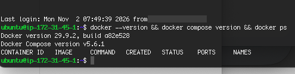
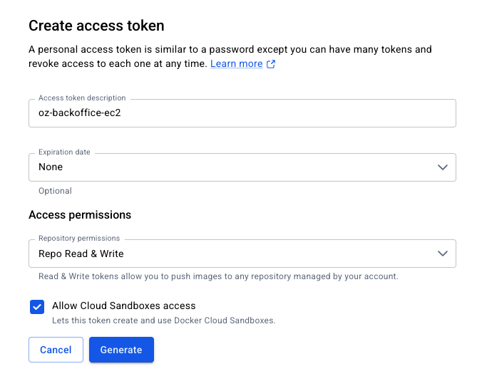
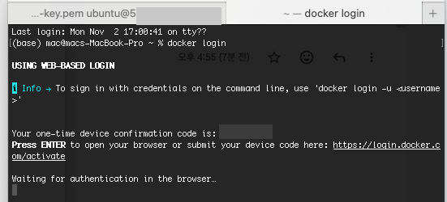

# 3️⃣ AWS EC2 내 도커 엔진, 도커 컴포즈 설치하기

## 1. SSH 접속

```bash
ssh -i ~/Desktop/aws-key/oz-backoffice-key.pem ubuntu@EC2_IP
```

- Ubuntu AMI의 기본 사용자 이름은 `ubuntu`
- 처음 접속하면 `Are you sure you want to continue connecting (yes/no/[fingerprint])?` → **`yes`** 를 끝까지 입력해야 함 (`y`만 치면 안 됨)
- 접속되면 프롬프트가 `ubuntu@ip-172-31-xx-xx:~$`로 바뀜

```
Welcome to Ubuntu 24.04.5 LTS (GNU/Linux 7.0.0-1014-aws x86_64)
  Usage of /:   9.6% of 28.02GB
  Memory usage: 32%
  Swap usage:   0%
```

> ⚠️ 접속 메시지에 `New release '26.04.1 LTS' available`이 나와도 `do-release-upgrade`는 하지 않음. OS가 통째로 바뀌어 설치한 것들이 꼬일 수 있음

> 💡 터미널 탭을 두 개로 나눠 쓰면 헷갈리지 않음  
> - 탭 1 (EC2): `ubuntu@ip-...:~$`  
> - 탭 2 (맥): `(base) mac@...` → 로그인, 빌드, 푸시, scp

## 2. Docker Engine + Compose 설치

> 참고: [Install Docker Engine on Ubuntu](https://docs.docker.com/engine/install/ubuntu/)

```bash
# ① 패키지 목록 업데이트 + 준비물 설치
sudo apt-get update && sudo apt-get install -y ca-certificates curl

# ② Docker 공식 GPG 키 등록 (받는 패키지가 진짜 Docker 것인지 확인하는 열쇠)
sudo install -m 0755 -d /etc/apt/keyrings && sudo curl -fsSL https://download.docker.com/linux/ubuntu/gpg -o /etc/apt/keyrings/docker.asc && sudo chmod a+r /etc/apt/keyrings/docker.asc

# ③ Docker 저장소 추가
echo "deb [arch=$(dpkg --print-architecture) signed-by=/etc/apt/keyrings/docker.asc] https://download.docker.com/linux/ubuntu $(. /etc/os-release && echo "$VERSION_CODENAME") stable" | sudo tee /etc/apt/sources.list.d/docker.list > /dev/null

# ④ Docker 엔진 + Compose 설치
sudo apt-get update && sudo apt-get install -y docker-ce docker-ce-cli containerd.io docker-buildx-plugin docker-compose-plugin

# ⑤ 설치 확인
sudo docker run hello-world
```

```
Hello from Docker!
 2. The Docker daemon pulled the "hello-world" image from the Docker Hub.
    (amd64)
```

- 출력의 **`(amd64)`** 로 서버가 x86인 것도 확인됨 → 맥(ARM)에서 이미지를 만들 때 amd64로 빌드해야 하는 이유

### sudo 없이 docker 쓰기

```bash
sudo usermod -aG docker ubuntu   # ubuntu 사용자를 docker 그룹에 추가
exit                             # 그룹 변경은 다시 접속해야 적용됨
```

다시 SSH로 접속한 뒤 확인



| 항목 | 결과 |
|---|---|
| Docker | 29.9.2 |
| Docker Compose | v5.6.1 |
| `sudo` 없이 `docker ps` | ✅ |

> ⚠️ 처음엔 `exit` 후 **다시 접속하지 않고** 확인 명령을 쳐서 맥의 도커 버전이 나왔음. 프롬프트가 `ubuntu@...`인지 먼저 확인해야 함

## 3. Docker Hub 가입 + PAT 토큰

| 항목 | 값 | 이유 |
|---|---|---|
| 가입 방법 | GitHub 연동 | 개발 계정끼리 묶어서 관리 |
| Username | `elin115` | 영문·숫자 4~30자만 가능 (`-` 불가) → GitHub 아이디에서 하이픈 제거. 이미지 이름 앞부분이 됨 |
| 플랜 | Personal (무료) | |

Account settings → **Personal access tokens** → Generate new token



| 항목 | 값 | 이유 |
|---|---|---|
| Description | `oz-backoffice-ec2` | |
| Expiration date | **30 days** (기본값 None에서 변경) | 과제 기간만 사용, 유출돼도 자동으로 만료 |
| Permissions | Repo Read & Write | 이미지 푸시에 Write 필요 |
| Allow Cloud Sandboxes access | **체크 해제** | 쓰지 않는 기능, 최소 권한 |

- 토큰은 생성 화면에서 **딱 한 번만** 보임. 캡처·메모·깃·채팅 어디에도 남기지 않음

## 4. Docker 로그인

### EC2 (이미지 받기용)

```bash
docker login -u elin115
# Password: 에 PAT 토큰 붙여넣기 (화면에 안 보이는 게 정상)
Login Succeeded
```

- `WARNING! Your credentials are stored unencrypted...` 경고는 EC2 안에 로그인 정보가 저장된다는 안내. 8단계에서 서버를 지우면 함께 사라짐

### 맥 (이미지 푸시용, 5단계에서 사용)

토큰은 다시 볼 수 없어서 맥에서는 **웹 로그인**을 사용함. EC2에 접속된 탭이 아니라 **새 터미널 탭**에서 실행.

```bash
docker login
```



1. 엔터 → 브라우저에서 터미널의 확인 코드와 같은지 확인 → GitHub로 로그인
2. 브라우저에 "Congratulations, you're all set!"이 나오면 완료 (터미널은 엔터를 쳐야 화면이 갱신됨)
3. 맥은 키체인(`credsStore: desktop`)에 `elin115` 계정으로 저장됨

## 💡 배운 점

- `usermod`처럼 그룹을 바꾸는 설정은 **다시 로그인해야** 적용됨
- 같은 Docker Hub 계정이라도 EC2는 **PAT 토큰**, 맥은 **웹 로그인**처럼 환경에 맞는 방법으로 로그인할 수 있음
- 토큰은 비밀번호와 같음. 만료일과 최소 권한을 정해서 만들고, 다 쓰면 삭제함
