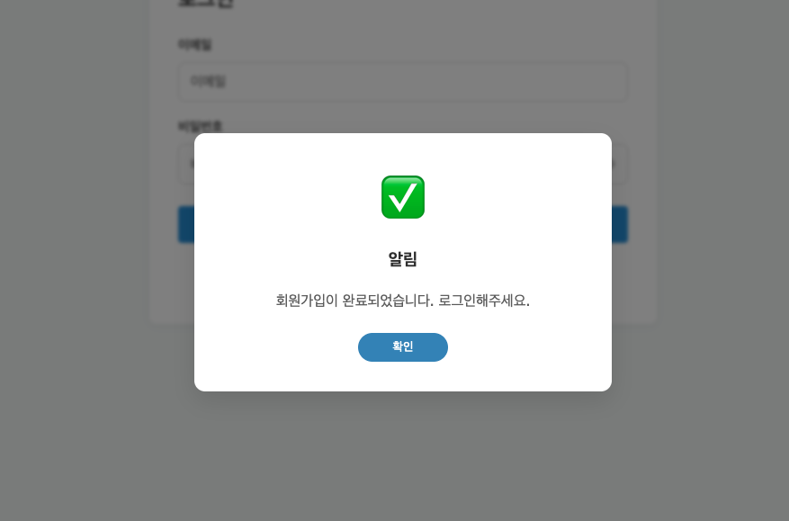
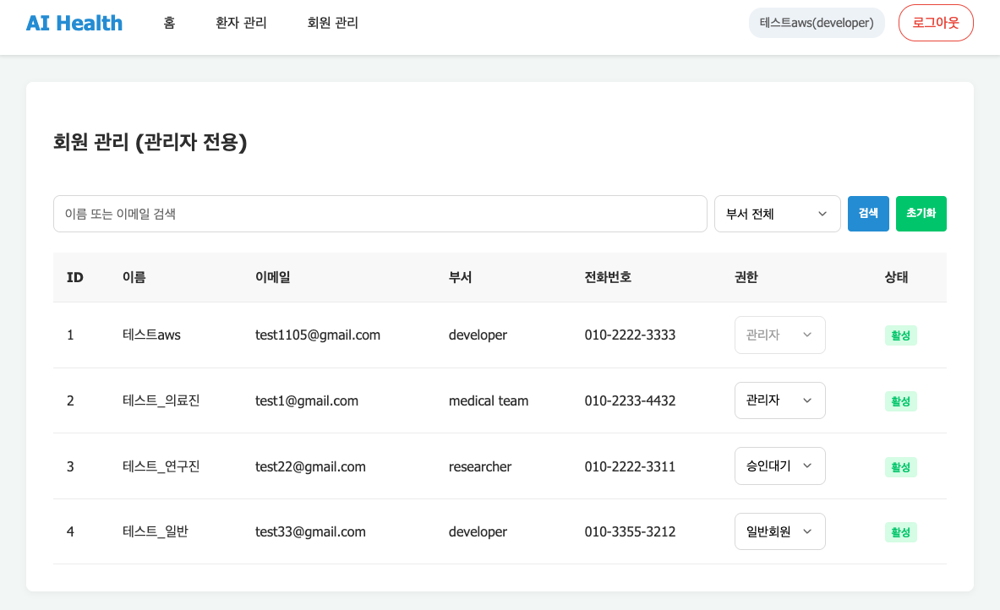
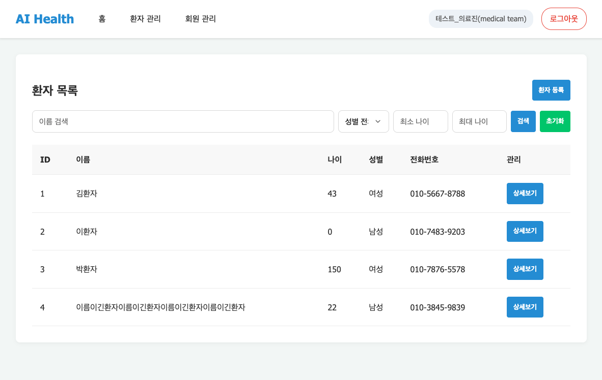
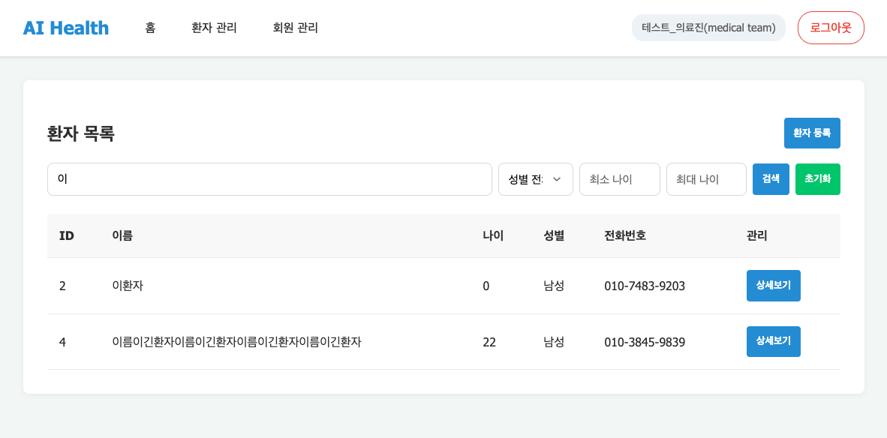
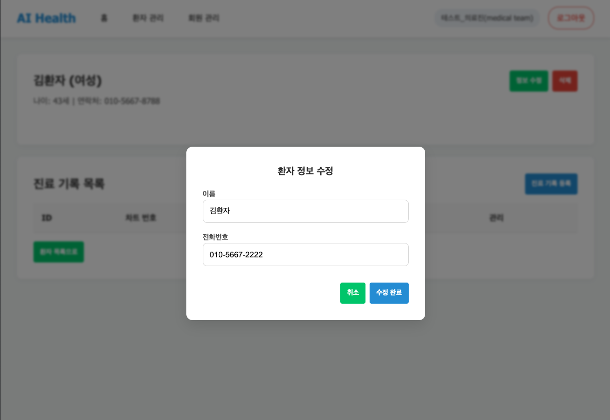
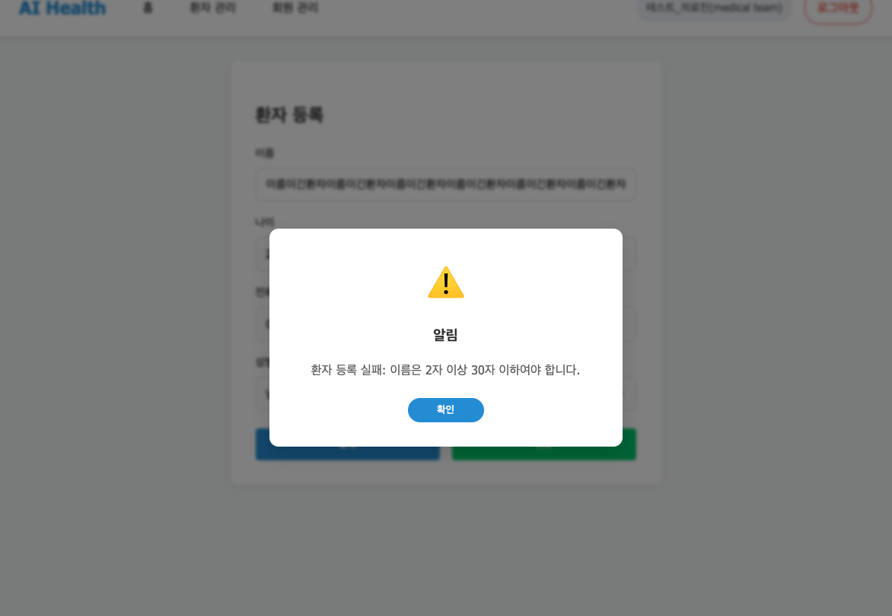
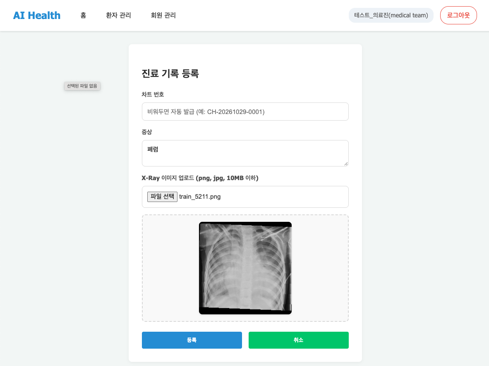
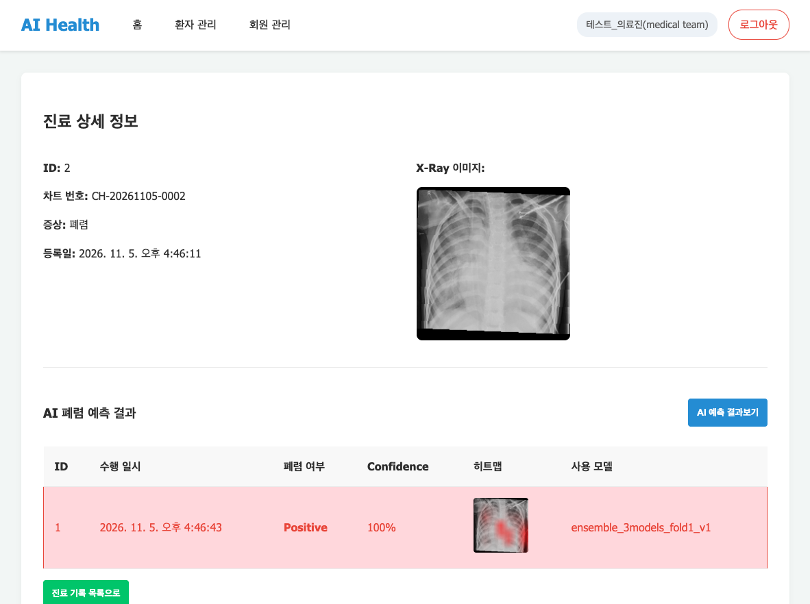

# 7️⃣ Docker를 통해 서버를 실행하고 테스트하기

## ▶️ 실행 (EC2 터미널)

```bash
cd ~/ai_project
docker compose up -d
docker ps -a
```

### 첫 실행 결과: fastapi unhealthy

```
 ✔ Image mysql:8.0                    Pulled
 ✔ Image elin115/oz-backoffice:latest Pulled
 ✔ Image nginx:stable-alpine          Pulled
 ✔ Container ai_project-mysql-1       Healthy
 ✘ Container ai_project-fastapi-1     Error dependency fastapi failed to start
 ✔ Container ai_project-nginx-1       Created
dependency failed to start: container ai_project-fastapi-1 is unhealthy
```

로그를 보니 **고장이 아니라 준비 시간이 부족했던 것**이었음.

```bash
docker logs --tail 40 ai_project-fastapi-1
```

```
INFO  [alembic.runtime.migration] Running upgrade  -> 79aafc5cfec9, create initial models
INFO  [alembic.runtime.migration] Running upgrade 79aafc5cfec9 -> 78d9440bd099, add soft delete and restrict fk delete
INFO  [alembic.runtime.migration] Running upgrade 78d9440bd099 -> a1c3e5f7b9d2, make heatmap_url nullable
INFO:     Uvicorn running on http://0.0.0.0:8000 (Press CTRL+C to quit)
[AI 모델] ensemble_3models_fold1_v1 불러오기 완료 (3개)
INFO:     127.0.0.1:43172 - "GET /healthcheck HTTP/1.1" 200 OK
```

| 순서 | 일어난 일 |
|---|---|
| 1 | fastapi가 켜지면서 빈 DB에 alembic 마이그레이션 3개 적용 (테이블 생성) |
| 2 | AI 모델 3개 불러오기 (t3.micro + 스왑이라 오래 걸림) |
| 3 | 그런데 healthcheck가 **5초 간격 × 3번(약 15초)** 만에 unhealthy로 판정 |
| 4 | compose는 fastapi가 실패했다고 보고 **nginx를 켜지 않고(Created) 멈춤** |
| 5 | 그 뒤 fastapi는 준비를 마치고 healthcheck `200 OK` → **healthy**가 됨 |

> 💡 식당에 비유하면, 주방(fastapi)은 준비 중이었는데 매니저(healthcheck)가 15초 만에 "실패"라고 판단해서 홀 직원(nginx)을 출근시키지 않은 상황

### 다시 실행

fastapi가 healthy가 된 뒤 다시 올리면 nginx도 켜짐.

```bash
docker compose up -d && docker ps -a
```

```
 ✔ Container ai_project-mysql-1   Healthy
 ✔ Container ai_project-fastapi-1 Healthy
 ✔ Container ai_project-nginx-1   Started

IMAGE                          STATUS                   PORTS
nginx:stable-alpine            Up                       0.0.0.0:80->80/tcp
elin115/oz-backoffice:latest   Up 3 minutes (healthy)   8000/tcp
mysql:8.0                      Up 3 minutes (healthy)   3306/tcp, 33060/tcp
```

- [x] nginx, fastapi, mysql 컨테이너 모두 Up
- [x] 외부로 열린 포트는 nginx의 **80번 하나**뿐 (fastapi 8000, mysql 3306은 컨테이너 안에서만)

### 메모리

```
               total        used        free      shared  buff/cache   available
Mem:           909Mi       735Mi        50Mi       1.9Mi       243Mi       174Mi
Swap:          4.0Gi       588Mi       3.4Gi
```

- RAM을 거의 다 쓰고 **스왑을 588Mi** 사용 중 → 4단계 스왑 설정이 없었으면 OOM으로 컨테이너가 강제 종료됐을 상황

## 🌐 외부 접속 확인 (맥에서)

```bash
curl -s -o /dev/null -w "%{http_code}\n" http://EC2_IP/
```

| 주소 | 결과 |
|---|---|
| `http://EC2_IP/` (홈) | **200** |
| `/docs` (Swagger) | **200** |
| `/healthcheck` | **200** |
| 응답 헤더 `Server` | `nginx` → nginx를 거쳐 fastapi로 가는 구조가 동작함 |
| DB 포트 3306 | **접속 안 됨** (보안 그룹·compose 모두 막음, 의도한 대로) |

- HTTP(80)는 보안 그룹에서 전체 허용이라 **팀원도 같은 주소로 접속 가능**
- SSH(22)는 내 IP만 허용이라 서버 관리는 나만 가능
- HTTPS는 설정하지 않아서 `http://`로 접속해야 함 → 테스트용 계정만 사용

## 🧪 배포 후 QA

[통합 테스트 시나리오](../day05_통합테스트_시나리오.md), [AI 예측 통합 테스트 시나리오](../day06_AI예측_통합테스트_시나리오.md)를 배포 주소에서 다시 실행함

> 💡 배포된 이미지는 **Day10(AI 워커 분리) 이전 버전**임. fastapi 안에서 AI 모델을 직접 불러오는 구조(fastapi + mysql + nginx)로, 과제 가이드의 구성과 같음

### 서버 상태 (2026-11-05)

```bash
cd ~/ai_project && docker compose up -d && docker ps -a
```

```
 ✔ Container ai_project-nginx-1   Running
 ✔ Container ai_project-fastapi-1 Healthy
 ✔ Container ai_project-mysql-1   Healthy

IMAGE                          STATUS                PORTS
elin115/oz-backoffice:latest   Up 2 days (healthy)   8000/tcp
nginx:stable-alpine            Up 2 days             0.0.0.0:80->80/tcp
mysql:8.0                      Up 2 days (healthy)   3306/tcp, 33060/tcp
```

- 11/02에 띄운 뒤 **2일 동안 재시작 없이** 정상 동작
- 첫 가입 계정은 승인 대기(`PENDING`)라 서버 DB에서 직접 `ADMIN`으로 바꾼 뒤, 이후 가입자는 화면의 회원 관리에서 승인함

```bash
docker compose exec mysql sh -c 'mysql -u"$MYSQL_USER" -p"$MYSQL_PASSWORD" "$MYSQL_DATABASE" -e "UPDATE users SET role=\"ADMIN\" WHERE email=\"가입한이메일\";"'
```

### 기능 테스트 (김지연)

| 기능 | 확인 내용 | 결과 |
|---|---|---|
| 회원가입·로그인 | 가입 완료 알림, 승인 후 로그인 | ✅ |
| 회원 관리 (관리자) | 회원 목록, 권한 변경(관리자·일반회원·승인대기), 부서 필터 | ✅ |
| 환자 등록 | 등록 성공, 이름 30자 초과 시 "이름은 2자 이상 30자 이하여야 합니다." | ✅ |
| 환자 목록·검색 | 이름 검색(`이`), 성별 필터(여성) | ✅ |
| 환자 수정·삭제 | 전화번호 수정, 환자 삭제 후 목록에서 사라짐 | ✅ |
| 진료기록 등록 | X-Ray 미리보기, 차트 번호 자동 발급(`CH-20261105-0001`) | ✅ |
| AI 예측 | "AI 예측이 완료되었습니다.", Positive 100%, 히트맵 표시, `ensemble_3models_fold1_v1` | ✅ |

| 회원가입 | 회원 관리 (관리자) |
|---|---|
|  |  |

| 환자 목록 | 환자 검색 |
|---|---|
|  |  |

| 환자 수정 | 환자 등록 검증 |
|---|---|
|  |  |

| 진료기록 등록 | AI 예측 결과 |
|---|---|
|  |  |

### 팀원 QA

| 팀원 | 회원 | 환자·진료기록 | AI 예측 | 비고 |
|---|---|---|---|---|
| 김지연 | ✅ | ✅ | ✅ | 위 기능 테스트 |
| 김도엽 | | | | |
| 박유정 | | | | |
| 이명석 | | | | |

- 서버가 작아서 AI 예측은 한 명씩 돌아가며 진행

## ⏭️ 남은 일

- [x] fastapi healthcheck에 `start_period: 120s` 추가 (`docker-compose.prod.yml`) → 재시작할 때 마이그레이션·모델 로딩 시간을 기다려 줌
- [x] 브라우저에서 회원가입 → 환자·진료기록 → AI 예측 확인, 캡처
- [ ] 팀원 QA

## 💡 배운 점

- **healthcheck는 "얼마나 기다려 줄지"까지 설정해야 함.** 로컬 맥에서는 금방 켜지던 앱도 작은 서버에서는 준비에 훨씬 오래 걸림
- `unhealthy`가 나오면 바로 고치기 전에 **`docker logs`부터** 확인. 이번처럼 실제로는 정상 동작 중일 수 있음
- 외부에서 접속 가능한 포트를 최소화하면(nginx 80만) 공격받을 수 있는 입구가 줄어듦
