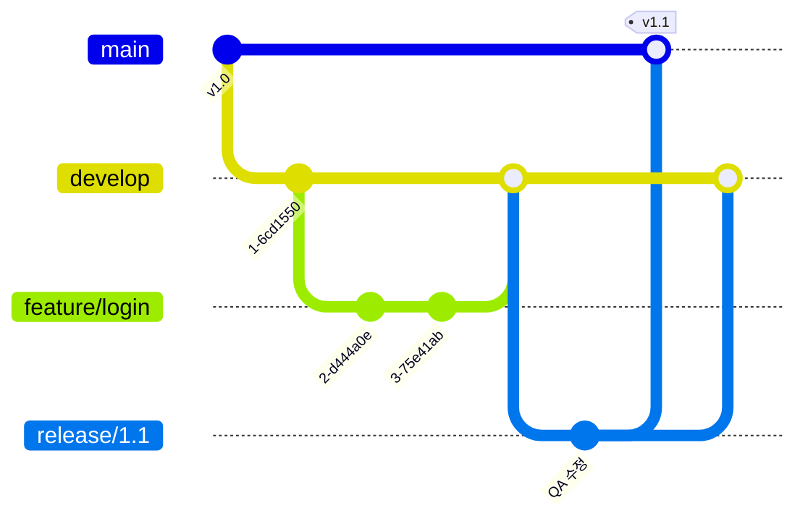
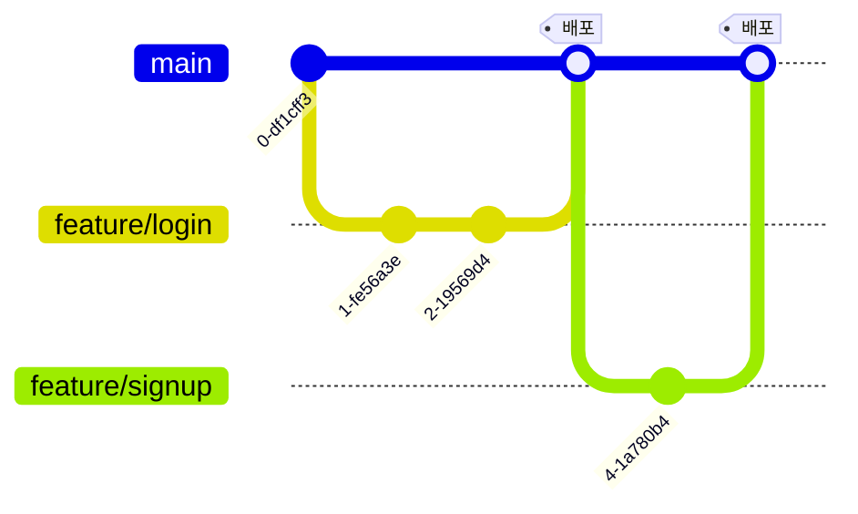
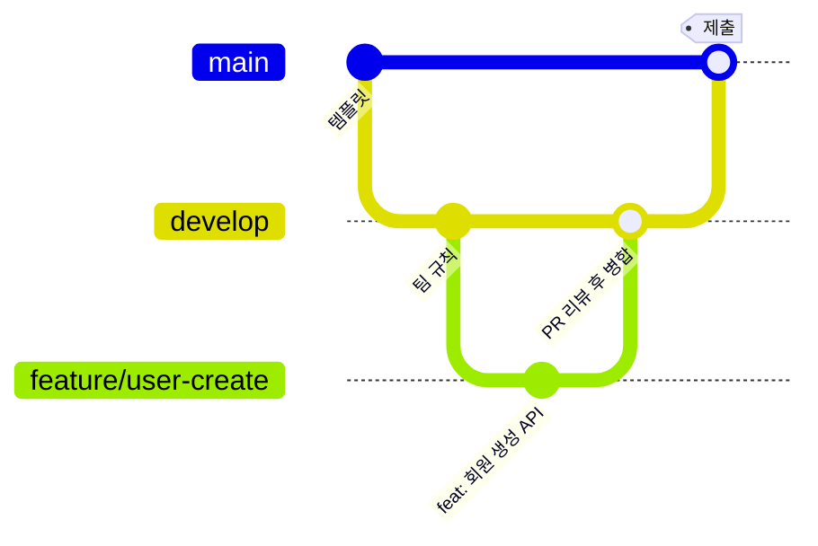

# 🌿 Day02 Git Branch 전략

## 1. 브랜치 전략이 필요한 이유

여러 명이 하나의 저장소에서 동시에 작업하면 서로의 코드를 덮어쓰거나 충돌이 나기 쉽다.
브랜치 전략은 **언제, 어디서 브랜치를 만들고, 어디로 병합할지**를 미리 정해두는 약속이다.
이를 통해 각자 독립적으로 작업하면서도 배포되는 코드의 안정성을 지킬 수 있다.

대표적인 전략으로 **Git Flow**와 **GitHub Flow**가 있다.

## 2. Git Flow

출시 버전, 개발 버전, 기능, 출시 준비, 긴급 수정을 각각 다른 브랜치로 나누어 관리하는 전략이다.

### 브랜치 종류

| 브랜치 | 역할 | 생성 위치 | 병합 대상 |
|---|---|---|---|
| `main` | 실제 배포(출시)된 코드 | - | - |
| `develop` | 다음 출시를 위해 개발 중인 코드 | `main` | `release` |
| `feature/*` | 기능 하나를 개발 | `develop` | `develop` |
| `release/*` | 출시 전 테스트와 버그 수정 | `develop` | `main`, `develop` |
| `hotfix/*` | 배포 후 발견된 긴급 버그 수정 | `main` | `main`, `develop` |

### 작업 흐름

1. `develop`에서 `feature` 브랜치를 만들어 기능을 개발
2. 개발이 끝나면 PR(Pull Request)과 리뷰를 거쳐 `develop`에 병합
3. 출시할 시점이 되면 `develop`에서 `release` 브랜치를 만들어 테스트하고 버그를 수정
4. 준비가 끝나면 `release`를 `main`에 병합해 출시하고, 수정 사항은 `develop`에도 반영
5. 출시 후 급한 버그가 생기면 `main`에서 `hotfix`를 만들어 고친 뒤 `main`과 `develop`에 병합

### 장단점

- **장점**: 개발 중인 코드와 배포된 코드가 분리되어 안정적이고, 버전 관리와 롤백이 체계적이다.
- **단점**: 브랜치 종류와 절차가 많아 복잡하고, 작은 팀이나 빠른 배포에는 부담이 될 수 있다.

## 3. GitHub Flow

`main` 브랜치 하나와 기능 개발용 브랜치만으로 운영하는 단순한 전략.

### 브랜치 종류

| 브랜치 | 역할 | 생성 위치 | 병합 대상 |
|---|---|---|---|
| `main` | 항상 배포 가능한 상태의 코드 | - | - |
| `feature/*` | 기능 개발, 버그 수정 등 모든 작업 | `main` | `main` |

### 작업 흐름

1. `main`에서 작업용 브랜치를 생성
2. 작업 후 커밋하고 원격 저장소에 push
3. Pull Request를 열어 팀원에게 리뷰 받기
4. 리뷰가 끝나면 `main`에 병합하고 배포

### 장단점

- **장점**: 구조가 단순해 배우기 쉽고, 빠르게 개발하고 자주 배포할 수 있다.
- **단점**: 별도의 검증 단계 없이 `main`에 바로 들어가므로, 리뷰와 테스트가 부족하면 배포 코드에 버그가 섞일 위험이 있다.

## 4. 두 전략 비교

| 구분 | Git Flow | GitHub Flow |
|---|---|---|
| 브랜치 수 | 많음 (5종) | 적음 (`main` + 작업 브랜치) |
| 기준 브랜치 | `develop` | `main` |
| 배포 방식 | `release`를 거쳐 단계적으로 배포 | `main` 병합 즉시 배포 |
| 복잡도 | 높음 | 낮음 |
| 적합한 상황 | 대규모 프로젝트, 정기적인 버전 출시 | 소규모 팀, 잦은 배포가 필요한 웹 서비스 |

## 5. 우리 팀의 선택: 간소화한 Git Flow

### 선택한 구조

| 브랜치 | 사용 방법 |
|---|---|
| `main` | 과제 제출, 최종 결과물만 병합 |
| `develop` | 개발 기간의 기준 브랜치, 모든 작업은 여기로 PR |
| `feature/기능명_YYMMDD` | 각자 기능 개발 (예: `feature/user-create_261022`) |
| `docs/내용_YYMMDD` | 문서 작업 (예: `docs/branch-strategy_261022`) |

### 선택 이유

1. **4명이 동시에 개발**하기 때문에, 각자의 작업을 `develop`에서 먼저 모아 확인한 뒤 `main`에 반영하는 단계가 필요하다.
2. **`main`을 제출용으로 깨끗하게 유지**할 수 있다. 작업 중인 코드가 섞여도 `main`은 영향을 받지 않는다.
3. 1일차부터 `main` / `develop` / `feature` 구조로 Ruleset(PR 필수, 승인 1명)을 적용해 운영하고 있어 그대로 이어가기 좋다.

### 생략한 것

- **`release`, `hotfix` 브랜치는 사용하지 않는다.**
  프로젝트 기간이 약 2주로 짧고, 실제 서비스를 운영하며 버전을 출시하지 않기 때문이다.
  출시 준비는 `develop → main` PR로, 긴급 수정은 일반 `feature` 브랜치로 대신한다.

### 우리 팀 작업 흐름

1. `develop`을 최신화한 뒤 `feature` 브랜치를 생성
2. 작업 후 Add & Commit → Push
3. `develop`으로 PR을 올리고 팀원 1명 이상의 승인을 받아 병합
4. 제출 시점에 `develop → main` PR로 최종 반영

## 📚 참고 자료

- [Git 브랜치 전략 - HEROPY](https://www.heropy.dev/p/6hdJi6)
- [Git Flow vs GitHub Flow - DEVOCEAN](https://devocean.sk.com/blog/techBoardDetail.do?ID=165571&boardType=techBlog)
- [Git Flow - velog](https://velog.io/@myoungji-kim/git-flow)
