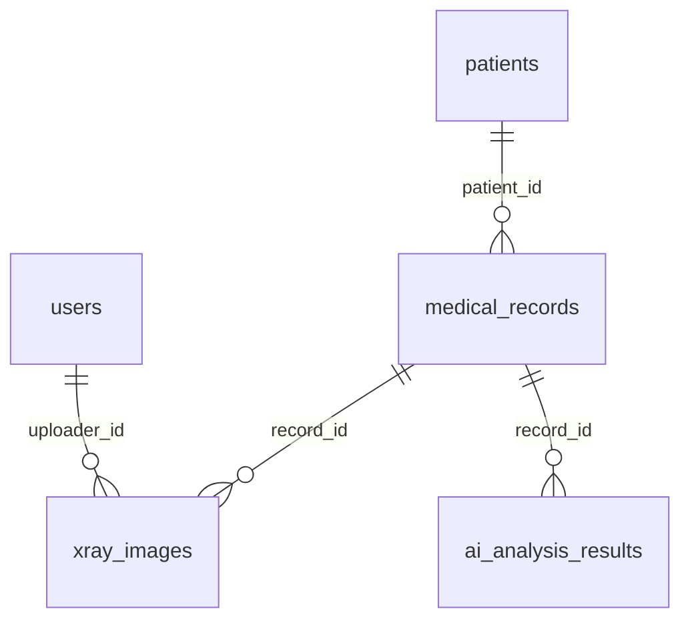
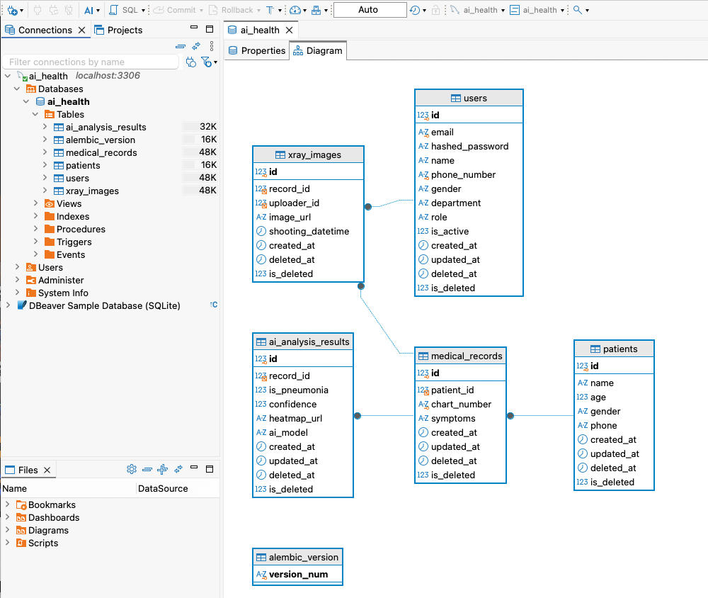
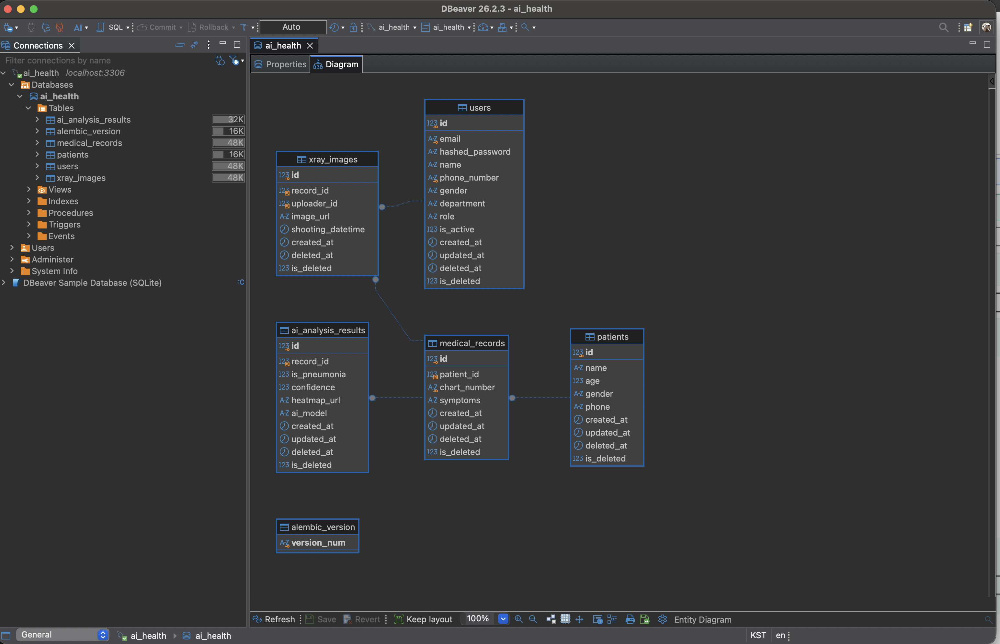
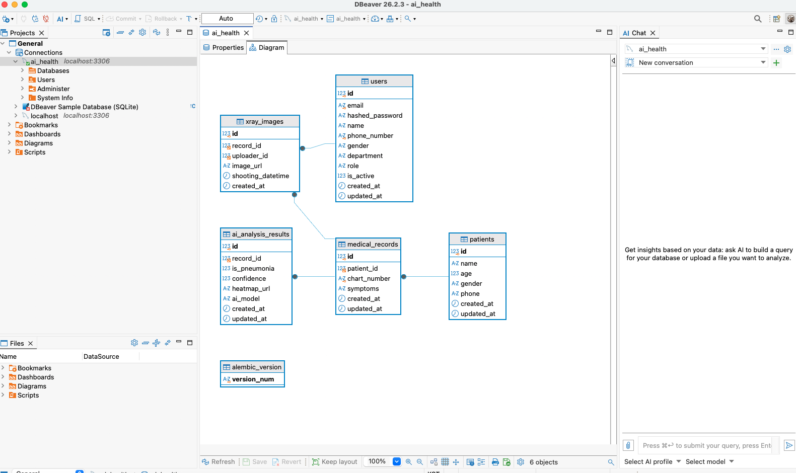
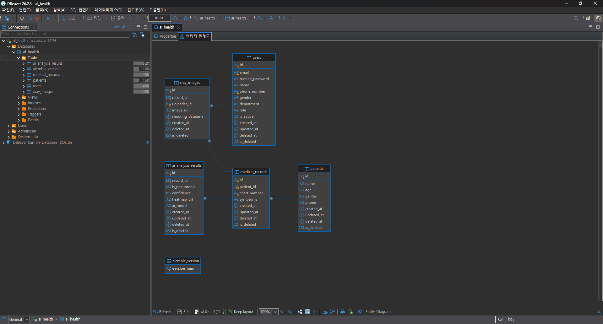

# 🗄️ Day03 DB 모델 작성과 마이그레이션

## 1. 사용한 환경

| 항목 | 내용 |
|---|---|
| Database | MySQL 8.0 (Docker 컨테이너) |
| ORM | SQLAlchemy 2.0 (비동기, `asyncmy` 드라이버) |
| 마이그레이션 | alembic |
| DB Viewer | DBeaver Community |

### MySQL을 Docker로 선택한 이유

- 템플릿의 `databases.py`가 `mysql+asyncmy`로, `docker-compose.yml`이 MySQL 8.0으로 이미 작성되어 있어 코드 수정 없이 쓸 수 있다.
- 팀원 4명이 같은 버전의 DB를 같은 방법으로 띄울 수 있다.
- 이후 Docker 배포 과제와 바로 이어진다.

## 2. 작성한 모델

| 테이블 | 파일 | 설명 |
|---|---|---|
| `users` | `app/models/users.py` | 백오피스 사용자 (의료진, 연구진, 개발자) |
| `patients` | `app/models/patients.py` | 환자 정보 |
| `medical_records` | `app/models/medical_records.py` | 환자별 진료 기록 |
| `xray_images` | `app/models/xray_images.py` | 진료 기록에 연결된 X-ray 이미지 |
| `ai_analysis_results` | `app/models/ai_analysis_results.py` | X-ray 폐렴 판독 결과 |

- Enum(`Gender`, `Department`, `UserRole`)은 `app/core/enums.py`에 작성했다.
- `created_at`, `updated_at`은 `TimestampMixin`을 상속해 추가했다. `xray_images`는 ERD에 `updated_at`이 없어 `created_at`만 직접 작성했다.
- 모든 모델은 `app/models/__init__.py`에 import해 alembic이 인식하도록 했다.

### 테이블 관계



| 관계 | 삭제 시 동작 |
|---|---|
| 환자 → 진료 기록 | 환자를 삭제하면 진료 기록도 삭제 (`CASCADE`) |
| 진료 기록 → X-ray, AI 결과 | 진료 기록을 삭제하면 함께 삭제 (`CASCADE`) |
| 사용자 → X-ray | 업로드한 이미지가 있는 사용자는 삭제 불가 (`RESTRICT`) |

## 3. 마이그레이션 과정

```bash
# 1. MySQL 컨테이너 실행
docker compose up -d mysql

# 2. .env 생성 (.env.example 복사)
cp .env.example .env

# 3. 마이그레이션 파일 생성
uv run alembic revision --autogenerate -m "create initial models"

# 4. DB에 적용
uv run alembic upgrade head
```

생성된 마이그레이션 파일: `alembic/versions/79aafc5cfec9_create_initial_models.py`

## 4. DB 적용 결과 (DBeaver)

`ai_health` DB에 테이블 5개와 alembic 버전 관리용 `alembic_version` 테이블이 생성되었다.



### 동작 확인

| 테스트 | 결과 |
|---|---|
| 5개 테이블에 샘플 데이터 저장 | 성공, `role` 기본값 `pending`, `is_active` 기본값 `True` |
| `confidence`에 150 저장 | 거부 (0~100 CheckConstraint) |
| 같은 `chart_number` 두 번 저장 | 거부 (unique) |
| 환자 삭제 | 진료 기록, X-ray, AI 결과까지 연쇄 삭제 |
| `alembic downgrade -1` → `upgrade head` | 정상 삭제 후 재생성 |

## 5. 트러블슈팅

### ERD의 FK 타입 불일치

- **문제**: ERD에서 `users.id`는 `integer`인데, 이를 참조하는 `xray_images.uploader_id`는 `bigint`이다.
- **원인**: MySQL은 외래키 양쪽 컬럼의 타입이 같아야 제약조건을 만들 수 있다.
- **해결**: `users.id`를 `BigInteger`로 맞췄다.

### created_at이 모두 같은 시간으로 저장되는 문제

- **문제**: 템플릿의 `TimestampMixin`이 `default=datetime.now(UTC)`로 작성되어 있었다.
- **원인**: 함수 호출 결과(값)를 넘겨서, 서버가 시작될 때 한 번만 계산된 시각이 모든 행에 들어간다.
- **해결**: `default=lambda: datetime.now(UTC)`처럼 함수를 넘겨 저장할 때마다 시각을 구하도록 수정했다.

### autogenerate가 CheckConstraint를 만들지 않음

- **문제**: 모델의 `confidence`에 `CheckConstraint`를 넣었지만, 생성된 마이그레이션 파일에는 없었다.
- **원인**: autogenerate는 컬럼 안에 넣은 체크 제약조건을 감지하지 못한다.
- **해결**: 마이그레이션 파일의 `create_table`에 `sa.CheckConstraint(...)`를 직접 추가했다. **autogenerate 결과는 반드시 직접 열어서 확인해야 한다.**

### downgrade 실행 시 오류

- **문제**: `alembic downgrade -1`에서 `DROP INDEX ix_xray_images_uploader_id` 오류가 발생했다.
- **원인**: MySQL은 외래키가 사용 중인 인덱스를 먼저 삭제할 수 없는데, autogenerate가 "인덱스 삭제 → 테이블 삭제" 순서로 만들었다.
- **해결**: `downgrade()`에서 `drop_index`를 지우고 `drop_table`만 남겼다. 테이블을 지우면 인덱스도 함께 삭제된다.

## 6. 팀원 적용 방법

```bash
git checkout develop
git pull origin develop
docker compose up -d mysql   # Docker Desktop 실행 후
cp .env.example .env         # .env가 없을 때만
uv sync
uv run alembic upgrade head
```

DBeaver 접속 정보: `localhost` / `3306` / DB `ai_health` / 사용자 `ozcoding` / 비밀번호 `pw1234`
(`Public Key Retrieval is not allowed` 오류가 나면 Driver properties에서 `allowPublicKeyRetrieval`을 `true`로 설정)

## 7. 팀원별 적용 확인

팀원 모두 각자 로컬에 MySQL을 띄우고 마이그레이션을 적용해 같은 스키마가 만들어지는 것을 확인했다.
캡처 파일은 `docs/images/day03_db_GitHub아이디.png`로 저장한다.

### 김지연 (@elin-115)


- 적용 중 겪은 문제: DBeaver 첫 실행 시 macOS 보안 확인 창이 숨어 있어 앱이 뜨지 않음 → 허용 후 정상 실행

### 박유정 (@RJ-Park)

<!--  -->

- 적용 중 겪은 문제:

### 김도엽 (@yeobbro)

<!--  -->

- 적용 중 겪은 문제:

### 이명석 (@fpemghs)

<!--  -->

- 적용 중 겪은 문제:
