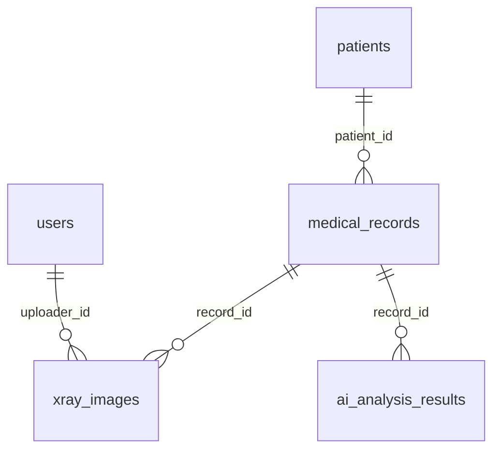

# 🗄️ Day03 DB 모델 작성과 마이그레이션

## 1. 사용한 환경

| 항목 | 내용 |
|---|---|
| Database | MySQL 8.0 (Docker 컨테이너) |
| ORM | SQLAlchemy 2.0 (비동기, `asyncmy` 드라이버) |
| 마이그레이션 | alembic |
| DB Viewer | DBeaver Community |

### MySQL을 Docker로 선택한 이유

- 템플릿의 `databases.py`가 `mysql+asyncmy`로, `docker-compose.yml`이 MySQL 8.0으로 이미 작성되어 있어 코드 수정 없이 쓸 수 있다.
- 팀원 4명이 같은 버전의 DB를 같은 방법으로 띄울 수 있다.
- 이후 Docker 배포 과제와 바로 이어진다.

## 2. 작성한 모델

| 테이블 | 파일 | 설명 |
|---|---|---|
| `users` | `app/models/users.py` | 백오피스 사용자 (의료진, 연구진, 개발자) |
| `patients` | `app/models/patients.py` | 환자 정보 |
| `medical_records` | `app/models/medical_records.py` | 환자별 진료 기록 |
| `xray_images` | `app/models/xray_images.py` | 진료 기록에 연결된 X-ray 이미지 |
| `ai_analysis_results` | `app/models/ai_analysis_results.py` | X-ray 폐렴 판독 결과 |

- Enum(`Gender`, `Department`, `UserRole`)은 `app/core/enums.py`에 작성했다.
- `created_at`, `updated_at`은 `TimestampMixin`을 상속해 추가했다. `xray_images`는 ERD에 `updated_at`이 없어 `created_at`만 직접 작성했다.
- 모든 테이블에 `SoftDeleteMixin`(`is_deleted`, `deleted_at`)을 추가했다. (ERD에 없는 컬럼, 아래 삭제 정책 참고)
- 모든 모델은 `app/models/__init__.py`에 import해 alembic이 인식하도록 했다.

### 테이블 관계



### 삭제 정책: 삭제 표시 (Soft Delete)

의료 기록은 함부로 사라지면 안 되므로, 데이터를 실제로 지우지 않고 **삭제 표시만** 한다.

- 삭제할 때: `is_deleted = True`, `deleted_at = 삭제 시각`으로 변경
- 조회할 때: `is_deleted = False`인 데이터만 보여줌
- 실제 삭제(`DELETE`)는 DB 단에서 막아둔다.

| 관계 | 실제 삭제(DELETE) 시 동작 |
|---|---|
| 환자 → 진료 기록 | 진료 기록이 있는 환자는 삭제 불가 (`RESTRICT`) |
| 진료 기록 → X-ray, AI 결과 | X-ray·AI 결과가 있는 진료 기록은 삭제 불가 (`RESTRICT`) |
| 사용자 → X-ray | 업로드한 이미지가 있는 사용자는 삭제 불가 (`RESTRICT`) |

> 처음에는 환자를 지우면 진료 기록까지 함께 지워지는 `CASCADE`로 작성했지만,
> 팀 논의 후 기록을 보존하는 삭제 표시 방식으로 변경했다. (두 번째 마이그레이션)

## 3. 마이그레이션 과정

```bash
# 1. MySQL 컨테이너 실행
docker compose up -d mysql

# 2. .env 생성 (.env.example 복사)
cp .env.example .env

# 3. 마이그레이션 파일 생성
uv run alembic revision --autogenerate -m "create initial models"

# 4. DB에 적용
uv run alembic upgrade head
```

생성된 마이그레이션 파일

| 순서 | 파일 | 내용 |
|---|---|---|
| 1 | `79aafc5cfec9_create_initial_models.py` | 테이블 5개 생성 |
| 2 | `78d9440bd099_add_soft_delete_and_restrict_fk_delete.py` | 삭제 표시 컬럼 추가, FK 삭제 동작을 `RESTRICT`로 변경 |

이미 반영된 1번 파일은 고치지 않고 2번 파일을 새로 추가했다. 1번을 이미 적용한 팀원도 `upgrade head`만 하면 2번까지 적용된다.

## 4. DB 적용 결과 (DBeaver)

`ai_health` DB에 테이블 5개와 alembic 버전 관리용 `alembic_version` 테이블이 생성되었다.
두 번째 마이그레이션까지 적용해 모든 테이블에 삭제 표시 컬럼(`is_deleted`, `deleted_at`)이 추가된 상태다.


### 동작 확인

| 테스트 | 결과 |
|---|---|
| 5개 테이블에 샘플 데이터 저장 | 성공, `role` 기본값 `pending`, `is_active` 기본값 `True` |
| `confidence`에 150 저장 | 거부 (0~100 CheckConstraint) |
| 같은 `chart_number` 두 번 저장 | 거부 (unique) |
| 새 데이터의 `is_deleted` | 기본값 `False` |
| 진료 기록이 있는 환자 실제 삭제(`DELETE`) | 거부 (`RESTRICT`) |
| 환자 삭제 표시 | 조회 대상에서 빠지고, 환자·진료 기록은 DB에 보관됨 |
| `alembic downgrade -1` → `upgrade head` | 두 마이그레이션 모두 정상 되돌리기 후 재적용 |

## 5. 트러블슈팅

### ERD의 FK 타입 불일치

- **문제**: ERD에서 `users.id`는 `integer`인데, 이를 참조하는 `xray_images.uploader_id`는 `bigint`이다.
- **원인**: MySQL은 외래키 양쪽 컬럼의 타입이 같아야 제약조건을 만들 수 있다.
- **해결**: `users.id`를 `BigInteger`로 맞췄다.

### created_at이 모두 같은 시간으로 저장되는 문제

- **문제**: 템플릿의 `TimestampMixin`이 `default=datetime.now(UTC)`로 작성되어 있었다.
- **원인**: 함수 호출 결과(값)를 넘겨서, 서버가 시작될 때 한 번만 계산된 시각이 모든 행에 들어간다.
- **해결**: `default=lambda: datetime.now(UTC)`처럼 함수를 넘겨 저장할 때마다 시각을 구하도록 수정했다.

### autogenerate가 CheckConstraint를 만들지 않음

- **문제**: 모델의 `confidence`에 `CheckConstraint`를 넣었지만, 생성된 마이그레이션 파일에는 없었다.
- **원인**: autogenerate는 컬럼 안에 넣은 체크 제약조건을 감지하지 못한다.
- **해결**: 마이그레이션 파일의 `create_table`에 `sa.CheckConstraint(...)`를 직접 추가했다. **autogenerate 결과는 반드시 직접 열어서 확인해야 한다.**

### downgrade 실행 시 오류

- **문제**: `alembic downgrade -1`에서 `DROP INDEX ix_xray_images_uploader_id` 오류가 발생했다.
- **원인**: MySQL은 외래키가 사용 중인 인덱스를 먼저 삭제할 수 없는데, autogenerate가 "인덱스 삭제 → 테이블 삭제" 순서로 만들었다.
- **해결**: `downgrade()`에서 `drop_index`를 지우고 `drop_table`만 남겼다. 테이블을 지우면 인덱스도 함께 삭제된다.

### 외래키를 바꾸는 마이그레이션의 downgrade 오류

- **문제**: FK 삭제 동작을 바꾸는 마이그레이션을 autogenerate로 만들자 `create_foreign_key(None, ...)`, `drop_constraint(None, ...)`처럼 이름이 비어 있었다.
- **원인**: 모델에 FK 이름을 지정하지 않아 autogenerate가 새 FK 이름을 모른다. 이름이 없으면 downgrade에서 어떤 FK를 지울지 지정할 수 없다.
- **해결**: MySQL이 자동으로 붙이는 이름(`테이블_ibfk_1`)을 직접 지정했다. upgrade → downgrade → upgrade를 실행해 확인했다.

## 6. 팀원 적용 방법

```bash
git checkout develop
git pull origin develop
docker compose up -d mysql   # Docker Desktop 실행 후
cp .env.example .env         # .env가 없을 때만
uv sync
uv run alembic upgrade head
```

DBeaver 접속 정보: `localhost` / `3306` / DB `ai_health` / 사용자 `ozcoding` / 비밀번호 `pw1234`
(`Public Key Retrieval is not allowed` 오류가 나면 Driver properties에서 `allowPublicKeyRetrieval`을 `true`로 설정)

## 7. 팀원별 적용 확인

팀원 모두 각자 로컬에 MySQL을 띄우고 마이그레이션을 적용해 같은 스키마가 만들어지는 것을 확인했다.  
캡처 파일은 `docs/images/day03_db_GitHub아이디.png`로 저장한다.

### 김지연 (@elin-115)


- 적용 중 겪은 문제: DBeaver 첫 실행 시 macOS 보안 확인 창이 숨어 있어 앱이 뜨지 않음 → 허용 후 정상 실행

### 박유정 (@RJ-Park)


- 적용 중 겪은 문제:
  - 터미널에서 docker 명령을 찾지 못함 → Docker Desktop을 실행해 Engine running을 확인하고, 터미널을 새로 열어 해결
  - DBeaver 연결 후 화면이 비어 보임 → 왼쪽 Connections 패널이 닫혀 있었음. Window → Connections로 다시 열어 해결

### 김도엽 (@yeobbro)


- 적용 중 겪은 문제: 최초에는 Python 3.14 환경에서 asyncmy 빌드가 실패했고, Python 3.13 환경으로 다시 설정한 뒤에는 MySQL 서버가 실행되지 않아 localhost:3306 연결 오류가 발생했다.
해결 방법: 프로젝트의 .env.example을 기반으로 .env를 생성하고 docker compose up -d mysql로 MySQL 컨테이너를 실행했다. 이후 uv run alembic upgrade head를 실행해 초기 마이그레이션을 성공적으로 적용했다.

### 이명석 (@fpemghs)


- 적용 중 겪은 문제: 최초 SQLAlchemy연결로 마이그레이션에 대해 배우고 이를 활용하기 위해 docker와 DBeaver를 처음 사용하다 보니 연결및 실행에 어려움이 있엇고 특히 DBeaver 사용시 데이터 베이스에 자동으로 연결되지 않아 연결과정에 어려움이 있엇으나, 팀원들의 도움으로 무사히 연결하여 데이터베이스 마이그레이션 상태를 확인할 수 있었다. 
