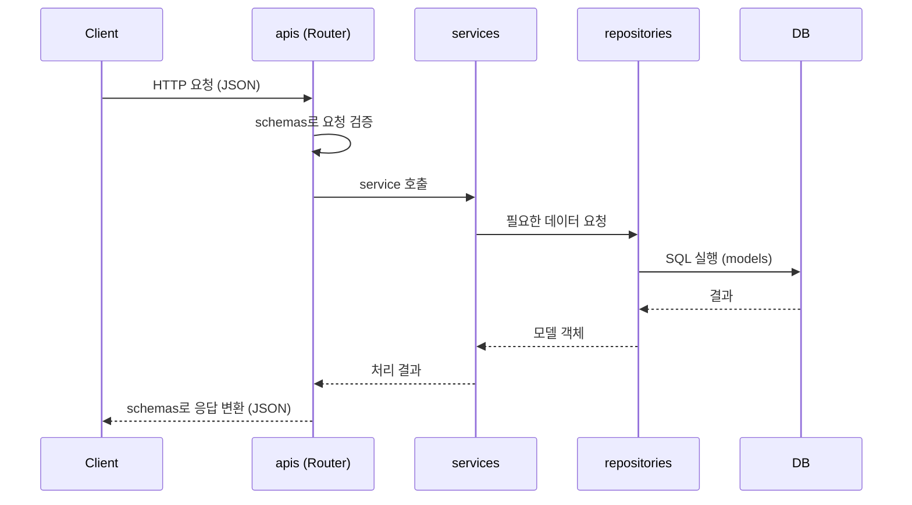

# 🔍 Day03 프로젝트 뜯어보기

## 0. 전체 구조 한눈에 보기

```
Oz_codingSchool
├── alembic/                 # DB 마이그레이션 (스키마 변경 이력)
├── alembic.ini              # alembic 설정
├── app/
│   ├── core/                # 설정, DB 연결 등 공통 모듈
│   │   ├── config.py
│   │   └── db/
│   │       ├── databases.py # DB 엔진, 세션, Base
│   │       └── models.py    # 공통 컬럼 Mixin
│   ├── apis/                # 라우터 (엔드포인트)
│   ├── schemas/             # 요청·응답 형식 (Pydantic)
│   ├── services/            # 비즈니스 로직
│   ├── repositories/        # DB 조회·저장 (CRUD)
│   ├── models/              # DB 테이블 (SQLAlchemy ORM)
│   ├── main.py              # FastAPI 앱 시작점
│   └── Dockerfile
├── static/, media/          # 프론트 파일, 업로드 파일
├── docker-compose.yml       # FastAPI + MySQL 컨테이너 실행
├── .env                     # DB 접속 정보 (직접 생성, 커밋 금지)
├── pyproject.toml
└── uv.lock
```

이 템플릿은 역할별로 계층을 나누는 **레이어드 아키텍처**를 따른다.
요청은 `apis → services → repositories → models(DB)` 순서로 내려가고, 결과는 거꾸로 올라온다.
계층을 나누면 한 계층을 고쳐도 다른 계층에 주는 영향이 적고, 여러 명이 동시에 작업하기 쉽다.

## 1. 디렉터리별 역할

| 디렉터리 | 역할 | 작성할 내용 |
|---|---|---|
| `app/core/` | 프로젝트 전체에서 쓰는 공통 모듈 | 환경 설정(`config.py`), DB 연결(`db/databases.py`), 공통 컬럼(`db/models.py`), Enum 같은 공통 상수 |
| `app/models/` | DB 테이블과 1:1로 대응하는 **SQLAlchemy ORM 모델** | 테이블별 파일(`users.py`, `patients.py` 등), 컬럼 타입·제약조건, FK와 `relationship` |
| `app/repositories/` | DB에 직접 접근하는 계층 | 모델을 이용한 조회·생성·수정·삭제 함수 (`select`, `add`, `commit` 등) |
| `app/schemas/` | API의 요청·응답 형식을 정의하는 **Pydantic 모델** | `UserCreateRequest`, `UserResponse` 같은 클래스와 입력값 검증 규칙 |
| `app/services/` | **비즈니스 로직** | 이메일 중복 확인, 비밀번호 해싱, 권한 확인처럼 "규칙"에 해당하는 코드. repository를 호출해 결과를 조합 |
| `app/apis/` | 클라이언트 요청을 받는 **라우터** | `APIRouter`, 엔드포인트(경로·메서드·상태코드), service 호출 |

### models와 schemas의 차이

| | models | schemas |
|---|---|---|
| 라이브러리 | SQLAlchemy | Pydantic |
| 대상 | DB 테이블 | API 입출력 데이터 |
| 예시 | `users` 테이블에 `hashed_password` 컬럼이 있음 | 응답 스키마에는 비밀번호를 넣지 않음 |

같은 "회원"이라도 DB에 저장하는 모양과 API로 주고받는 모양이 다르기 때문에 둘을 나눈다.

### services와 repositories를 나누는 이유

- **repository**: "DB에서 어떻게 꺼내고 넣는가"만 담당한다.
- **service**: "무엇을 해야 하는가"(규칙)를 담당한다.
- 예를 들어 DB를 MySQL에서 다른 DB로 바꿔도 repository만 고치면 되고, service와 api는 그대로 쓸 수 있다.

## 2. 파일별 역할

| 파일 | 역할 |
|---|---|
| `app/main.py` | FastAPI 앱 객체(`app`)를 만드는 시작점. 라우터 등록(`include_router`), `static`·`media` 폴더 마운트, 헬스체크(`/healthcheck`), 프론트 페이지(`index.html`) 반환을 담당한다. |
| `app/core/config.py` | `pydantic-settings`의 `BaseSettings`로 DB 접속 정보 같은 **환경 설정**을 관리한다. `.env` 파일을 읽어 값을 채우고, 없으면 기본값을 쓴다. 코드에 비밀번호를 직접 쓰지 않기 위함이다. |
| `pyproject.toml` | 프로젝트 이름, 파이썬 버전(3.13 이상), **필요한 패키지 목록**(FastAPI, SQLAlchemy, alembic, asyncmy 등)을 적은 설정 파일. pip의 `requirements.txt` 역할을 한다. |
| `uv.lock` | `pyproject.toml`의 패키지가 실제로 **어떤 버전으로 설치되는지** 정확히 기록한 파일. `uv sync`를 하면 팀원 모두 같은 버전이 설치된다. 직접 수정하지 않고 `uv add`로 패키지를 추가하면 자동으로 갱신된다. |

### main.py에서 주의할 점

`main.py` 맨 아래의 `catch_all` 라우트는 **모든 경로**를 받아 `index.html`을 돌려준다.
그래서 API 라우터는 반드시 `catch_all`보다 **위에서** `include_router`로 등록해야 한다.
아래에 등록하면 API 요청이 전부 `catch_all`로 빠진다.

## 3. 데이터베이스 연결 설정 (`app/core/db/databases.py`)

```python
DATABASE_PREFIX = "mysql+asyncmy://"
DATABASE_URI = f"{settings.DB_USER}:{settings.DB_PASSWORD}@{settings.DB_HOST}:{settings.DB_PORT}/{settings.DB_NAME}"
DATABASE_URL = f"{DATABASE_PREFIX}{DATABASE_URI}"

async_engine = create_async_engine(DATABASE_URL, echo=False, future=True)
AsyncSessionLocal = async_sessionmaker(bind=async_engine, autoflush=False, expire_on_commit=False)
Base = declarative_base()

async def async_get_db() -> AsyncGenerator[AsyncSession, None]:
    async with AsyncSessionLocal() as db:
        yield db
```

| 구성 요소 | 역할 |
|---|---|
| `DATABASE_URL` | DB 접속 주소. `mysql+asyncmy`는 **MySQL을 비동기 드라이버(asyncmy)로** 연결한다는 뜻이다. 접속 정보는 `config.py`(`.env`)에서 가져온다. |
| `async_engine` | DB와 실제로 연결을 맺고 관리하는 엔진. `async`라서 DB 응답을 기다리는 동안 다른 요청을 처리할 수 있다. |
| `AsyncSessionLocal` | 세션(DB 작업 단위)을 찍어내는 공장. `expire_on_commit=False`는 commit 후에도 객체 값을 다시 조회하지 않고 쓸 수 있게 한다. |
| `Base` | 모든 모델이 상속하는 부모 클래스. 모델 정보가 `Base.metadata`에 모이고, alembic이 이것을 보고 테이블을 만든다. |
| `async_get_db()` | 요청마다 세션을 하나 열어주고, 요청이 끝나면 자동으로 닫는 함수. 라우터에서 `Depends(async_get_db)`로 주입받아 쓴다. |

### `.env` 파일

`config.py`는 프로젝트 루트의 `.env`를 읽는다. `.env.example`을 복사해서 만들고, **`.gitignore`에 있어 커밋되지 않는다.**

```
DB_HOST=localhost
DB_PORT=3306
DB_USER=ozcoding
DB_PASSWORD=pw1234
DB_ROOT_PASSWORD=Password123@!
DB_NAME=ai_health
```

### 공통 컬럼 Mixin (`app/core/db/models.py`)

여러 테이블에 반복되는 컬럼을 Mixin으로 미리 만들어두고, 모델에서 상속만 하면 된다.

| Mixin | 추가되는 컬럼 |
|---|---|
| `UUIDMixin` | `uuid` (UUID7 기본키) |
| `TimestampMixin` | `created_at`, `updated_at` |
| `SoftDeleteMixin` | `deleted_at`, `is_deleted` (실제로 지우지 않고 삭제 표시만) |

## 4. SQLAlchemy 모델 작성과 alembic 마이그레이션

### 4-1. 모델 작성

```python
# app/models/users.py
from sqlalchemy import BigInteger, String
from sqlalchemy.orm import Mapped, mapped_column

from app.core.db.databases import Base
from app.core.db.models import TimestampMixin


class User(Base, TimestampMixin):
    __tablename__ = "users"

    id: Mapped[int] = mapped_column(BigInteger, primary_key=True)
    email: Mapped[str] = mapped_column(String(255), unique=True)
    name: Mapped[str] = mapped_column(String(30))
```

- `Base`를 상속하면 테이블로 인식된다.
- `Mapped[타입]`과 `mapped_column()`으로 컬럼을 정의한다 (SQLAlchemy 2.0 방식).
- 다른 테이블을 참조할 때는 `ForeignKey("테이블.컬럼")`, 객체로 오갈 때는 `relationship()`을 쓴다.

### 4-2. 모델 등록 (중요!)

`alembic/env.py`는 `from app import models`로 모델을 불러온다.
그래서 **`app/models/__init__.py`에 모든 모델을 import**해야 alembic이 테이블을 인식한다.

```python
# app/models/__init__.py
from .users import User
from .patients import Patient
```

빠뜨리면 `--autogenerate`를 해도 그 테이블은 마이그레이션 파일에 생기지 않는다.

### 4-3. 마이그레이션 실행

alembic은 DB 스키마 변경을 **git처럼 버전으로 관리**하는 도구다.

| 순서 | 명령어 | 설명 |
|---|---|---|
| 1 | (DB 실행) | MySQL이 켜져 있어야 한다. 예: `docker compose up -d mysql` |
| 2 | `uv run alembic revision --autogenerate -m "create initial models"` | 모델과 DB를 비교해 변경 내용을 담은 파일을 `alembic/versions/`에 생성 |
| 3 | 생성된 파일 확인 | `upgrade()`, `downgrade()` 내용이 의도대로인지 확인 |
| 4 | `uv run alembic upgrade head` | 최신 버전까지 DB에 반영 (테이블 생성) |
| - | `uv run alembic downgrade -1` | 한 단계 되돌리기 |
| - | `uv run alembic current` / `history` | 현재 버전 / 변경 이력 확인 |

- `alembic.ini`의 DB 주소는 비워두고, `env.py`에서 `DATABASE_URL`로 덮어쓴다. 그래서 `.env`만 맞추면 된다.
- `Base.metadata.create_all()`로 테이블을 직접 만들지 않는다. alembic과 섞으면 버전 기록이 어긋난다.
- 생성된 마이그레이션 파일은 **커밋해서 팀원과 공유**한다. 팀원은 `upgrade head`만 하면 같은 스키마가 된다.

## 5. API 구현 흐름

### 요청이 처리되는 순서



### 새 API를 만들 때 작성 순서

1. **models**: 필요한 테이블이 없으면 모델 작성 → alembic 마이그레이션
2. **schemas**: 요청(`~Request`)·응답(`~Response`) Pydantic 클래스 작성
3. **repositories**: DB 조회·저장 함수 작성
4. **services**: 검증·중복 확인 같은 비즈니스 로직 작성, repository 호출
5. **apis**: 라우터에 엔드포인트 작성, service 호출
6. **main.py**: 새 라우터라면 `include_router`로 등록 (`catch_all`보다 위)
7. Swagger(`/docs`)에서 테스트

### Day02 실습과 비교

| | Day02 (`practice_apis.py`) | 앞으로 (계층 구조) |
|---|---|---|
| 데이터 | 파이썬 리스트(`user_list`) | MySQL DB |
| 코드 위치 | 한 파일에 스키마·로직·라우터 모두 | schemas / services / repositories / apis로 분리 |
| 서버 재시작 시 | 데이터 초기화 | 데이터 유지 |

Day02에서는 한 파일에 다 넣었지만, 실제 프로젝트에서는 위처럼 계층을 나누어 작성한다.

## 6. 팀원별 학습 정리

각자 맡은 섹션을 직접 코드와 비교해보고, 이해한 점과 궁금한 점을 정리했다.

### 김지연 - 3. 데이터베이스 연결 설정

- **이해한 점**:
- **궁금한 점**:

### 박유정 - 1. 디렉터리별 역할

- **이해한 점**:
- **궁금한 점**:

### 김도엽 - 2. 파일별 역할

- **이해한 점**:
  - `main.py`는 FastAPI 애플리케이션의 진입점이며, 라우터 등록과 정적 파일 제공을 담당한다.
  - `config.py`는 `.env`의 환경변수를 읽어 DB 접속 정보를 관리한다.
  - `pyproject.toml`은 프로젝트의 Python 버전 조건과 의존성을 선언하고, `uv.lock`은 구체적인 패키지 버전을 기록해 팀원 간 개발 환경 차이를 줄인다.
  - 실제 환경을 설정하면서 Python 버전과 패키지 호환성이 개발 환경 구성에 영향을 줄 수 있다는 점을 배웠다.

- **궁금한 점**:
  - `pyproject.toml`에서 Python 3.13 이상을 허용하고 있는데, 로컬에서 Python 3.14로 설치할 때 `asyncmy` 빌드 오류가 발생했다. 팀원들의 환경을 동일하게 유지하기 위해 Python 버전을 프로젝트에서 명시적으로 고정하는 것이 좋을까?

### 이명석 - 4. 모델 작성과 alembic 마이그레이션

- **이해한 점**:
- **궁금한 점**:

## 📚 참고 자료

- [FastAPI 프로젝트 구조 - DEVOCEAN](https://devocean.sk.com/blog/techBoardDetail.do?ID=166993&boardType=techBlog)
- [FastAPI 프로젝트 구조 - brotherdan](https://brotherdan.tistory.com/40)
- [Structuring a FastAPI Project - DEV](https://dev.to/mohammad222pr/structuring-a-fastapi-project-best-practices-53l6)
- [SQL 데이터베이스 - FastAPI 공식 튜토리얼(한국어)](https://www.joonas.io/fastapi/ko/tutorial/sql-databases/)
- [Alembic - WikiDocs](https://wikidocs.net/175967#_2)
- [Alembic 마이그레이션 - devspoon](https://devspoon.tistory.com/304)
- [Alembic 사용법 - metamong](https://metamong-data.tistory.com/56)
