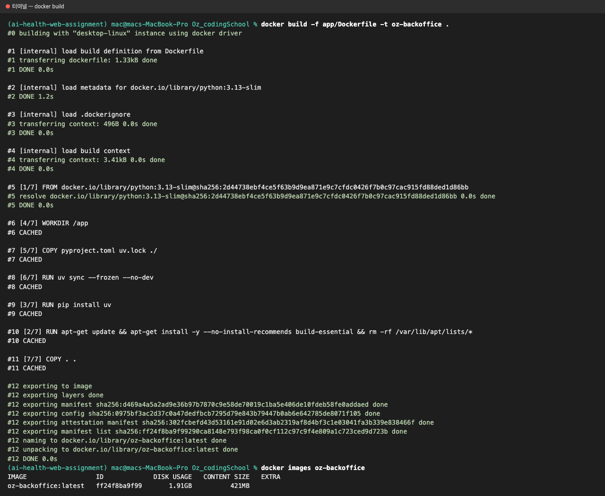
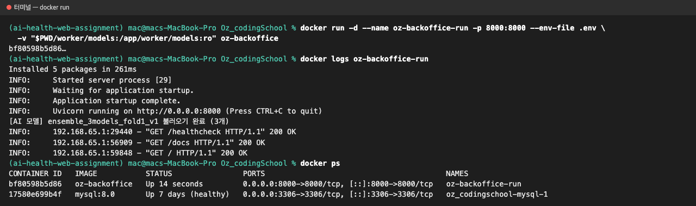
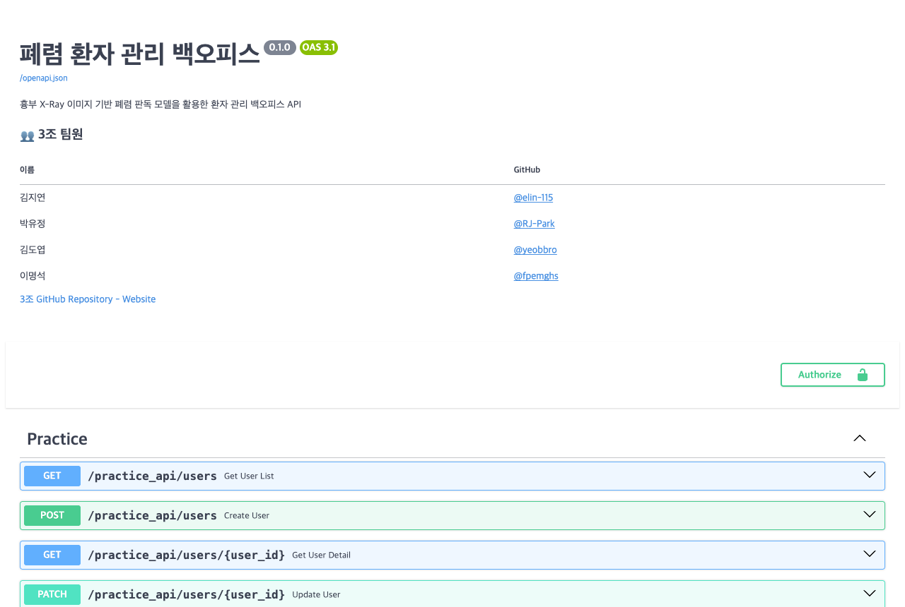
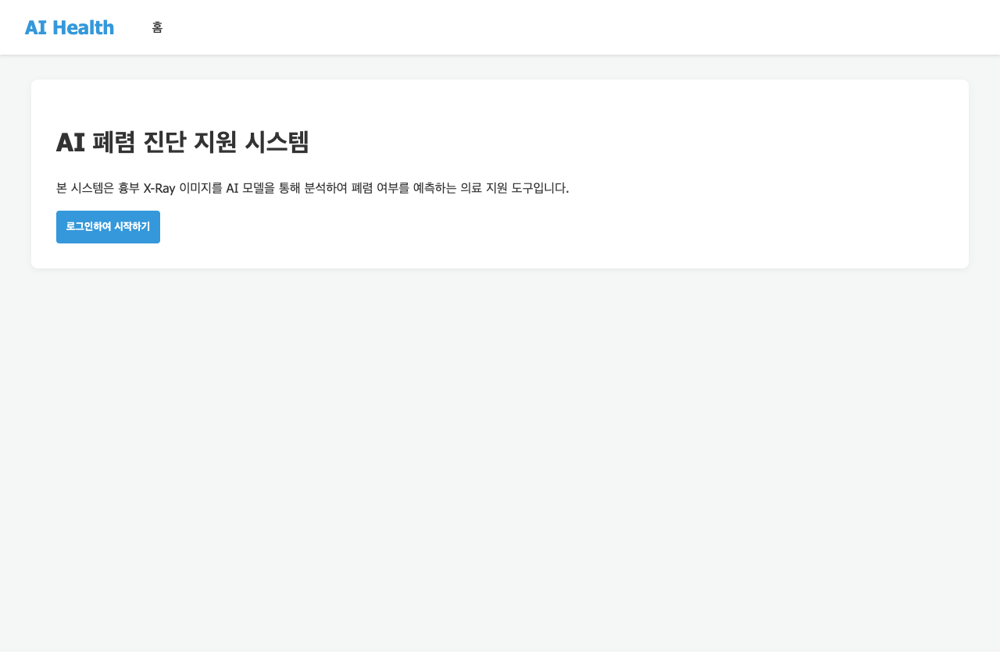

# 🐳 8일차 도커 실행 화면

- 날짜: 2026-10-30
- 기준 브랜치: `develop`
- 범위: 과제 1(Dockerfile, .dockerignore) + 과제 2(docker-compose.yml)
- 진행: 선행 작업(Dockerfile, torch CPU 전용)을 먼저 머지하고, 파일별 담당자가 이어서 작성 → 빌드·실행 화면을 캡처해 문서로 정리

| 파일 | 담당 | PR |
|---|---|---|
| `app/Dockerfile` | 김지연 | #61 |
| `pyproject.toml`, `uv.lock` (torch CPU 전용) | 김지연 | #62 |
| `.dockerignore` (루트) | 박유정 | #64 |
| `docker-compose.yml` - fastapi 서비스, Dockerfile 실행 명령 | 이명석 | #63 |
| `docker-compose.yml` - mysql 서비스 + 연결 | 김도엽 | <!-- TODO --> |

## 🐳 과제 1. Dockerfile + .dockerignore

### Dockerfile (`app/Dockerfile`)

| 순서 | 명령 | 하는 일 |
|---|---|---|
| 1 | `FROM python:3.13-slim` | Python 3.13이 깔린 가벼운 리눅스에서 시작 (`requires-python >= 3.13`) |
| 2 | `RUN apt-get ... build-essential` | `asyncmy` 컴파일용 gcc 설치 (slim 이미지엔 없음) |
| 3 | `RUN pip install uv` | 팀이 쓰는 패키지 관리 도구 설치 |
| 4 | `WORKDIR /app` | 컨테이너 안 작업 폴더 |
| 5 | `COPY pyproject.toml uv.lock ./` → `RUN uv sync --frozen --no-dev` | 의존성 먼저 설치. 코드만 바뀌면 이 단계는 캐시 사용 |
| 6 | `COPY . .` | 나머지 코드 복사 |
| 7 | `EXPOSE 8000` | 8000번 포트 사용 표시 |
| 8 | `CMD ["uv", "run", "uvicorn", "app.main:app", "--host", "0.0.0.0", "--port", "8000"]` | 컨테이너 켤 때 앱 실행. `0.0.0.0`이어야 컨테이너 밖에서 접속 가능. 처음엔 `fastapi run`(#61), compose와 맞추려고 `uvicorn`으로 바꿈(#63) |

- 빌드 context는 프로젝트 루트(`.`): 앱이 `app/`뿐 아니라 `worker/`(AI 모델), `static/`(프론트)도 사용함
- `.env`는 이미지에 넣지 않고 실행할 때 `--env-file`로만 전달

### .dockerignore (루트)

- 과제 문구는 `app/.dockerignore`지만, 빌드 context가 루트라서 루트에 둠 (`app/` 안에 두면 읽히지 않음)

| 제외 대상 | 이유 |
|---|---|
| `.env`, `.env.*` (`.env.example`은 남김) | 비밀 값이 이미지에 들어가지 않게 |
| `.venv`, `__pycache__`, `*.pyc` | 맥 가상환경·캐시가 들어가면 컨테이너 켤 때 재설치됨 |
| `.mypy_cache`, `.ruff_cache`, `.pytest_cache` | 도구 캐시는 실행에 불필요 |
| `Dockerfile*`, `.dockerignore`, `docker-compose*.yml` | 도커 설정 파일 |
| `docs`, `README.md` | 문서 |
| `.vscode`, `.idea`, `.DS_Store`, `.git`, `.gitignore` | IDE·OS·git 파일 |
| `tests`, `media` | 테스트 코드, 업로드 파일 (compose에선 볼륨으로 연결) |
| `*.pt`, `*.pth` | AI 모델 파일 (Drive로 공유, 실행할 때 볼륨으로 연결) |

- 확인: 가짜 `.env`·`.venv`·`.pt`를 넣고 빌드해도 이미지 `/app`에 들어가지 않음

### 이미지 크기 변화

| 단계 | 이미지 크기 (디스크 / 내용물) | 바뀐 것 |
|---|---|---|
| Dockerfile만 (#61) | 12GB / 4.28GB | 리눅스 기본 torch = GPU(CUDA)용, `.venv`·`media` 등도 같이 복사됨 |
| torch CPU 전용 (#62) | 4.31GB / 1.28GB | `nvidia-*`, `cuda-*`, `triton` 제거 |
| .dockerignore 추가 (#64) | 1.91GB / 421MB | 로컬 `.venv`, AI 모델 파일, `.env`, docs 등이 빠짐 |

### 실행 화면

빌드 (프로젝트 루트에서)

```bash
docker build -f app/Dockerfile -t oz-backoffice .
```



실행

```bash
docker run --rm -p 8000:8000 --env-file .env -v "$PWD/worker/models:/app/worker/models:ro" oz-backoffice
```

- AI 모델 파일은 이미지에서 빠지므로 `-v`로 로컬 `worker/models`를 연결 (없으면 예측 API가 503)
- 켤 때 `.venv` 재설치 줄이 사라지고, AI 모델 3개 로드 확인



컨테이너로 띄운 API 문서(`/docs`)와 홈 화면




## 🧩 과제 2. docker-compose.yml

<!-- TODO: 명석님(fastapi), 도엽님(mysql) PR 머지 후 정리 -->

### 서비스 구성

| 서비스 | 설정 | 내용 |
|---|---|---|
| fastapi | build | `app/Dockerfile`로 이미지 빌드 |
| fastapi | volumes | 로컬 프로젝트 → 컨테이너 `/app` |
| fastapi | command | `--reload`로 코드 수정 즉시 반영 |
| fastapi | env_file | |
| fastapi | depends_on | |
| mysql | image | `mysql:8.0` |
| mysql | volumes | |
| mysql | healthcheck | |

### 실행 화면

```bash
docker compose up --build
```

<!-- TODO: 과제 2 캡처 (compose 빌드·실행, 두 컨테이너 실행 중, --reload 반영 확인) -->

## 💡 만난 문제

| 문제 | 원인 | 해결 |
|---|---|---|
| `uv sync` 중 `asyncmy` 빌드 실패 (`No such file or directory: 'gcc'`) | 리눅스 ARM용 완성 파일이 없어 컴파일 필요, slim 이미지엔 gcc 없음 | `build-essential` 설치 (#61) |
| 이미지 12GB | 리눅스에선 torch가 GPU(CUDA)용으로 설치됨 | 리눅스에서만 PyTorch CPU 전용 저장소 사용 (#62) |
| 도커 torch만 2.15.0으로 잡힘 | CPU 저장소에서 최신 버전 선택 | `torch<2.15`, `torchvision<0.30`으로 로컬과 맞춤 (#62) |
| 컨테이너 켤 때마다 패키지 재설치 | 로컬 `.venv`가 이미지에 복사돼 컨테이너 `.venv`를 덮어씀 | `.dockerignore`로 제외 (#64), compose에선 `.venv` 전용 볼륨 (#63) |
| 이미지 안에 `.env`가 들어 있었음 | `.dockerignore`가 없어서 루트 파일이 전부 복사됨 | `.dockerignore`로 제외 후 다시 빌드 (#64). 이미지를 외부에 올린 적은 없음 |
| `.dockerignore`를 `app/`에 두면 적용 안 됨 | `.dockerignore`는 빌드 context(루트) 기준으로 읽힘 | 루트에 둠 (#64) |
