# 🧪 Day10 통합 테스트 (FastAPI ↔ Redis ↔ AI 워커)

- 대상: AI 폐렴 예측 `POST /api/v1/medical-records/{record_id}/predict`
- 목표: 과제 완료 조건 확인
  - fastapi와 ai-worker 도커 서비스가 분리되어 있음
  - 요청 → Redis 큐에 작업 삽입 → 워커가 예측 → Pub/Sub으로 결과 전달 → FastAPI가 DB 저장·응답
- 기준 문서: [Day10 AI 워커 분리 설계](day10_AI워커_분리_설계.md)
- 테스트 기준: `develop` #86 머지 커밋 `e2bd92b` (미완료 작업 복구 포함)
- 테스트 날짜: 2026-11-05 (각자 PC에서 진행, 아래 1·2번은 김지연 PC 결과)
- 참여: 김지연, 김도엽, 박유정, 이명석

## 0. 준비

```bash
git switch develop && git pull origin develop
docker compose down && docker volume rm oz_codingschool_venv_volume   # 처음 한 번만 ("no such volume"이면 이미 없는 것)
docker compose up --build -d --scale ai-worker=2
docker compose ps
```

- [ ] `.env`에 `REDIS_HOST`, `REDIS_PORT` 있음
- [ ] `worker/models/`에 fold1 모델 파일 3개 있음
- [ ] 로그 보기 (터미널을 따로 열어 두기)
  ```bash
  docker compose logs -f ai-worker
  ```
  ```bash
  docker compose exec redis redis-cli MONITOR
  ```
  `MONITOR`는 Redis에 들어오는 명령(`SUBSCRIBE`, `LPUSH`, `BLMOVE`, `EXPIRE`, `PUBLISH`, `LREM`)을 실시간으로 보여 줌 → 흐름 캡처용

## 1. 서비스 분리 확인

```bash
docker compose ps
```

| 확인 | 기대 결과 | 결과 |
|---|---|---|
| 컨테이너 | fastapi, ai-worker ×2, redis, mysql | ✅ 5개 모두 Up |
| fastapi | `healthy` | ✅ healthy (`/healthcheck` 200) |
| ai-worker 로그 | `[AI 모델] ... 불러오기 완료 (3개)`, `[AI 워커] 시작!` (2개 모두) | ✅ ai-worker-1·2 모두 출력 |
| fastapi 로그 | AI 모델 불러오기 메시지 **없음** (모델은 워커만 로딩) | ✅ 0건 |

📸 캡처: `docker compose ps`, 워커 시작 로그

## 2. 기본 흐름 (화면)

로그인 → 환자 등록 → 진료기록 등록(X-Ray 업로드) → **AI 예측**

| # | 시나리오 | 기대 결과 | 결과 |
|---|---|---|---|
| 2-1 | 새 진료기록 예측 | `201`, 폐렴 여부·신뢰도·히트맵 표시 | ✅ `201 Created`, 진료기록 73 → Positive 99.2%, 히트맵 표시, "AI 예측이 완료되었습니다." 알림 |
| 2-2 | 워커 로그 | `완료 task_id=... status=success` (워커 1개만) | ✅ `ai-worker-2`에서만 `status=success` |
| 2-3 | Redis MONITOR | `SUBSCRIBE` → `LPUSH ai:predict:queue` → `BLMOVE ai:predict:queue ai:predict:processing:{hostname}` → `EXPIRE` → `PUBLISH ai:predict:result:{task_id}` → `LREM` 순서 | ✅ `SET ai:predict:lock:73:... NX EX 70` → `SUBSCRIBE` → `LPUSH` → `EXPIRE` → `PUBLISH` → `LREM` → 다음 작업용 `BLMOVE` → `UNSUBSCRIBE` → `DEL` 락 (아래 참고) |
| 2-4 | 결과 목록 | `GET /analyses`에 방금 결과 | ✅ 예측 후 `GET /medical-records/73/analyses` 200, 결과 id 43 |
| 2-5 | DB | `ai_analysis_results`에 1행, `ai_model = ensemble_3models_fold1_v1` | ✅ id 43, record_id 73, is_pneumonia 1, confidence 99.20 |
| 2-6 | 히트맵 파일 | `media/heatmap/`에 새 파일, 화면에 표시 | ✅ `3eaaa4db...png` 생성, 화면 표시 |

📸 캡처: 예측 결과 화면, 워커 로그, MONITOR 흐름

> 💡 2-3에서 이 작업의 `BLMOVE`가 `LPUSH`보다 앞에 안 보이는 이유: 워커는 예측 요청이 오기 **전부터** `BLMOVE`를 걸어두고 기다리고 있음. 작업이 들어오면 그 명령이 바로 끝나고, 처리 후 다음 작업을 위한 `BLMOVE`가 다시 찍힘
> 💡 MONITOR 앞뒤의 `"ping"`은 Redis healthcheck(5초마다)라 무시

## 3. 기존 결과 재사용 (필수 조건)

| # | 시나리오 | 기대 결과 | 결과 |
|---|---|---|---|
| 3-1 | 같은 진료기록을 다시 예측 | `200`, 같은 결과 id | ✅ 진료기록 73 다시 예측 → `200 OK`, 결과 id 43 그대로 |
| 3-2 | 워커 로그 | 새 `완료` 로그 **없음** (큐에 안 넣음) | ✅ 새 `완료` 로그 없음 |
| 3-3 | DB | 행 개수 그대로 | ✅ record_id 73 결과 1행 (id 43) |

## 4. 다중 워커

| # | 시나리오 | 기대 결과 | 결과 |
|---|---|---|---|
| 4-1 | 진료기록 3~4개를 연달아 예측 | 모두 `201` | ✅ 진료기록 74·75·76 → 모두 `201`, DB id 44·45·46 |
| 4-2 | 워커 로그 | `ai-worker-1`, `ai-worker-2`가 작업을 나눠 처리, 같은 task_id가 두 번 나오지 않음 | ✅ 3건 중 `ai-worker-2` 1건(`ee0f26f7`), `ai-worker-1` 2건(`142f732b`·`d01960d7`), task_id 중복 없음 |

📸 캡처: 두 워커 로그

## 5. 동시 요청 (따닥 방지 락)

| # | 시나리오 | 기대 결과 | 결과 |
|---|---|---|---|
| 5-1 | 새 진료기록에서 예측 버튼 빠르게 두 번 (또는 Swagger 두 탭에서 동시에) | 첫 번째 `201`, 두 번째 `409 이미 AI 예측이 진행 중입니다.` | ✅ 진료기록 77 → 하나는 `409 Conflict`, 하나는 `201 Created` (로그엔 409가 먼저 찍힘: 409는 바로 응답, 201은 예측이 끝나야 응답) |
| 5-2 | DB | 결과 1행만 | ✅ record_id 77 결과 1행, 워커 처리도 1건(`d8f7fb86`), 예측 후 Redis에 락 키 없음 |
| 5-3 | 예측 끝난 뒤 다시 예측 | `200` 기존 결과 (409 아님 → 락이 풀림) | ✅ 세 번째 요청 `200 OK`, 기존 결과 id 47 |

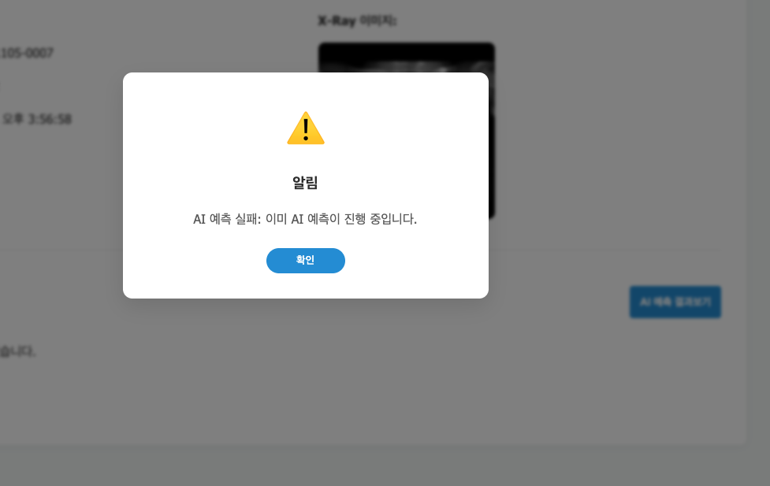

## 6. 에러 코드

| # | 시나리오 | 방법 | 기대 결과 | 결과 |
|---|---|---|---|---|
| 6-1 | X-Ray 파일 없음 | 진료기록의 `media/xray/` 파일을 잠깐 다른 곳으로 옮기고 예측 | `404` (FastAPI 사전 확인) || ✅ 진료기록 79 → `404 Not Found`, "X-Ray 이미지 파일을 찾을 수 없습니다.", 워커 로그 없음 |
| 6-2 | 모델 준비 안 됨 | 모델 파일을 잠깐 옮기고 `docker compose restart ai-worker` 후 예측 | `503 AI 모델이 준비되지 않았습니다.` || ✅ fold1 모델 1개 빼고 재시작 → 워커는 켜짐(`파일 1개 없음 → 예측 비활성화`), 진료기록 79 → `503 Service Unavailable`, 워커 `status=error`. 화면은 공통 문구 "잠시후 다시 시도해주세요." (발견한 문제 참고) |
| 6-3 | 워커 없음 (타임아웃) | `docker compose stop ai-worker` 후 예측 | 60초 뒤 `504 AI 예측 시간이 초과되었습니다.` || ✅ 워커 2개 stop → 진료기록 79 → 60초 뒤 `504 Gateway Timeout`, 화면은 공통 문구. 응답 후 Redis 락 키 없음, 큐에 작업 1개 남음 |
| 6-4 | 6-3 직후 다시 예측 | 워커를 켜고 바로 예측 | `409`가 아니라 정상 처리 (락 해제 확인) || ✅ 워커 start 직후 진료기록 79 → `201 Created`, 결과 id 49 (Positive 99.89%) |

> ⚠️ 6-3 동안 큐에 남은 작업은 워커를 다시 켜면 처리됨 (결과는 받을 사람이 없어 사라지고, 히트맵 파일만 남을 수 있음)

- 테스트 후 옮긴 파일 원래대로, `docker compose up -d --scale ai-worker=2`

> 🔎 실제로 확인한 6-3 이후 동작: 504 응답 뒤에도 큐에 작업 1개가 남아 있었고, 워커를 켜자 `ai-worker-2`가 바로 꺼내 `status=success`로 처리함. FastAPI는 이미 응답을 끝내서 DB에는 저장되지 않음 (히트맵 파일만 남음)

| 6-1 이미지 없음 404 | 6-2 모델 없음 503 |
|---|---|
| 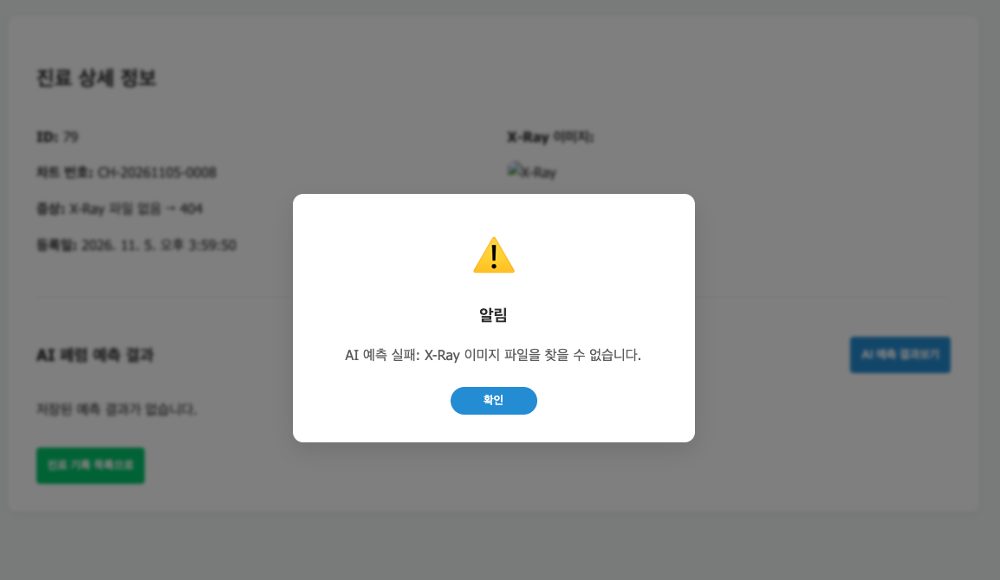 | 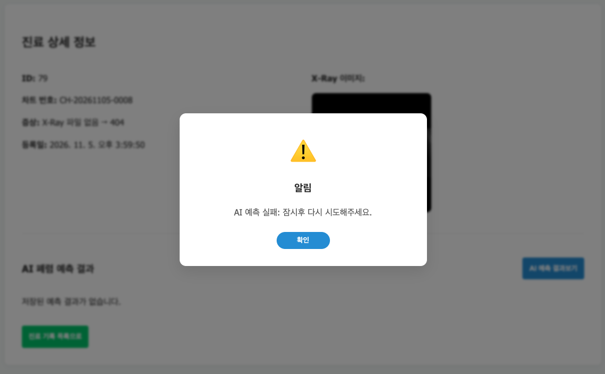 |

| 6-3 워커 없음 504 | 6-4 워커 재시작 후 정상 |
|---|---|
| 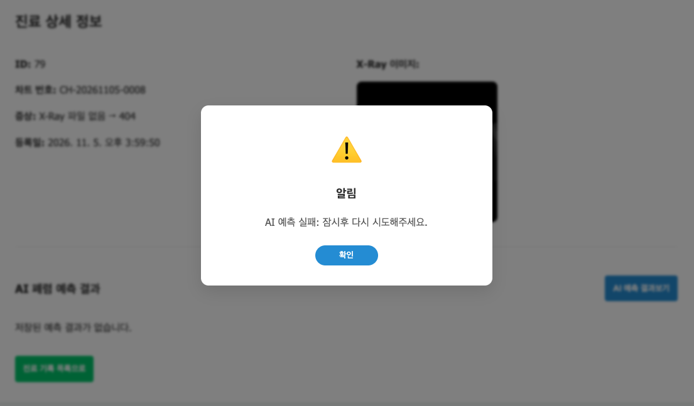 | 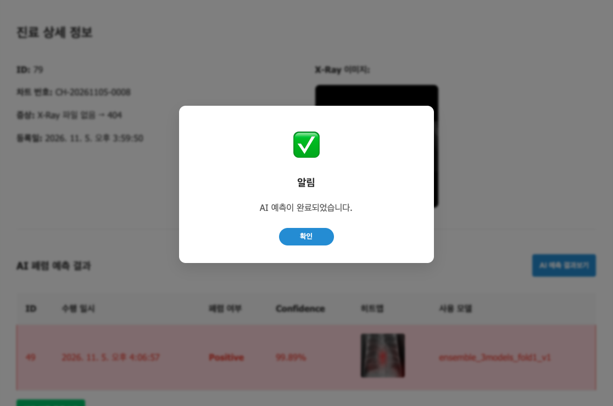 |

## 7. 미완료 작업 복구 (#86)

예측 도중 워커가 죽어도 작업이 사라지지 않고, 워커가 다시 켜지면 이어서 처리되는지 확인함.
워커가 꺼낸 작업은 워커별 작업대 `ai:predict:processing:{hostname}`에 올라가 있다가 결과를 보낸 뒤 지워짐.

```bash
docker compose up -d --scale ai-worker=1     # 워커 1개로 줄여서 확인 (어느 워커가 죽었는지 헷갈리지 않게)
docker compose exec ai-worker hostname       # 작업대 이름에 들어갈 hostname 확인
```

| # | 시나리오 | 방법 | 기대 결과 | 결과 |
|---|---|---|---|---|
| 7-1 | 예측 중 워커 강제 종료 | 진료기록 3~4개를 연달아 예측하고, 워커 로그에 첫 `완료`가 뜨면 바로 `docker compose kill ai-worker` | 처리 중이던 작업이 작업대에 남음 (`redis-cli LRANGE ai:predict:processing:{hostname} 0 -1`) || ✅ 진료기록 81·82 연달아 예측 → 81 `완료` 직후 kill → 처리 중이던 82 작업이 `ai:predict:processing:4914968bc94e`에 남음 (큐는 비어 있음) |
| 7-2 | 작업대 유효기간 | `redis-cli TTL ai:predict:processing:{hostname}` | 120 이하의 양수 || ✅ TTL 118 |
| 7-3 | 같은 컨테이너 재시작 | `docker compose start ai-worker` | `[AI 워커] 미완료 작업 N개 복구` → 남은 작업 모두 `완료 ... status=success` || ✅ 약 14초 뒤 start → `미완료 작업 1개 복구` → `완료 task_id=3644f6de... status=success`. 60초 안에 끝나서 화면 요청도 `201 Created`로 결과를 받음 (DB id 51, record 82) |
| 7-4 | 처리 끝난 뒤 | `redis-cli EXISTS ai:predict:processing:{hostname}`, `redis-cli LLEN ai:predict:queue` | 둘 다 `0` (흔적 없음) || ✅ 작업대 `EXISTS 0`, 큐 `LLEN 0`, hostname 그대로(`4914968bc94e`) |
| 7-5 | (선택) 컨테이너 새로 생성 | 7-1처럼 kill 후 `docker compose rm -f ai-worker && docker compose up -d ai-worker` | hostname이 바뀌어 옛 작업대는 복구 안 함, 약 120초 뒤 옛 작업대 자동 삭제 (`EXISTS` → `0`) || ➖ 통합 테스트에선 생략. #86 PR 때 도커 단독 테스트로 확인함 (hostname 변경 후 옛 작업대 125초 뒤 자동 삭제) |

> ⚠️ 7-1에서 화면 요청은 워커가 60초 안에 다시 켜지지 않으면 `504`가 됨. 복구된 작업의 결과는 FastAPI가 이미 응답을 끝냈으면 버려짐 (의도한 동작)
> 💡 `redis-cli` 명령은 `docker compose exec redis redis-cli ...`로 실행

- 테스트 후 `docker compose up -d --scale ai-worker=2`

## 8. 자동 테스트

```bash
uv run pytest -q
```

| 확인 | 기대 결과 | 결과 |
|---|---|---|
| 전체 테스트 | 모두 통과 || ✅ 16 passed |

## 👥 팀원별 결과

위 1~8번 표는 김지연(macOS) PC 결과임. 팀원도 각자 PC에서 같은 시나리오를 실행함

### 이명석 (Windows)

| # | 항목 | 결과 | 김지연 결과와 다른 점 |
|---|---|---|---|
| 0 | 준비 | ✅ Redis `PONG`, FastAPI healthcheck 200 | |
| 1 | 서비스 분리 | ✅ FastAPI·MySQL·Redis·워커 2개, FastAPI 모델 로딩 로그 없음 | |
| 2 | 기본 흐름 | ✅ 진료기록 4 → `201`, 결과·히트맵, DB 1행 | |
| 3 | 결과 재사용 | ✅ 재요청 `200`, 행 수 1 그대로, 워커 작업 없음 | 새 기록뿐 아니라 **기존 기록(10/28)**도 재요청해 200 확인 |
| 4 | 다중 워커 | ✅ 워커 1·2가 2개씩 처리 | 화면 대신 **Redis 큐에 작업 4개를 직접 넣어** 확인 |
| 5 | 따닥 방지 | ✅ 진료기록 5 → `[409, 201]`, 결과 1건 | |
| 6 | 에러 코드 | ✅ 404 / 503 / 504 | 503은 모델 파일을 건드리지 않고, 워커를 멈춘 상태에서 **Redis로 `MODEL_NOT_READY` 결과를 직접 발행**해 FastAPI의 503 변환을 확인 |
| 7 | 미완료 작업 복구 | ✅ kill → 재시작 → `미완료 작업 1개 복구` → 완료, 큐 0 | **워커 1이 복구한 작업을 워커 2가 처리**함 (아래 참고) |
| 8 | 자동 테스트 | ✅ 16 passed | |

> 💡 7번에서 복구한 워커와 처리한 워커가 다른 이유: 복구는 작업대 → **공용 큐**로 되돌리는 것이라, 그 순간 먼저 기다리고 있던 워커가 가져감. 작업이 사라지지 않고 누군가는 처리한다는 점에서 의도한 동작임

| 컨테이너 상태 | 빌드 결과 |
|---|---|
| 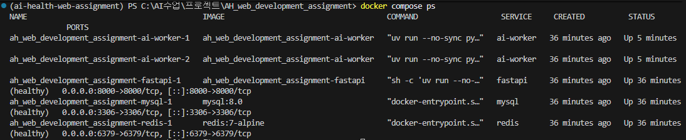 | 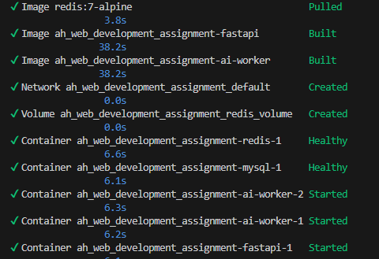 |

| 신규 예측 (201) | 결과 재사용 (200) |
|---|---|
| 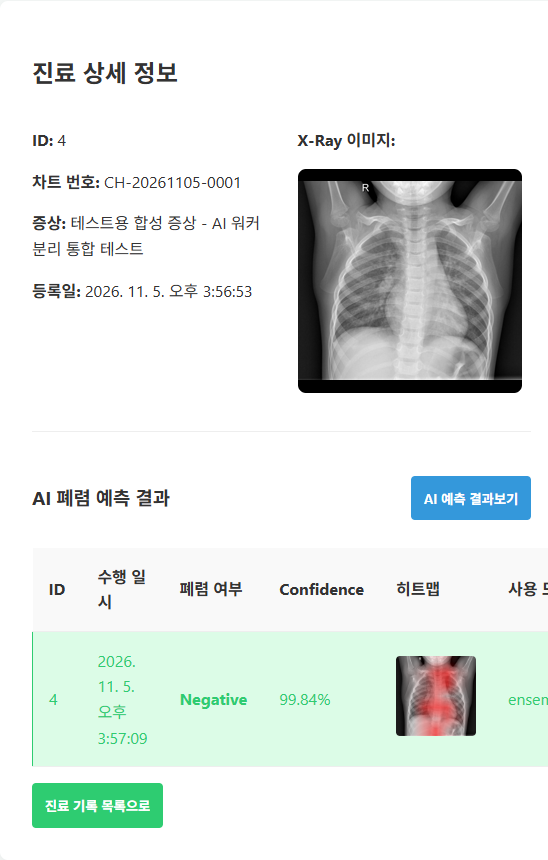 | 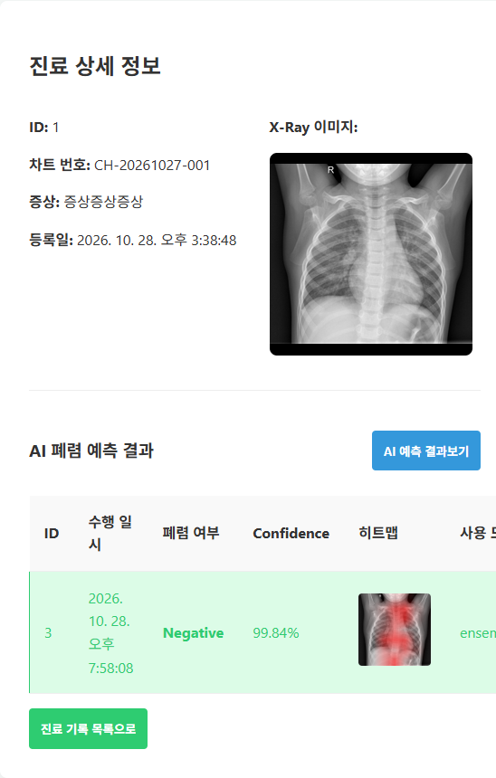 |

| Redis ping | pytest |
|---|---|
| 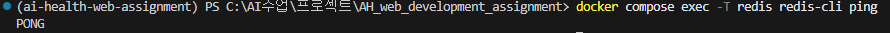 | 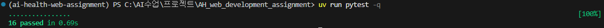 |

### 박유정 (워커 쪽, macOS)

| # | 항목 | 결과 | 김지연 결과와 다른 점 |
|---|---|---|---|
| 4 | 다중 워커 | ✅ 예측 5개 → `ai-worker-1`·`2`가 번갈아 처리 | |
| 4 | Redis MONITOR | ✅ `SET lock NX EX 70` → `SUBSCRIBE` → `LPUSH` → `EXPIRE` → `PUBLISH` → `LREM` → `BLMOVE`(다음 대기) → `UNSUBSCRIBE` → `DEL lock` | **"구독 먼저, 큐 나중"** 순서가 지켜지는 것, **워커마다 작업대 이름이 다른 것**(`processing:a136…` / `processing:b124…`)까지 확인 |
| 7 | 미완료 작업 복구 | ✅ `ai-worker-1` `미완료 작업 1개 복구` → `ai-worker-2`가 이어서 `success` | 예측이 1~2초로 빨라 도중 kill이 어려워서, **작업대에 작업을 직접 넣고 restart**하는 방식으로 재현 |

> 💡 박유정 참고: `docker compose kill ai-worker`는 워커 2개를 모두 끄고, **직접 끈 것으로 처리**돼서 `restart: unless-stopped`로 자동 재시작되지 않음 → `docker compose start ai-worker`로 켜야 함. 자동 재시작은 워커가 **스스로 죽었을 때**(에러, Redis 연결 끊김 등)만 동작함 (복구 로그 위의 `exited with code 143 (restarting)`은 restart 명령으로 꺼졌다 켜진 것)

| 워커 로그 (번갈아 처리) | 미완료 작업 복구 |
|---|---|
| 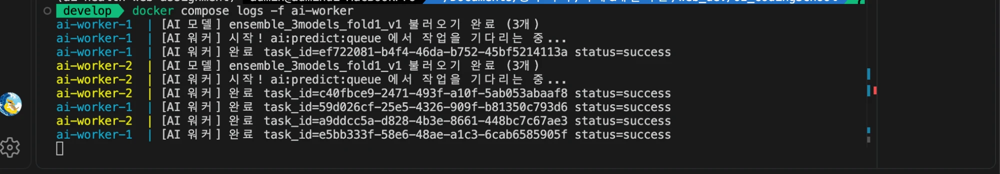 | 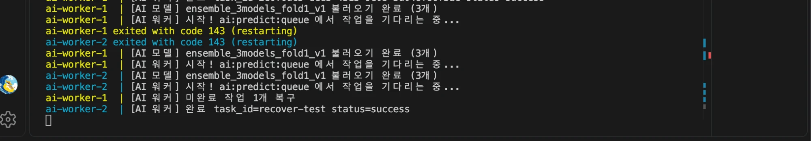 |

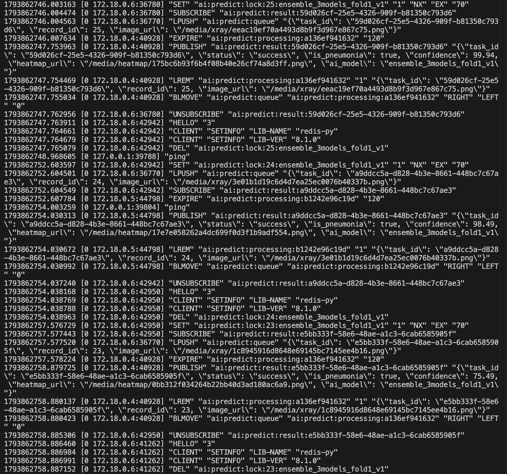

### 김도엽 (FastAPI 쪽, macOS)

| # | 항목 | 결과 | 비고 |
|---|---|---|---|
| 1 | 서비스 분리 | ✅ fastapi(healthy)·mysql·redis·ai-worker 실행 | 워커 **1개**로 실행 (`--scale ai-worker=2` 아님) |
| 2 | 기본 흐름 (Swagger) | ✅ 환자 생성 `201` → 진료기록·X-Ray 등록 `201` → 예측 `201`, 결과 id 3, `is_pneumonia: true`, confidence 98.97, 히트맵 경로 반환 | 워커 로그 `status=success` |
| 8 | 자동 테스트 | ✅ 16 passed (`-v`로 에러 코드별 테스트 503·500·504 포함 확인) | |

> 💡 Confidence는 모델이 반환한 값이며, 임상적 진단 정확도나 확진 확률을 뜻하지 않음 (김도엽 보고서 문구)

| 워커 로그·컨테이너 | Swagger 예측 `201` | pytest |
|---|---|---|
| 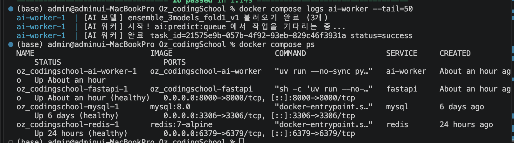 | 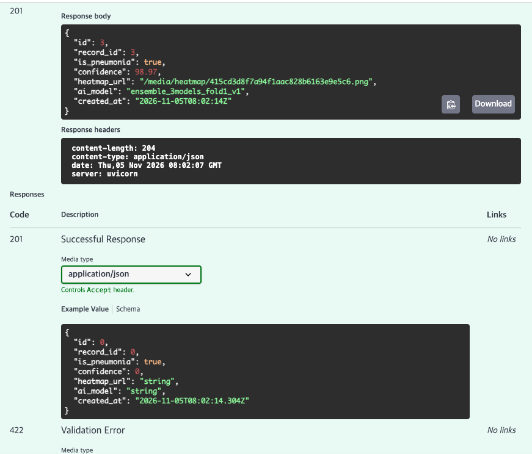 | 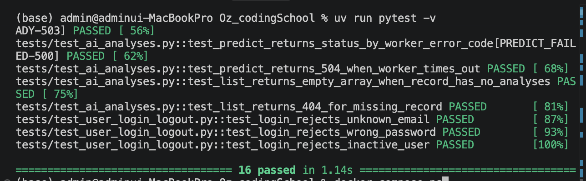 |

## 📋 결과 요약

| 항목 | 결과 | 확인한 사람 |
|---|---|---|
| 1. 서비스 분리 | ✅ | 김지연, 이명석 |
| 2. 기본 흐름 | ✅ | 김지연, 이명석, 김도엽 |
| 3. 기존 결과 재사용 | ✅ | 김지연, 이명석 |
| 4. 다중 워커 | ✅ | 김지연, 이명석, 박유정 |
| 5. 동시 요청 | ✅ | 김지연, 이명석 |
| 6. 에러 코드 | ✅ (화면 문구는 발견한 문제 참고) | 김지연, 이명석 |
| 7. 미완료 작업 복구 | ✅ | 김지연, 이명석, 박유정 |
| 8. 자동 테스트 | ✅ 16 passed | 김지연, 이명석, 김도엽 |

## 🔍 발견한 문제

| 문제 | 원인 | 조치 |
|---|---|---|
| 503·504일 때 화면에 서버 메시지 대신 "잠시후 다시 시도해주세요."만 표시됨 (박유정 발견, 6-2·6-3에서 재확인) | 프론트가 500 이상 응답은 공통 문구로 표시하는 규칙 | 서버 응답 코드·메시지는 정상. 의도된 동작으로 두고, 필요하면 503·504만 서버 메시지를 보여주도록 프론트 개선 |
| 504 이후 큐에 남은 작업이 워커 재시작 시 처리되지만 결과가 버려짐 (6-3) | FastAPI는 60초 후 응답을 끝내고 결과 구독을 해제함 | 의도된 동작. 히트맵 파일만 남으므로 필요하면 오래된 작업은 워커가 건너뛰도록 개선 |
